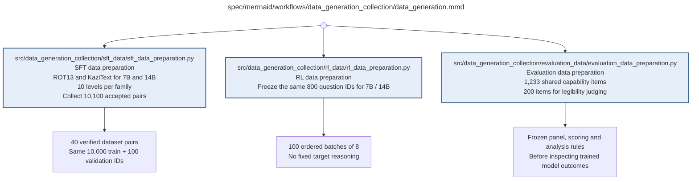

# data_generation.md

**Owner:** `data_preparation`. **Implementation status:** blank placeholder, not implemented or tested.

| Artifact | Exact repository path |
|---|---|
| Implementation | `src/data_generation_collection/data_generation.py` |
| Workflow/support diagram | [`spec/mermaid/workflows/data_generation_collection/data_generation.mmd`](../../../spec/mermaid/workflows/data_generation_collection/data_generation.mmd) |
| This specification | `docs/modules/data_generation_collection/data_generation.md` |
| Unit test slot | `tests/unit/data_generation_collection/test_data_generation.py` |

**Scientific sources:** 3.1; B.1; C.1; C.2.3; E.2.2–E.2.4; H.2–H.3. [p. 3](../../../spec/experiment.pdf#page=3) · [p. 17](../../../spec/experiment.pdf#page=17) · [p. 18](../../../spec/experiment.pdf#page=18) · [p. 27](../../../spec/experiment.pdf#page=27) · [p. 30](../../../spec/experiment.pdf#page=30) · [p. 54](../../../spec/experiment.pdf#page=54) · [p. 55](../../../spec/experiment.pdf#page=55) · [p. 69](../../../spec/experiment.pdf#page=69) · [p. 70](../../../spec/experiment.pdf#page=70) · [p. 71](../../../spec/experiment.pdf#page=71).

## Responsibility and controlling details

The three source-preparation branches are SFT data, RL training questions and the evaluation package. SFT uses paired model-specific clean generations from common accepted prompts. RL uses official GSM8K training questions with numeric references, not LMSYS traces. Evaluation uses the fixed four-domain manifest and nested legibility panel. All source revisions, exclusions, seeds and manifests are frozen; all required children return validated artifacts or propagate failure. The source's visually independent preparation branches do not remove the need to know evaluation questions when excluding detectable overlap.

## Interfaces and dependent procedures

Use the common [artifact contracts](../../contracts.md), [frozen prompt instructions](../../prompts.md), [decision ledger](../../decisions.md) and [validation requirements](../../validation.md). Typed signatures/serialization are delegated implementation details; their scientific meaning is not. The named owner defines this module with its consumers before dependent integration.

| Source node | Called procedure (exact path) | Specification |
|---|---|---|
| `SFT` | `src/data_generation_collection/sft_data/sft_data_preparation.py` | [sft_data_preparation](sft_data/sft_data_preparation.md) |
| `RL` | `src/data_generation_collection/rl_data/rl_data_preparation.py` | [rl_data_preparation](rl_data/rl_data_preparation.md) |
| `EVAL` | `src/data_generation_collection/evaluation_data/evaluation_data_preparation.py` | [evaluation_data_preparation](evaluation_data/evaluation_data_preparation.md) |

## Original procedural constraints

The following source comments retain the procedural detail of the supplied diagram. Obsolete introductory editing instructions and raw link directives are omitted from this list; all links are resolved in the path-synchronized diagram below. Appendix H controls any earlier conflicting language.
- Data generation/collection
- Execution contract: known faults use bounded recovery; unclassified/persistent faults stop the worker.
- Frozen invalid inputs are fatal. Unrecoverable child failures propagate; never release incomplete results.
- SFT: 2 models x 2 transformation families x 10 levels = 40 datasets; each model supplies its own clean traces.
- Both transformation families use the same prompt IDs and split at every level.
- Evaluation data and protocol must be ready before outcome inspection; independent domain preparation can proceed in parallel.
- Blue boxes expand into detailed procedures; output boxes state verified handoff artifacts.

## Completion and failure boundary

Implement and test `src/data_generation_collection/data_generation.py` against its specified behavior in `tests/unit/data_generation_collection/test_data_generation.py`. Validate every emitted artifact and preserve its source/configuration identity. Do not claim completeness from a placeholder or passing import. Propagate required child failures and maintain ordinary model outcomes separately from infrastructure faults. Mandatory real preflights and permission gates remain in force. Unspecified allowed conventions must be documented/frozen before outcomes; new scientific choices are not silently authorized.

## Exact path-synchronized diagram

The following diagram is byte-for-byte the active `.mmd` content at generation time. Its procedural content is from the supplied workflow or the cited PDF support requirement; file labels and role assignment are the requested repository organization.

