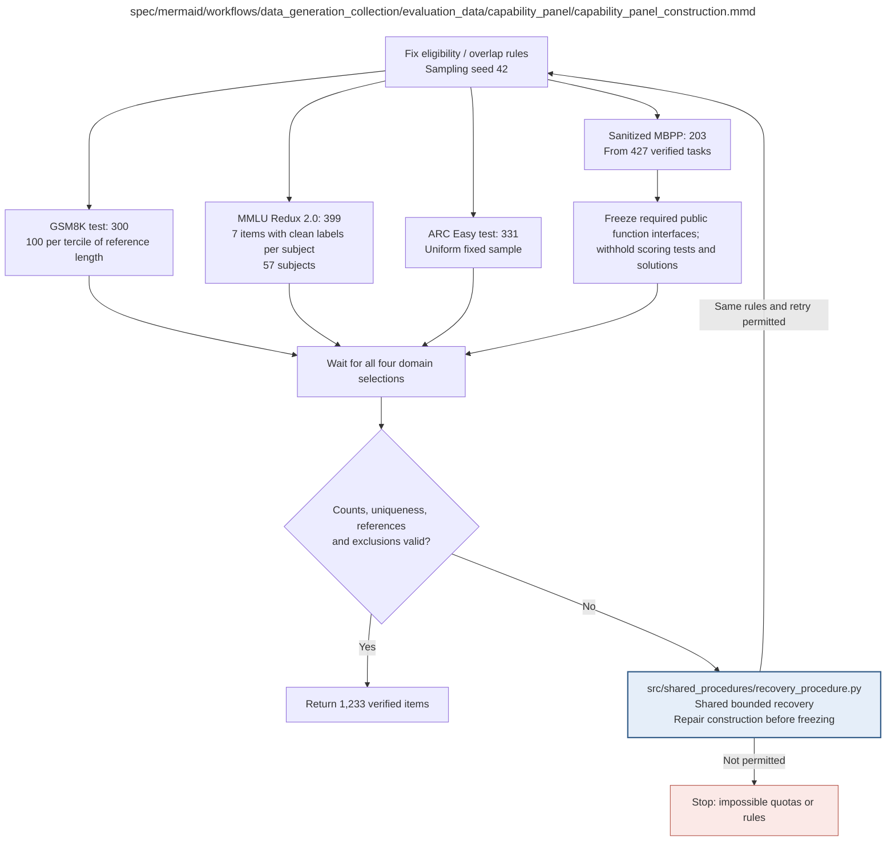

# capability_panel_construction.md

**Owner:** `data_preparation`. **Implementation status:** Implemented and tested; real fixed 1233-item panel prepared, with selected MBPP reference certification owned by evaluation.

| Artifact | Exact repository path |
|---|---|
| Implementation | `src/data_generation_collection/evaluation_data/capability_panel/capability_panel_construction.py` |
| Workflow/support diagram | [`spec/mermaid/workflows/data_generation_collection/evaluation_data/capability_panel/capability_panel_construction.mmd`](../../../../../spec/mermaid/workflows/data_generation_collection/evaluation_data/capability_panel/capability_panel_construction.mmd) |
| This specification | `docs/modules/data_generation_collection/evaluation_data/capability_panel/capability_panel_construction.md` |
| Unit test slot | `tests/unit/data_generation_collection/evaluation_data/capability_panel/test_capability_panel_construction.py` |

**Scientific sources:** D.1.2; H.4. [p. 38](../../../../../spec/experiment.pdf#page=38) · [p. 40](../../../../../spec/experiment.pdf#page=40) · [p. 41](../../../../../spec/experiment.pdf#page=41) · [p. 72](../../../../../spec/experiment.pdf#page=72).

## Responsibility and controlling details

## Fixed selection and scoring manifest

| Domain | Source and selection | Count | Scoring |
|---|---|---:|---|
| GSM8K | Official test population 1319; count whitespace-delimited reference-solution words, sort with stable index tie-break, divide into reference-length terciles and sample 100 without replacement in each | 300 | Normalized numeric exact match |
| MMLU-Redux-2.0 | Source-described clean-labeled eligibility; stable IDs and seven sampled without replacement in each of all 57 subjects | 399 | Exact choice label |
| ARC-Easy | Official test population 2376; stable ID sort then uniform without-replacement fixed sample | 331 | Exact choice label |
| Sanitized MBPP | 427 released hand-verified tasks; stable ID sort then uniform without-replacement fixed sample | 203 | Isolated execution pass@1 |

Use seed 42 and persist exact selected IDs, source revisions, exclusions, references and sampling metadata. The combined count is 1233. Selection is model-independent; never sample based on how any baseline or trained state answers. MMLU's actual post-eligibility populations and GSM stratum boundaries must be recorded for design-aware inference. Do not interpret seven-item subject scores as reliable individual-subject estimates.

Mechanically extract MBPP required callable names, parameters and defaults into a frozen public-interface manifest. Keep the original task description public. Do not expose hidden scoring tests, reference implementation bodies, helper algorithms, assertions, expected outputs or solution comments to generation or audit. Verify source tests and interface extraction before freezing. This is a project-specific withheld-test evaluation, not a directly comparable reproduction of original test-visible MBPP scores.

Validate counts, per-stratum/subject quotas, uniqueness, valid references and exclusions. If quotas are impossible, stop; no replacement benchmark or changed count is authorized. The source's roughly five-percentage-point precision calculations motivate panel sizing but are not a promise about realized or conditional confidence bounds.

## Interfaces and dependent procedures

Use the common [artifact contracts](../../../../contracts.md), [frozen prompt instructions](../../../../prompts.md), [decision ledger](../../../../decisions.md) and [validation requirements](../../../../validation.md). Typed signatures/serialization are delegated implementation details; their scientific meaning is not. The named owner defines this module with its consumers before dependent integration.

| Source node | Called procedure (exact path) | Specification |
|---|---|---|
| `REPAIR` | `src/shared_procedures/recovery_procedure.py` | [recovery_procedure](../../../shared_procedures/recovery_procedure.md) |

## Original procedural constraints

The following source comments retain the procedural detail of the supplied diagram. Obsolete introductory editing instructions and raw link directives are omitted from this list; all links are resolved in the path-synchronized diagram below. Appendix H controls any earlier conflicting language.
- Capability panel construction
- Record pool revisions, source IDs and exclusions; validate MBPP tests before freezing.
- MBPP prompts expose only the task and mechanically extracted public function interface.
- The interface manifest contains required entry point names, parameters and defaults from the pinned source.
- Withhold every scoring test, reference implementation, helper body, algorithm fragment,
- assertion, expected output and solution comment from prompts and judge inputs.
- This is a project-specific withheld-test MBPP variant, not directly comparable to published test-visible scores.

## Implemented interface and evidence

`load_evaluation_sources(revisions, *, cache_root=None)` reads actual immutable GSM8K test, MMLU-Redux-2.0 saved Arrow datasets, ARC-Easy test and every sanitized MBPP split. `construct_capability_panel(pools, revisions, *, output_path=None, verify_mbpp_reference=None)` freezes JSON `items`, revisions, source/exclusion/population/stratum metadata and the exact 300/399/331/203 quotas. `validate_capability_panel(..., require_verified=True)` separates prepared source selection from mandatory reference verification.

GSM8K reference whitespace-word counts define three stable ranked source terciles (440/440/439); sample 100 per tercile. MMLU uses only exact `error_type == "ok"`, samples seven per each of 57 fixed subjects and records actual clean population sizes. ARC-Easy and sanitized MBPP sample uniformly without replacement. Random namespaces derive from global 42. Selected IDs are never changed after original-reference failures.

`extract_mbpp_interface(reference_code, scoring_tests)` mechanically exposes only tested callable names, parameters and literal defaults; original implementations, helper bodies, imports and assertions remain hidden. Hidden source `test_imports` become test setup for the original reference suite. Reference execution is a supplied actual restricted-sandbox callback; absence leaves status `prepared`, and an ordinary failure is fatal rather than resampled.

Actual acquired frames contain GSM8K1319, MMLU5700 (5330 clean, 370 excluded), ARC2376 and MBPP427. `data/evaluation/official_pools.json` records those real sources; `capability_panel_prepared.json` fixes 1233 actual selected IDs. Unit checks cover exact source quotas/clean statuses/strata, AST interface privacy, source questions and fatal reference failures. Mandatory sandbox evidence is supplied by the evaluation owner.

## Completion and failure boundary

Implement and test `src/data_generation_collection/evaluation_data/capability_panel/capability_panel_construction.py` against its specified behavior in `tests/unit/data_generation_collection/evaluation_data/capability_panel/test_capability_panel_construction.py`. Validate every emitted artifact and preserve its source/configuration identity. Do not claim completeness from a placeholder or passing import. Propagate required child failures and maintain ordinary model outcomes separately from infrastructure faults. Mandatory real preflights and permission gates remain in force. Unspecified allowed conventions must be documented/frozen before outcomes; new scientific choices are not silently authorized.

## Exact path-synchronized diagram

The following diagram is byte-for-byte the active `.mmd` content at generation time. Its procedural content is from the supplied workflow or the cited PDF support requirement; file labels and role assignment are the requested repository organization.

