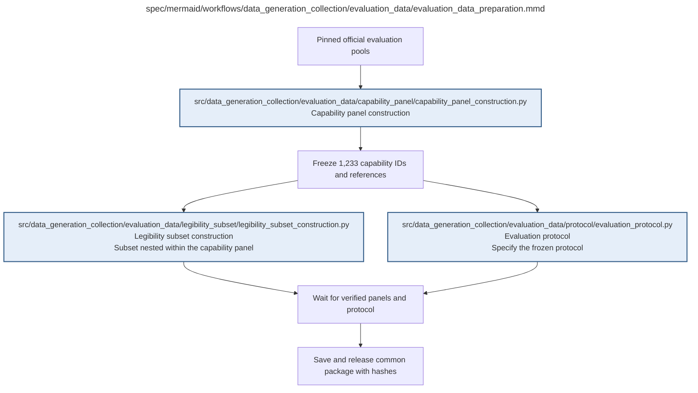

# evaluation_data_preparation.md

**Owner:** `data_preparation`. **Implementation status:** blank placeholder, not implemented or tested.

| Artifact | Exact repository path |
|---|---|
| Implementation | `src/data_generation_collection/evaluation_data/evaluation_data_preparation.py` |
| Workflow/support diagram | [`spec/mermaid/workflows/data_generation_collection/evaluation_data/evaluation_data_preparation.mmd`](../../../../spec/mermaid/workflows/data_generation_collection/evaluation_data/evaluation_data_preparation.mmd) |
| This specification | `docs/modules/data_generation_collection/evaluation_data/evaluation_data_preparation.md` |
| Unit test slot | `tests/unit/data_generation_collection/evaluation_data/test_evaluation_data_preparation.py` |

**Scientific sources:** D.1.2; D.2.3; E.2.2; H.4,H.8.2. [p. 38](../../../../spec/experiment.pdf#page=38) · [p. 40](../../../../spec/experiment.pdf#page=40) · [p. 41](../../../../spec/experiment.pdf#page=41) · [p. 43](../../../../spec/experiment.pdf#page=43) · [p. 54](../../../../spec/experiment.pdf#page=54) · [p. 72](../../../../spec/experiment.pdf#page=72) · [p. 78](../../../../spec/experiment.pdf#page=78).

## Responsibility and controlling details

First construct and freeze the 1233 capability IDs/references and public interfaces. From that frozen parent, construct the nested 200-item legibility subset and freeze the evaluation generation/scoring/judging/analysis specification. Release the package only after every child has verified counts, identities and required rules. All 62 states use that same package. Keep the nested selection metadata and raw-output reuse explicit.

A complete protocol file is not evidence its required statistical, baseline or real integration preflights passed. The prospective analysis module and shared preflight coordinate those checks before the affected paid scientific launches. Failures cannot trigger response-dependent sample changes.

## Interfaces and dependent procedures

Use the common [artifact contracts](../../../contracts.md), [frozen prompt instructions](../../../prompts.md), [decision ledger](../../../decisions.md) and [validation requirements](../../../validation.md). Typed signatures/serialization are delegated implementation details; their scientific meaning is not. The named owner defines this module with its consumers before dependent integration.

| Source node | Called procedure (exact path) | Specification |
|---|---|---|
| `CAP` | `src/data_generation_collection/evaluation_data/capability_panel/capability_panel_construction.py` | [capability_panel_construction](capability_panel/capability_panel_construction.md) |
| `LEG` | `src/data_generation_collection/evaluation_data/legibility_subset/legibility_subset_construction.py` | [legibility_subset_construction](legibility_subset/legibility_subset_construction.md) |
| `PROTO` | `src/data_generation_collection/evaluation_data/protocol/evaluation_protocol.py` | [evaluation_protocol](protocol/evaluation_protocol.md) |

## Original procedural constraints

The following source comments retain the procedural detail of the supplied diagram. Obsolete introductory editing instructions and raw link directives are omitted from this list; all links are resolved in the path-synchronized diagram below. Appendix H controls any earlier conflicting language.
- Evaluation data preparation
- No selection based on trained-model outcomes. All 62 states use the same package.
- Packaging failures use shared bounded recovery; frozen IDs and semantics cannot change.

## Completion and failure boundary

Implement and test `src/data_generation_collection/evaluation_data/evaluation_data_preparation.py` against its specified behavior in `tests/unit/data_generation_collection/evaluation_data/test_evaluation_data_preparation.py`. Validate every emitted artifact and preserve its source/configuration identity. Do not claim completeness from a placeholder or passing import. Propagate required child failures and maintain ordinary model outcomes separately from infrastructure faults. Mandatory real preflights and permission gates remain in force. Unspecified allowed conventions must be documented/frozen before outcomes; new scientific choices are not silently authorized.

## Exact path-synchronized diagram

The following diagram is byte-for-byte the active `.mmd` content at generation time. Its procedural content is from the supplied workflow or the cited PDF support requirement; file labels and role assignment are the requested repository organization.

