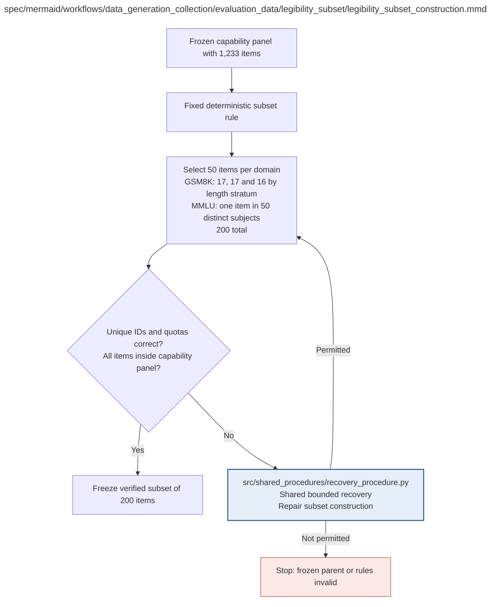

# legibility_subset_construction.md

**Owner:** `data_preparation`. **Implementation status:** blank placeholder, not implemented or tested.

| Artifact | Exact repository path |
|---|---|
| Implementation | `src/data_generation_collection/evaluation_data/legibility_subset/legibility_subset_construction.py` |
| Workflow/support diagram | [`spec/mermaid/workflows/data_generation_collection/evaluation_data/legibility_subset/legibility_subset_construction.mmd`](../../../../../spec/mermaid/workflows/data_generation_collection/evaluation_data/legibility_subset/legibility_subset_construction.mmd) |
| This specification | `docs/modules/data_generation_collection/evaluation_data/legibility_subset/legibility_subset_construction.md` |
| Unit test slot | `tests/unit/data_generation_collection/evaluation_data/legibility_subset/test_legibility_subset_construction.py` |

**Scientific sources:** D.2.3; H.8.2. [p. 43](../../../../../spec/experiment.pdf#page=43) · [p. 44](../../../../../spec/experiment.pdf#page=44) · [p. 78](../../../../../spec/experiment.pdf#page=78).

## Responsibility and controlling details

Use only the frozen 1233 capability IDs. Select exactly 50 per domain, 200 total, without replacement with seed 42 and the distinct fixed `legibility` namespace. GSM8K allocates 17,17,16 across the existing reference-length terciles, with the remainder assignment determined by the fixed seed. MMLU chooses 50 distinct subjects from the 57 and one already selected capability item in each. ARC/MBPP use the source's fixed nested selection rule; exact randomization mechanics are documented and frozen under the implementation authority.

Verify uniqueness, quotas and subset containment; preserve sampling metadata for the second-stage inference. Freeze once before trained output inspection. Use the same subset for both bases and all sixty trained states. **Reuse the raw capability outputs** for those IDs, rather than making another 200 generation calls per state. All fixed items retain their denominator positions despite absent/unassessable traces or unavailable judgments.

## Interfaces and dependent procedures

Use the common [artifact contracts](../../../../contracts.md), [frozen prompt instructions](../../../../prompts.md), [decision ledger](../../../../decisions.md) and [validation requirements](../../../../validation.md). Typed signatures/serialization are delegated implementation details; their scientific meaning is not. The named owner defines this module with its consumers before dependent integration.

| Source node | Called procedure (exact path) | Specification |
|---|---|---|
| `REPAIR` | `src/shared_procedures/recovery_procedure.py` | [recovery_procedure](../../../shared_procedures/recovery_procedure.md) |

## Original procedural constraints

The following source comments retain the procedural detail of the supplied diagram. Obsolete introductory editing instructions and raw link directives are omitted from this list; all links are resolved in the path-synchronized diagram below. Appendix H controls any earlier conflicting language.
- Legibility subset construction
- Nested means the 200 are a subset of the 1,233; reuse their exact generated outputs.

## Completion and failure boundary

Implement and test `src/data_generation_collection/evaluation_data/legibility_subset/legibility_subset_construction.py` against its specified behavior in `tests/unit/data_generation_collection/evaluation_data/legibility_subset/test_legibility_subset_construction.py`. Validate every emitted artifact and preserve its source/configuration identity. Do not claim completeness from a placeholder or passing import. Propagate required child failures and maintain ordinary model outcomes separately from infrastructure faults. Mandatory real preflights and permission gates remain in force. Unspecified allowed conventions must be documented/frozen before outcomes; new scientific choices are not silently authorized.

## Exact path-synchronized diagram

The following diagram is byte-for-byte the active `.mmd` content at generation time. Its procedural content is from the supplied workflow or the cited PDF support requirement; file labels and role assignment are the requested repository organization.

