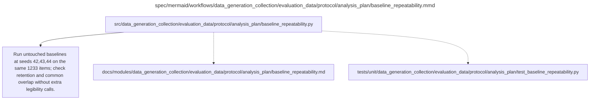

# baseline_repeatability.md

**Owner:** `analysis`. **Implementation status:** implemented and unit tested; actual model repeatability is blocked pending real native generations.

## Implemented interface and evidence boundary

`baseline_repeatability(passes_by_model, panel, require_full_panel=True) -> dict` accepts model keys `7b`/`14b`, each mapping seeds 42/43/44 to evaluator packages or item records. It returns domainwise repeat retention, joint overlap, absolute correct/common counts and IDs, lost/new IDs, unresolved scoring IDs, readiness and a canonical `baseline_repeatability` check.

An ordinary wrong answer is observed failure; unavailable scoring is indeterminate. Training readiness additionally requires the exact 1,233-item panel and real generation provenance (`simulation=False`, raw hash, successful generation and matching seed). Reduced fixtures never establish live readiness. Both untouched models' real diagnostic passes remain unperformed; no additional legibility judgments or scientific model states are introduced.

| Artifact | Exact repository path |
|---|---|
| Implementation | `src/data_generation_collection/evaluation_data/protocol/analysis_plan/baseline_repeatability.py` |
| Workflow/support diagram | [`spec/mermaid/workflows/data_generation_collection/evaluation_data/protocol/analysis_plan/baseline_repeatability.mmd`](../../../../../../spec/mermaid/workflows/data_generation_collection/evaluation_data/protocol/analysis_plan/baseline_repeatability.mmd) |
| This specification | `docs/modules/data_generation_collection/evaluation_data/protocol/analysis_plan/baseline_repeatability.md` |
| Unit test slot | `tests/unit/data_generation_collection/evaluation_data/protocol/analysis_plan/test_baseline_repeatability.py` |

**Scientific sources:** G.9; H.6.4,H.8.2. [p. 67](../../../../../../spec/experiment.pdf#page=67) · [p. 76](../../../../../../spec/experiment.pdf#page=76) · [p. 78](../../../../../../spec/experiment.pdf#page=78).

## Responsibility and controlling details

For each untouched model generate on the same 1233 capability IDs at main seed 42 and diagnostic seeds 43 and 44, with the same native decoding settings. Compare each repeat to seed 42 using domainwise 80% retention of seed-42 baseline-correct IDs and 60% common overlap across the three passes. Do not add legibility judging for these diagnostics. Four extra passes across two sizes add 4932 generations; the main comparison baseline remains seed 42.

Record ordinary sampling variability, invalid answers and absolute shared counts. Three passes flag gross instability, not a precise repeatability estimate. A failure marks retention measurement uncalibrated and blocks the relevant ready-for-training claim; any needed scientific revision must be versioned before trained outcomes, not disguised as implementation freedom. Seeds 43/44 do not become additional independent scientific states or observations in the H.8 inference family.

## Interfaces and dependent procedures

Use the common [artifact contracts](../../../../../contracts.md), [frozen prompt instructions](../../../../../prompts.md), [decision ledger](../../../../../decisions.md) and [validation requirements](../../../../../validation.md). Typed signatures/serialization are delegated implementation details; their scientific meaning is not. The named owner defines this module with its consumers before dependent integration.

No separate child procedure is declared in this diagram. This does not exempt shared recovery, storage, provenance or validation contracts.

## Completion and failure boundary

Implement and test `src/data_generation_collection/evaluation_data/protocol/analysis_plan/baseline_repeatability.py` against its specified behavior in `tests/unit/data_generation_collection/evaluation_data/protocol/analysis_plan/test_baseline_repeatability.py`. Validate every emitted artifact and preserve its source/configuration identity. Do not claim completeness from a placeholder or passing import. Propagate required child failures and maintain ordinary model outcomes separately from infrastructure faults. Mandatory real preflights and permission gates remain in force. Unspecified allowed conventions must be documented/frozen before outcomes; new scientific choices are not silently authorized.

## Exact path-synchronized diagram

The following diagram is byte-for-byte the active `.mmd` content at generation time. Its procedural content is from the supplied workflow or the cited PDF support requirement; file labels and role assignment are the requested repository organization.

