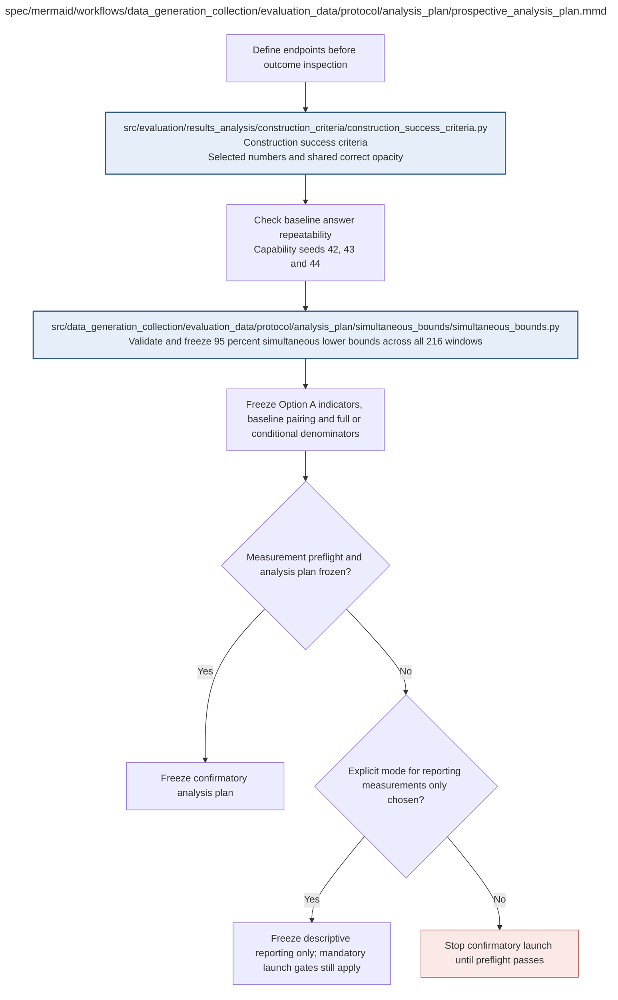

# prospective_analysis_plan.md

**Owner:** `analysis`. **Implementation status:** implemented; registry/design/hash tests pass. A frozen plan is prospective specification, not a passing scientific preflight.

## Implemented interface and conventions

`create_analysis_plan(panel, legibility_ids, config=None) -> dict` accepts preparation packages or their row/ID lists. Every row requires its immutable item ID, domain, stratum and actual eligible finite-population size. The returned plan contains 216 windows, 10,800 deduplicated scalar gates, all three transfer pairs, full nested design metadata and `plan_hash`. `verify_analysis_plan(plan)` rejects altered frozen contents. Fixture plans cannot authorize confirmation.

The original panel plan hash was `8422201afde6701451a5999a22fe0c4e171357be221186492ddfc93668e833ad`. The revised plan keeps all actual question IDs and counts while binding the approved evaluation-only concentration guard. Its new hash is recorded by the full validation entrypoint; the old hash cannot certify the revised method. MMLU clean eligible strata contain 43–100 items rather than an assumed 100 each. The statistical simulation freeze binds these actual strata and this plan. No trained outcomes exist. Statistical coverage remains a separate mandatory gate; descriptive reporting never releases training through it.

| Artifact | Exact repository path |
|---|---|
| Implementation | `src/data_generation_collection/evaluation_data/protocol/analysis_plan/prospective_analysis_plan.py` |
| Workflow/support diagram | [`spec/mermaid/workflows/data_generation_collection/evaluation_data/protocol/analysis_plan/prospective_analysis_plan.mmd`](../../../../../../spec/mermaid/workflows/data_generation_collection/evaluation_data/protocol/analysis_plan/prospective_analysis_plan.mmd) |
| This specification | `docs/modules/data_generation_collection/evaluation_data/protocol/analysis_plan/prospective_analysis_plan.md` |
| Unit test slot | `tests/unit/data_generation_collection/evaluation_data/protocol/analysis_plan/test_prospective_analysis_plan.py` |

**Scientific sources:** G; H.6,H.8,H.9. [p. 65](../../../../../../spec/experiment.pdf#page=65) · [p. 66](../../../../../../spec/experiment.pdf#page=66) · [p. 67](../../../../../../spec/experiment.pdf#page=67) · [p. 75](../../../../../../spec/experiment.pdf#page=75) · [p. 76](../../../../../../spec/experiment.pdf#page=76) · [p. 78](../../../../../../spec/experiment.pdf#page=78) · [p. 79](../../../../../../spec/experiment.pdf#page=79) · [p. 80](../../../../../../spec/experiment.pdf#page=80).

## Responsibility and controlling details

Freeze the complete criteria and analysis family before trained outcomes. Include all 216 windows, every per-level/domain baseline-correct retention gate, common retention, full/common qualified-opacity fractions and paired baseline increases, plus every possible nonmath transfer-domain component. Identical component statistics may be computationally deduplicated but hypotheses/windows are not removed.

Require the baseline-repeatability diagnostic at seeds 42/43/44 and the exact H.8 design-aware simultaneous method. Statistical implementation, numeric conventions, missingness/degeneracy handling and its quantitative Monte Carlo validation rule are prospective implementation outputs. Mandatory simulations must cover boundaries, correlated states, uneven domains, small/empty conditional sets and extreme proportions. Freeze the supported method before trained outcome inspection. Failed mandatory validation stops the affected confirmatory launch, not a switch to another method after results.

An explicit descriptive-only reporting mode can label available point estimates without a confirmatory claim. It does not waive source-required launch gates or authorize extra runs. If baseline repeatability fails, G.9 marks retention measurement uncalibrated and requires a versioned protocol revision before outcomes; the implementing agent cannot silently alter frozen scientific criteria under H.9.

## Interfaces and dependent procedures

Use the common [artifact contracts](../../../../../contracts.md), [frozen prompt instructions](../../../../../prompts.md), [decision ledger](../../../../../decisions.md) and [validation requirements](../../../../../validation.md). Typed signatures/serialization are delegated implementation details; their scientific meaning is not. The named owner defines this module with its consumers before dependent integration.

| Source node | Called procedure (exact path) | Specification |
|---|---|---|
| `RULE` | `src/data_generation_collection/evaluation_data/protocol/analysis_plan/simultaneous_bounds/simultaneous_bounds.py` | [simultaneous_bounds](simultaneous_bounds/simultaneous_bounds.md) |
| `THRESH` | `src/evaluation/results_analysis/construction_criteria/construction_success_criteria.py` | [construction_success_criteria](../../../../evaluation/results_analysis/construction_criteria/construction_success_criteria.md) |

## Original procedural constraints

The following source comments retain the procedural detail of the supplied diagram. Obsolete introductory editing instructions and raw link directives are omitted from this list; all links are resolved in the path-synchronized diagram below. Appendix H controls any earlier conflicting language.
- Prospective analysis plan
- Do not invent unspecified scientific thresholds or retroactively choose them.
- Final versus any-checkpoint claims differ; RL checkpoints are dependent observations.
- Causal usefulness is not a first-stage success requirement; ablations are optional post-training diagnostics.
- Enumerate all 36 windows of at least three consecutive levels per branch/model pair, 216 windows total.
- Family includes every required scalar retention, common-correct, opacity-floor and paired-increase gate,
- plus every eligible transfer domain; never restrict uncertainty adjustment to the eventual winning window.
- Use 10000 design-aware paired bootstrap draws, seed 42, with the same question outcome vector across all states.
- Validate maximum-statistic simultaneous lower bounds on simulated populations before trained outcomes or confirmatory launch.
- Simulation coverage includes boundaries, correlated checkpoints, uneven domains, small conditional subsets and extreme proportions.
- Respect GSM strata, within-subject MMLU sampling and nested legibility selection; all 57 capability subjects are covered.
- A missing/uncertain required audit or primary score makes affected confirmatory claims indeterminate, including baseline differences.
- Zero estimated variance is never certainty. Freeze validated degeneracy handling or block confirmatory launch.
- Failed mandatory statistical validation cannot trigger a method switch after viewing trained outcomes.
- Descriptive reporting never authorizes an affected training launch through a failed mandatory preflight.
- A reporting mode may govern available measurements; it does not waive any required launch gate.
- This is a required implementation preflight, not a claim that validation has already been performed.
- Numeric goals are selected. The measurement protocol and uncertainty procedure require preflight.

## Completion and failure boundary

Implement and test `src/data_generation_collection/evaluation_data/protocol/analysis_plan/prospective_analysis_plan.py` against its specified behavior in `tests/unit/data_generation_collection/evaluation_data/protocol/analysis_plan/test_prospective_analysis_plan.py`. Validate every emitted artifact and preserve its source/configuration identity. Do not claim completeness from a placeholder or passing import. Propagate required child failures and maintain ordinary model outcomes separately from infrastructure faults. Mandatory real preflights and permission gates remain in force. Unspecified allowed conventions must be documented/frozen before outcomes; new scientific choices are not silently authorized.

## Exact path-synchronized diagram

The following diagram is byte-for-byte the active `.mmd` content at generation time. Its procedural content is from the supplied workflow or the cited PDF support requirement; file labels and role assignment are the requested repository organization.

