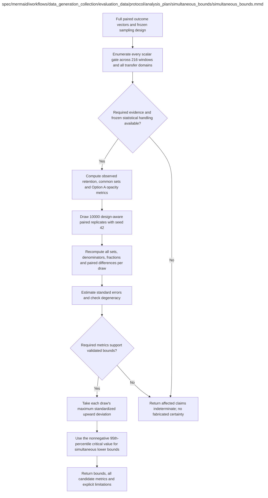

# simultaneous_bounds.md

**Owner:** `analysis`. **Implementation status:** implemented and unit tested; actual eligible-frame coverage validation rejected this candidate; confirmatory launch is blocked.

## Implemented interface and frozen construction

`compute_simultaneous_bounds(records_by_state, plan, draws=10000, seed=42, batch_size=128) -> dict` aligns the entire 62-state question vector and computes every scalar gate. `maximum_standardized_bounds(point, replicates, registry, unresolved=None)` implements the H.8.3 upward-deviation formula. Qualification is never inferred from this numerical computation alone.

The frozen candidate is `nested_rao_wu_conservative_v1`: multinomial `n−1` Rao-Wu rescaled multipliers with first-stage factor `sqrt(1−n/N)`, followed by nested legibility `l−1` multipliers with factor `sqrt(1−l/n)` on the same question vectors. GSM strata remain fixed; MMLU capability keeps all 57 fixed subjects and legibility adds its separate 50-of-57 subject stage. Both nested variance components are retained with intended conservatism. The actual eligible-frame simulation nevertheless failed the prospectively fixed joint-coverage rule; retaining these components does not establish conservative bounds. This construction is not certified by precedent or passing unit tests.

Numerical conventions are float64 totals/replicates, bootstrap sample standard deviation (`ddof=1`), 128-draw batches, a distinct seed-42 namespace and empirical 95th percentile `method="higher"`. Zero/unsupported variance (32 machine epsilons), any undefined draw, empty denominator or required unresolved evidence produces an indeterminate gate with a natural-range lower bound; no such gate disappears from the family. Infrastructure-missing baseline generation remains unknown, separately from an ordinary observed unassessable trace. Resampled weighted intersection denominators are recomputed, never fixed to their observed counts.

| Artifact | Exact repository path |
|---|---|
| Implementation | `src/data_generation_collection/evaluation_data/protocol/analysis_plan/simultaneous_bounds/simultaneous_bounds.py` |
| Workflow/support diagram | [`spec/mermaid/workflows/data_generation_collection/evaluation_data/protocol/analysis_plan/simultaneous_bounds/simultaneous_bounds.mmd`](../../../../../../../spec/mermaid/workflows/data_generation_collection/evaluation_data/protocol/analysis_plan/simultaneous_bounds/simultaneous_bounds.mmd) |
| This specification | `docs/modules/data_generation_collection/evaluation_data/protocol/analysis_plan/simultaneous_bounds/simultaneous_bounds.md` |
| Unit test slot | `tests/unit/data_generation_collection/evaluation_data/protocol/analysis_plan/simultaneous_bounds/test_simultaneous_bounds.py` |

**Scientific sources:** G.10; H.6,H.8. [p. 67](../../../../../../../spec/experiment.pdf#page=67) · [p. 75](../../../../../../../spec/experiment.pdf#page=75) · [p. 76](../../../../../../../spec/experiment.pdf#page=76) · [p. 78](../../../../../../../spec/experiment.pdf#page=78) · [p. 79](../../../../../../../spec/experiment.pdf#page=79) · [p. 80](../../../../../../../spec/experiment.pdf#page=80).

## Responsibility and controlling details

## Complete family and sampling design

Use exactly 10000 paired resamples, seed 42, in a distinct frozen statistical namespace. Enumerate all 216 candidate windows and all required scalar gates, including all three nonmath transfer-domain pairs through their components. Do not restrict correction to the winning window, treat RL snapshots as independent replicates, or drop a troublesome metric after viewing outcomes.

Preserve each question's entire aligned outcome vector across all states. In every draw recompute baseline/per-level correct sets, window common intersections, conditional legibility denominators, qualified-opacity fractions and paired baseline differences. Do not freeze the originally observed common set inside resamples.

Represent the actual two-stage/without-replacement design and relevant finite-population structure. Preserve GSM reference-length strata and nested 17/17/16 allocation. Represent ARC/MBPP uniform capability selections and nested subsets. MMLU capability has **all 57 fixed subject strata** with within-subject question sampling; its legibility stage separately selects 50 subjects and one selected question each. Do not resample capability subjects as if they were randomly included clusters. Freeze weighting, estimands, stratum/two-stage handling and numerical conventions and validate them prospectively. Baseline repeatability seeds 43/44 are not added inference states.

## Source-prescribed maximum-standardized lower bounds

For each registered metric j, let `theta_hat_j` be its observed value and `theta_star_bj` its value in bootstrap draw b, B=10000. Use:

```text
bootstrap_mean_j = sum_b(theta_star_bj) / B
se_j = sqrt(sum_b((theta_star_bj - bootstrap_mean_j)^2) / (B - 1))
Z_b = max_j((theta_star_bj - theta_hat_j) / se_j)
q = max(0, empirical_95th_percentile(Z_1, ..., Z_B))
LCB_j = theta_hat_j - q * se_j
```

The standard error is fixed across draws. This is maximum-standardized bootstrap, not a fully studentized bootstrap-t. The upward deviation protects against point estimates overstating the quantities for lower bounds. Freeze the percentile convention. Relevant bounds must clear retention 0.80, common retention 0.60, absolute qualified opacity 0.50 and paired opacity increase 0.20 throughout a qualifying window with the same transfer pair.

## Invalid or degenerate evidence

Zero standard error must not create a zero-width confident positive interval. Empty denominators, undefined draws, unavailable required primary judgments, unresolved readable-solution assessment and unsupported variance retain explicit statuses. Freeze conservative family handling and affected indeterminate claims **before** outcomes; never drop these gates and qualify an easier remainder. Natural-range lower bounds with indeterminate status are permitted by H.8.3. The source does not supply a universal already-validated degenerate-case implementation, so do not invent one as a fixed scientific result.

This procedure must pass the separately implemented prospectively fixed simulation validation before confirmatory launch. Failure cannot trigger an outcome-adapted method switch, extra data or relaxed floors. Item-sampling uncertainty does not cover training-seed or judge-model uncertainty, and 50-item panels may not give conclusive conditional claims.

## Interfaces and dependent procedures

Use the common [artifact contracts](../../../../../../contracts.md), [frozen prompt instructions](../../../../../../prompts.md), [decision ledger](../../../../../../decisions.md) and [validation requirements](../../../../../../validation.md). Typed signatures/serialization are delegated implementation details; their scientific meaning is not. The named owner defines this module with its consumers before dependent integration.

No separate child procedure is declared in this diagram. This does not exempt shared recovery, storage, provenance or validation contracts.

## Original procedural constraints

The following source comments retain the procedural detail of the supplied diagram. Obsolete introductory editing instructions and raw link directives are omitted from this list; all links are resolved in the path-synchronized diagram below. Appendix H controls any earlier conflicting language.
- Shared statistical implementation called during simulation preflight and final results analysis.
- Confirmatory use requires the exact code and sampling design to pass simulation validation and be frozen before trained outcomes.
- This diagram specifies required future implementation and validation; it does not assert they have been performed.
- Search family: 36 contiguous windows of length >=3 among 10 levels x 3 branches x 2 model sizes = 216 windows.
- Include all required scalar gates across all windows and all possible nonmath transfer domains.
- Retention floors are .80 per level/domain and .60 for common baseline-correct intersections per window/domain.
- Option A opacity indicator: assessable, primary GPT4o score >=6 and readable_solution=not_detected.
- Apply the identical indicator to baseline and every trained state; preserve raw scores and padding diagnostics.
- Opacity floors are .50 and paired baseline increases .20, both for full and common-correct subsets.
- Keep full denominators 200 and 50; common-correct denominators are explicit and recomputed for each window/draw.
- A missing or uncertain required primary score/readable-solution assessment makes the affected claim indeterminate.
- Never count unknown baseline evidence as zero opacity; padding uncertainty alone does not block a resolved readable gate.
- Use 10000 paired resamples with seed 42. A question's complete outcome vector across all states stays together.
- Freeze design-aware resampling that preserves GSM reference-length strata and accounts for nested legibility selection.
- MMLU capability covers all 57 subjects: retain that coverage and respect within-subject question sampling.
- Separately account for selection of 50 legibility subjects and one item per selected subject.
- Do not blindly resample MMLU subjects as though the capability subjects were randomly selected.
- For every draw recompute baseline-correct sets, per-level retention, each common intersection K,
- every conditional denominator, opacity fractions and paired baseline differences from resampled outcome vectors.
- Let theta_hat_j be a required metric and se_j its estimated bootstrap standard error.
- Per draw b, M_b = max_j[(theta_star_bj - theta_hat_j)/se_j] over the full prespecified scalar family.
- Unresolved metrics follow prospectively frozen indeterminate handling; never drop them after viewing outcomes.
- Let c95 = max(0, percentile95(M_b)) using the frozen percentile convention.
- Simultaneous lower bounds are theta_hat_j - c95*se_j.
- Qualification requires the relevant lower bounds to clear their fixed floors; report crossing bounds as indeterminate.
- Zero variance, empty required denominators and degenerate resamples need validated frozen handling, never zero-width certainty.
- Validation simulations must include boundary cases, correlated checkpoints, uneven domains,
- small common-correct subsets and extreme proportions. Failed validation blocks confirmatory launch.
- Item resampling does not quantify training-seed or judge-model uncertainty and cannot guarantee conclusive small-panel claims.

## Completion and failure boundary

Implement and test `src/data_generation_collection/evaluation_data/protocol/analysis_plan/simultaneous_bounds/simultaneous_bounds.py` against its specified behavior in `tests/unit/data_generation_collection/evaluation_data/protocol/analysis_plan/simultaneous_bounds/test_simultaneous_bounds.py`. Validate every emitted artifact and preserve its source/configuration identity. Do not claim completeness from a placeholder or passing import. Propagate required child failures and maintain ordinary model outcomes separately from infrastructure faults. Mandatory real preflights and permission gates remain in force. Unspecified allowed conventions must be documented/frozen before outcomes; new scientific choices are not silently authorized.

## Exact path-synchronized diagram

The following diagram is byte-for-byte the active `.mmd` content at generation time. Its procedural content is from the supplied workflow or the cited PDF support requirement; file labels and role assignment are the requested repository organization.


