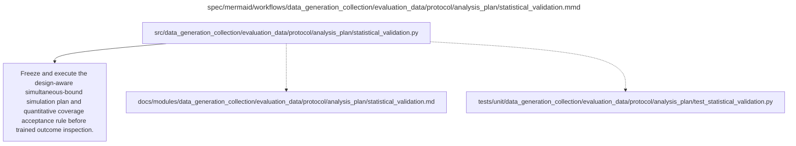

# statistical_validation.md

**Owner:** `analysis`. **Implementation status:** blank placeholder, not implemented or tested.

| Artifact | Exact repository path |
|---|---|
| Implementation | `src/data_generation_collection/evaluation_data/protocol/analysis_plan/statistical_validation.py` |
| Workflow/support diagram | [`spec/mermaid/workflows/data_generation_collection/evaluation_data/protocol/analysis_plan/statistical_validation.mmd`](../../../../../../spec/mermaid/workflows/data_generation_collection/evaluation_data/protocol/analysis_plan/statistical_validation.mmd) |
| This specification | `docs/modules/data_generation_collection/evaluation_data/protocol/analysis_plan/statistical_validation.md` |
| Unit test slot | `tests/unit/data_generation_collection/evaluation_data/protocol/analysis_plan/test_statistical_validation.py` |

**Scientific sources:** G.10; H.8. [p. 67](../../../../../../spec/experiment.pdf#page=67) · [p. 78](../../../../../../spec/experiment.pdf#page=78) · [p. 79](../../../../../../spec/experiment.pdf#page=79) · [p. 80](../../../../../../spec/experiment.pdf#page=80).

## Responsibility and controlling details

Define and freeze a finite-population simulation plan before trained outcome inspection. It must specify generators, exact capability/nested sampling mechanisms, seeds, simulation replication budget and a quantitative Monte Carlo acceptance rule for joint one-sided 95% coverage across the full scalar family. Report Monte Carlo uncertainty and the actual validation outputs. The source delegates these exact implementation choices; this blank module and documentation do not claim they have passed.

Mandatory scenarios include decision-boundary quantities, correlated checkpoints, uneven domains, extreme proportions and small/empty common-correct sets. Test aligned pairing, sample/stratum inclusion, recomputation of intersections and denominators, all 216 windows, transfer-domain choices and degenerate/indeterminate cases. Account for fixed-all-subject MMLU capability versus separately sampled legibility subjects and within-subject questions. Check that missing required evidence and zero variance do not manufacture confident qualification.

If mandatory validation fails, stop confirmatory launch and record why. Do not change methods after trained outputs, relax source thresholds, expand panels or add adaptive training. Descriptive candidate reporting does not establish simultaneous coverage and does not waive launch gates. This is implementation validation, not a new scientific ablation or optimizer search.

## Interfaces and dependent procedures

Use the common [artifact contracts](../../../../../contracts.md), [frozen prompt instructions](../../../../../prompts.md), [decision ledger](../../../../../decisions.md) and [validation requirements](../../../../../validation.md). Typed signatures/serialization are delegated implementation details; their scientific meaning is not. The named owner defines this module with its consumers before dependent integration.

No separate child procedure is declared in this diagram. This does not exempt shared recovery, storage, provenance or validation contracts.

## Completion and failure boundary

Implement and test `src/data_generation_collection/evaluation_data/protocol/analysis_plan/statistical_validation.py` against its specified behavior in `tests/unit/data_generation_collection/evaluation_data/protocol/analysis_plan/test_statistical_validation.py`. Validate every emitted artifact and preserve its source/configuration identity. Do not claim completeness from a placeholder or passing import. Propagate required child failures and maintain ordinary model outcomes separately from infrastructure faults. Mandatory real preflights and permission gates remain in force. Unspecified allowed conventions must be documented/frozen before outcomes; new scientific choices are not silently authorized.

## Exact path-synchronized diagram

The following diagram is byte-for-byte the active `.mmd` content at generation time. Its procedural content is from the supplied workflow or the cited PDF support requirement; file labels and role assignment are the requested repository organization.

