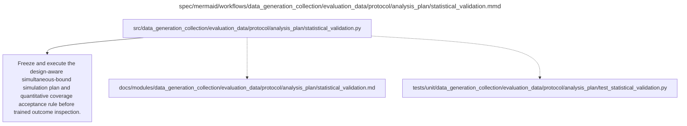

# statistical_validation.md

**Owner:** `analysis`. **Implementation status:** original candidate rejected; approved evaluation-only guard implemented and targeted checks passed. Full revised seven-scenario validation passed (700/700 repetitions); this clears the statistical component only.

## Implemented interface and prospective acceptance rule

`freeze_simulation_plan(analysis_plan=None, repetitions=100, draws=10000, fixture=False) -> dict` binds the implementation hash, actual eligible stratum sizes when a plan is supplied, seven scenarios, finite populations, exact two-stage SRS without replacement, seeds and acceptance. `run_statistical_validation(analysis_plan=None, simulation_plan=None, output_path=None, scenarios=None, resume=False, ...) -> dict` persists the freeze before simulation and reports every completed/failed/unrun replication. Atomic per-repetition checkpoints bind content, code, frozen plan, selected cases and exact seed sequence. `resume=True` rejects corrupted or stale checkpoints. All seven mandatory cases remain in the output registry. Successful subsets are `partial`; a mandatory rejection is `failed`, and no subset can issue a passing certificate. It uses the same complete 216-window/10,800-gate bound implementation as final analysis.

The frozen budget is 100 repetitions per mandatory scenario and 10,000 paired draws per repetition, with seed 42 in a separate statistical namespace. Scenarios cover decision boundaries, correlated checkpoints, uneven domains, extreme proportions, small common sets, empty common sets and heterogeneous strata. Each scenario must have a one-sided 95% Wilson lower confidence limit for joint coverage at least 0.95 and zero structural failures. Monte Carlo estimates, standard errors and Wilson limits are reported. A Wilson interval at a futility-stopped random repetition count is nominal descriptive uncertainty, not an anytime-valid confidence guarantee; rejection uses the mathematically unattainable fixed final-100 acceptance rule.

Prospectively approved futility stops a scenario when even success in every remaining planned repetition cannot meet that rule; two failures make the best attainable result 98/100, whose lower limit is 0.94135. A rejected mandatory scenario stops confirmation and leaves all later scenarios explicitly unrun. This saves computation without accepting a weaker result. A partial or reduced fixture run never issues a passing certificate.

Final orchestration source was frozen at 2026-10-10 22:38:34 UTC. Current actual-panel simulation freeze hash: `fec05bc79d525074718509205ef26783599f4ede69677c1da75dc9fc2f839688`; implementation hash: `95e615ae076ee9672de28013176e0d3e00185af57fa88f21f7f424def00e1c9a`. The unchanged numerical procedure previously completed 36 actual-frame boundary repetitions with 34 jointly covered, two failures and zero structural failures. The best possible final result is 98/100; its Wilson lower limit is below 0.95. It therefore stopped under frozen futility, leaving 64 repetitions and six whole scenarios unrun. This is a scientific rejection, not a passing or reduced-budget certificate. That exact rejected plan/report and an earlier interrupted 30-repetition report are preserved under `docs/evidence/statistical_validation_rejected_{plan,report}.json` and `statistical_validation_interrupted_{plan,report}.json`. The final code completed the same procedure at one NumPy thread in 627.21 seconds with no changed seeds, scenarios, numerical rules or acceptance thresholds. It reproduced both failures and stopped at 36/100 boundary repetitions with 34 jointly covered, zero structural failures and a best attainable final Wilson lower limit of 0.94135163. Current final report hash: `3e99f06fd472b1fab0f16de38e1451a202dafe9debc1ba5755de1414d5ff2cf8`; there is no active validation job. The standard `docs/evidence/statistical_validation_{plan,report}.json` files contain this completed current-code rejection. Four validator unit tests passed, including real reduced-draw interruption/resume equality and corrupted-checkpoint rejection. The complete focused analysis suite has 20 passes and two blocked-live skips; unit fixtures never establish coverage. Runtime evidence is persisted at `artifacts/preflight/statistical_validation/report.json` and its `.plan.json` companion. Earlier generic-frame undercoverage diagnostics are retained separately and are not a substitute for validation using actual MMLU eligibility sizes. There are no trained outcomes and no passing coverage certificate.

| Artifact | Exact repository path |
|---|---|
| Implementation | `src/data_generation_collection/evaluation_data/protocol/analysis_plan/statistical_validation.py` |
| Workflow/support diagram | [`spec/mermaid/workflows/data_generation_collection/evaluation_data/protocol/analysis_plan/statistical_validation.mmd`](../../../../../../spec/mermaid/workflows/data_generation_collection/evaluation_data/protocol/analysis_plan/statistical_validation.mmd) |
| This specification | `docs/modules/data_generation_collection/evaluation_data/protocol/analysis_plan/statistical_validation.md` |
| Unit test slot | `tests/unit/data_generation_collection/evaluation_data/protocol/analysis_plan/test_statistical_validation.py` |

**Scientific sources:** G.10; H.8. [p. 67](../../../../../../spec/experiment.pdf#page=67) · [p. 78](../../../../../../spec/experiment.pdf#page=78) · [p. 79](../../../../../../spec/experiment.pdf#page=79) · [p. 80](../../../../../../spec/experiment.pdf#page=80).

## Responsibility and controlling details

Define and freeze a finite-population simulation plan before trained outcome inspection. It must specify generators, exact capability/nested sampling mechanisms, seeds, simulation replication budget and a quantitative Monte Carlo acceptance rule for joint one-sided 95% coverage across the full scalar family. Report Monte Carlo uncertainty and the actual validation outputs. The source delegates these exact implementation choices; implemented numerical procedures and documentation do not imply that validation passed.

Mandatory scenarios include decision-boundary quantities, correlated checkpoints, uneven domains, extreme proportions and small/empty common-correct sets. Test aligned pairing, sample/stratum inclusion, recomputation of intersections and denominators, all 216 windows, transfer-domain choices and degenerate/indeterminate cases. Account for fixed-all-subject MMLU capability versus separately sampled legibility subjects and within-subject questions. Check that missing required evidence and zero variance do not manufacture confident qualification.

If mandatory validation fails, stop confirmatory launch and record why. Do not change methods after trained outputs, relax source thresholds, expand panels or add adaptive training. Descriptive candidate reporting does not establish simultaneous coverage and does not waive launch gates. This is implementation validation, not a new scientific ablation or optimizer search.

## Interfaces and dependent procedures

Use the common [artifact contracts](../../../../../contracts.md), [frozen prompt instructions](../../../../../prompts.md), [decision ledger](../../../../../decisions.md) and [validation requirements](../../../../../validation.md). Typed signatures/serialization are delegated implementation details; their scientific meaning is not. The named owner defines this module with its consumers before dependent integration.

No separate child procedure is declared in this diagram. This does not exempt shared recovery, storage, provenance or validation contracts.

## Completion and failure boundary

Implement and test `src/data_generation_collection/evaluation_data/protocol/analysis_plan/statistical_validation.py` against its specified behavior in `tests/unit/data_generation_collection/evaluation_data/protocol/analysis_plan/test_statistical_validation.py`. Validate every emitted artifact and preserve its source/configuration identity. Do not claim completeness from a placeholder or passing import. Propagate required child failures and maintain ordinary model outcomes separately from infrastructure faults. Mandatory real preflights and permission gates remain in force. Unspecified allowed conventions must be documented/frozen before outcomes; new scientific choices are not silently authorized.

## Exact path-synchronized diagram

The following diagram is byte-for-byte the active `.mmd` content at generation time. Its procedural content is from the supplied workflow or the cited PDF support requirement; file labels and role assignment are the requested repository organization.

