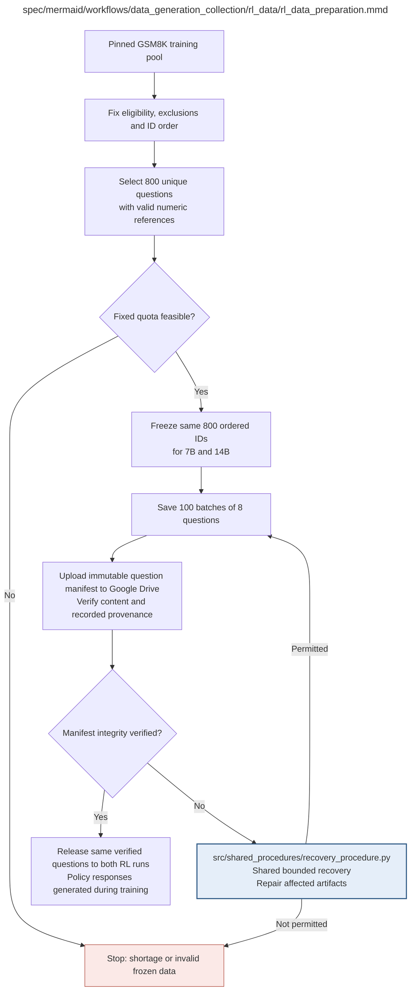

# rl_data_preparation.md

**Owner:** `data_preparation`. **Implementation status:** Implemented and tested; the real 800-question manifest has been prepared from pinned public GSM8K.

| Artifact | Exact repository path |
|---|---|
| Implementation | `src/data_generation_collection/rl_data/rl_data_preparation.py` |
| Workflow/support diagram | [`spec/mermaid/workflows/data_generation_collection/rl_data/rl_data_preparation.mmd`](../../../../spec/mermaid/workflows/data_generation_collection/rl_data/rl_data_preparation.mmd) |
| This specification | `docs/modules/data_generation_collection/rl_data/rl_data_preparation.md` |
| Unit test slot | `tests/unit/data_generation_collection/rl_data/test_rl_data_preparation.py` |

**Scientific sources:** C.3.2,C.3.5; E.2.2; H.7. [p. 32](../../../../spec/experiment.pdf#page=32) · [p. 35](../../../../spec/experiment.pdf#page=35) · [p. 54](../../../../spec/experiment.pdf#page=54) · [p. 77](../../../../spec/experiment.pdf#page=77).

## Responsibility and controlling details

Select exactly 800 unique eligible problems from the official GSM8K training pool, with valid numeric references and frozen exclusions/order. Keep the same ordered IDs for both 7B and 14B and write 100 consecutive batches of eight. Log source IDs, revisions, rejected IDs and reasons, including detectable evaluation overlap. References must be usable by the deterministic normalizer; do not use a generative correctness judge.

No target reasoning is attached for imitation: the current RL policy creates four rollouts per question. Freeze before training, and do not reshuffle or revisit easy questions for more favorable rewards. Invalid frozen data or insufficient eligible count stops preparation rather than changing the corpus or rollout budget. Easiness alone is not a failure criterion; subsequent within-group effective opacity variation supplies the relative learning signal when present.

## Interfaces and dependent procedures

Use the common [artifact contracts](../../../contracts.md), [frozen prompt instructions](../../../prompts.md), [decision ledger](../../../decisions.md) and [validation requirements](../../../validation.md). Typed signatures/serialization are delegated implementation details; their scientific meaning is not. The named owner defines this module with its consumers before dependent integration.

| Source node | Called procedure (exact path) | Specification |
|---|---|---|
| `REPAIR` | `src/shared_procedures/recovery_procedure.py` | [recovery_procedure](../../shared_procedures/recovery_procedure.md) |

## Original procedural constraints

The following source comments retain the procedural detail of the supplied diagram. Obsolete introductory editing instructions and raw link directives are omitted from this list; all links are resolved in the path-synchronized diagram below. Appendix H controls any earlier conflicting language.
- RL data preparation
- Keep rejected source IDs and reasons; exclusions include detectable evaluation overlap.
- No fixed training reasoning targets: current policies generate their own rollouts.
- GSM8K easiness is not intrinsically disqualifying; inspect within-group opacity reward variation.

## Implemented interface and evidence

`load_rl_source(revision, *, cache_root=None)` reads checksummed pinned GSM8K train shards. `prepare_rl_data(rows, source_revision, evaluation_questions, *, output_path=None)` returns `questions` (800), fixed `batches` (100 ordered batches of eight), source revision, overlap/dedup exclusions, hashes and verified status. Records use `question_id`, alias `example_id`, exact `question`, normalized numeric `reference_answer` and source content hashes; no source reasoning target is passed to RL. `validate_rl_manifest` checks all counts, ID uniqueness, ordering/groups and hash identities.

The reference comes only from the official `####` numeric answer. Normalized question overlap checks the full frozen benchmark frame, not only sampled evaluation IDs. Questions order by SHA-derived namespace `rl_questions` with global 42. The model never chooses substitutes or difficulty strata.

Actual pinned GSM8K train rows (7473) were acquired and verified; `data/rl/manifest.json` contains the real fixed 800 questions and 100 batches, with no detected full-frame overlap/dedup exclusions. Unit checks cover reference parsing, exact counts/group order, repeatability, duplicates, detectable overlap and insufficient pools.

## Completion and failure boundary

Implement and test `src/data_generation_collection/rl_data/rl_data_preparation.py` against its specified behavior in `tests/unit/data_generation_collection/rl_data/test_rl_data_preparation.py`. Validate every emitted artifact and preserve its source/configuration identity. Do not claim completeness from a placeholder or passing import. Propagate required child failures and maintain ordinary model outcomes separately from infrastructure faults. Mandatory real preflights and permission gates remain in force. Unspecified allowed conventions must be documented/frozen before outcomes; new scientific choices are not silently authorized.

## Exact path-synchronized diagram

The following diagram is byte-for-byte the active `.mmd` content at generation time. Its procedural content is from the supplied workflow or the cited PDF support requirement; file labels and role assignment are the requested repository organization.

## Current procedure

The approved vLLM corpus migration, Drive-only preservation, frozen RL selection, and remaining validation boundaries are documented in `docs/procedure_update.md` and the integrated protocol PDF.
