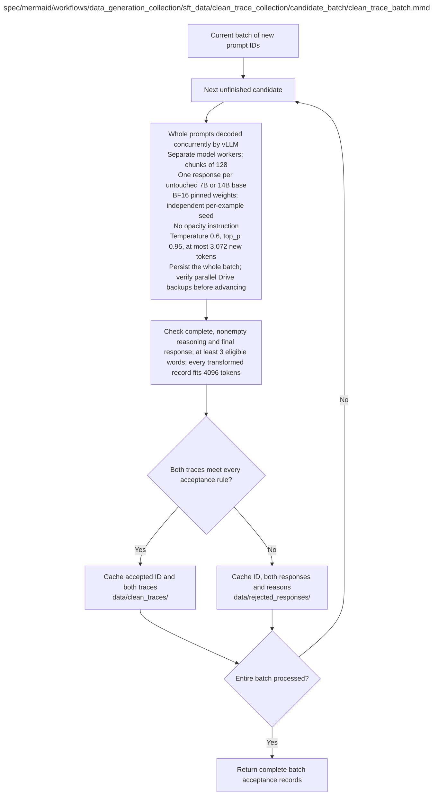

# clean_trace_batch.md

**Owner:** `data_preparation`. **Implementation status:** Implemented and tested with explicit model/tokenizer/noise fixtures; real clean generation requires authorized source and GPU preflights.

| Artifact | Exact repository path |
|---|---|
| Implementation | `src/data_generation_collection/sft_data/clean_trace_collection/candidate_batch/clean_trace_batch.py` |
| Workflow/support diagram | [`spec/mermaid/workflows/data_generation_collection/sft_data/clean_trace_collection/candidate_batch/clean_trace_batch.mmd`](../../../../../../spec/mermaid/workflows/data_generation_collection/sft_data/clean_trace_collection/candidate_batch/clean_trace_batch.mmd) |
| This specification | `docs/modules/data_generation_collection/sft_data/clean_trace_collection/candidate_batch/clean_trace_batch.md` |
| Unit test slot | `tests/unit/data_generation_collection/sft_data/clean_trace_collection/candidate_batch/test_clean_trace_batch.py` |

**Scientific sources:** 3.1; C.1.3; C.2.3; E.2.4; H.2.3,H.3. [p. 3](../../../../../../spec/experiment.pdf#page=3) · [p. 25](../../../../../../spec/experiment.pdf#page=25) · [p. 30](../../../../../../spec/experiment.pdf#page=30) · [p. 55](../../../../../../spec/experiment.pdf#page=55) · [p. 70](../../../../../../spec/experiment.pdf#page=70) · [p. 71](../../../../../../spec/experiment.pdf#page=71).

## Responsibility and controlling details

Native clean generation: temperature 0.6, `top_p=0.95`, at most 3072 new tokens, no added system prompt, native reasoning formatting and no opacity instruction. Both untouched models independently respond to the same candidate. Save both raw responses, finish reasons, token counts, model/tokenizer/runtime/seed identity and failures before derived processing.

Each output must be completed and separable into nonempty reasoning and nonempty final response; reasoning has at least three original word spans containing an ASCII Latin letter. Apply the exact final transformation algorithms, profile settings, seeds and protected-span rules to preflight every variant. Clean and all variants must fit the **total prompt-plus-response 4096-token bound** for the relevant model tokenizer. Preserve final answers and prompts; KaziText protects numerical and mathematical spans. A failure for either model or any required variant rejects that shared candidate before freeze.

Do not add a semantic-correctness judge, reasoning-quality score, minimum 50-word rule, minimum five-step rule, or distinct-mask requirement. Short/wrong/uninformative but structurally acceptable traces may remain. Log actual lengths, eligible word counts, encoded fractions and repeated masks. Ordinary cutoff/parse/rejection outcomes are not execution retries.

## Interfaces and dependent procedures

Use the common [artifact contracts](../../../../../contracts.md), [frozen prompt instructions](../../../../../prompts.md), [decision ledger](../../../../../decisions.md) and [validation requirements](../../../../../validation.md). Typed signatures/serialization are delegated implementation details; their scientific meaning is not. The named owner defines this module with its consumers before dependent integration.

No separate child procedure is declared in this diagram. This does not exempt shared recovery, storage, provenance or validation contracts.

## Original procedural constraints

The following source comments retain the procedural detail of the supplied diagram. Obsolete introductory editing instructions and raw link directives are omitted from this list; all links are resolved in the path-synchronized diagram below. Appendix H controls any earlier conflicting language.
- One clean trace candidate batch
- Execution contract: known faults use bounded recovery; unclassified/persistent faults stop the worker.
- Frozen invalid inputs are fatal. Unrecoverable child failures propagate; never release incomplete results.
- One clean-trace candidate batch
- Cache folders are siblings. Raw responses include generation provenance.
- Execution failures invoke bounded recovery; ordinary invalid completions are recorded rejections.
- Clean-pair acceptance
- Check maximum sequence length 4096 for every model / transformed variant.
- Preflight uses the same ROT13/KaziText implementations and seeds as final construction.
- Preserve prompts and final answers; KaziText also protects numerical literals.
- Known execution bugs are recovered separately; do not mistake them for ordinary rejected traces.
- Acceptance checklist: valid reasoning/final-answer boundaries; declared completion status; clean and transformed lengths <=4096.
- Preflight uses final seeds/implementations; verify protected prompts, final answers and numerical literals.
- All acceptance checks are applied to both model traces. Never resample ordinary rejected responses until they pass.
- Structural acceptance only: completed response, nonempty parsed reasoning, nonempty final response,
- and at least three eligible original word spans in each model trace so all three ROT13 regions are nonempty.
- Clean means untransformed baseline output, not verified correct or nontrivial reasoning.
- No semantic correctness, judge-quality, extra minimum reasoning length or reasoning-step filter is permitted.
- Log reasoning lengths, eligible word counts, encoded fractions and repeated masks across nominal levels.
- Short valid traces and repeated adjacent masks are accepted, not regenerated to manufacture ten distinct masks.

## Implemented interface and evidence

`NativeCleanGenerator(models, *, device_map="auto", torch_dtype="bfloat16", cache_root=None)` loads each untouched frozen base lazily and emits native responses at temperature 0.6, top-p 0.95 and at most 3072 new tokens. `process_clean_batch(candidates, generator, tokenizers, *, kazitext, output_dir, config_hash)` saves full raw responses before parsing, then returns paired accepted/rejected JSON mappings. `validate_clean_trace` preserves explicit missing fields on boundary rejection and retains semantically wrong traces.

Acceptance checks nonempty native reasoning/final boundaries, complete generation, at least three eligible words, full intact native-training sequence at most 4096 tokens and all twenty exact model-specific transformation variants. The shared SFT renderer preserves the entire target even when the model's inference history template strips previous reasoning. Infrastructure failures propagate; ordinary rejection never regenerates that candidate. Every durable raw/pair artifact immediately invokes the shared storage notification hook.

Production and injected fixture caches have distinct `execution_mode` directories and `simulation` identities. Fixture responses cannot enter live clean-data readiness. Optional `stop_requested` callbacks pause before model loading/generation or paired validation. Completed raw/pair records have already passed durable write/readback and the synchronous storage notification hook. `CleanDataPause.progress` names the exact next operation and completed IDs; resumption uses original raw caches. No native sample or scientific criterion is changed.

Unit checks cover exact bytes, truncation/malformed rejection, paired structural acceptance, full reasoning token counting, raw cache reuse and generator failures. Actual base-model generation has not run in this CPU environment.

## Completion and failure boundary

Implement and test `src/data_generation_collection/sft_data/clean_trace_collection/candidate_batch/clean_trace_batch.py` against its specified behavior in `tests/unit/data_generation_collection/sft_data/clean_trace_collection/candidate_batch/test_clean_trace_batch.py`. Validate every emitted artifact and preserve its source/configuration identity. Do not claim completeness from a placeholder or passing import. Propagate required child failures and maintain ordinary model outcomes separately from infrastructure faults. Mandatory real preflights and permission gates remain in force. Unspecified allowed conventions must be documented/frozen before outcomes; new scientific choices are not silently authorized.

## Exact path-synchronized diagram

The following diagram is byte-for-byte the active `.mmd` content at generation time. Its procedural content is from the supplied workflow or the cited PDF support requirement; file labels and role assignment are the requested repository organization.

## Current procedure amendment

The approved vLLM corpus migration, Drive-only preservation, frozen RL selection, and remaining validation boundaries are documented in `docs/procedure_update.md` and PDF H.11.
