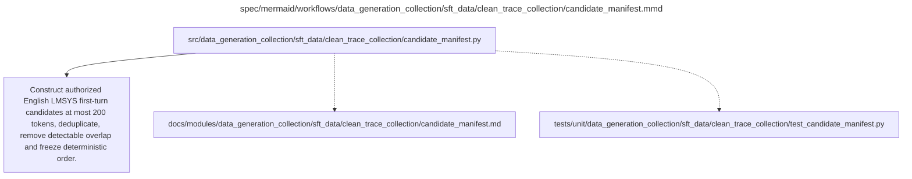

# candidate_manifest.md

**Owner:** `data_preparation`. **Implementation status:** blank placeholder, not implemented or tested.

| Artifact | Exact repository path |
|---|---|
| Implementation | `src/data_generation_collection/sft_data/clean_trace_collection/candidate_manifest.py` |
| Workflow/support diagram | [`spec/mermaid/workflows/data_generation_collection/sft_data/clean_trace_collection/candidate_manifest.mmd`](../../../../../spec/mermaid/workflows/data_generation_collection/sft_data/clean_trace_collection/candidate_manifest.mmd) |
| This specification | `docs/modules/data_generation_collection/sft_data/clean_trace_collection/candidate_manifest.md` |
| Unit test slot | `tests/unit/data_generation_collection/sft_data/clean_trace_collection/test_candidate_manifest.py` |

**Scientific sources:** 3.1; B.1; E.2.2–E.2.4; H.3. [p. 3](../../../../../spec/experiment.pdf#page=3) · [p. 17](../../../../../spec/experiment.pdf#page=17) · [p. 18](../../../../../spec/experiment.pdf#page=18) · [p. 54](../../../../../spec/experiment.pdf#page=54) · [p. 55](../../../../../spec/experiment.pdf#page=55) · [p. 56](../../../../../spec/experiment.pdf#page=56) · [p. 71](../../../../../spec/experiment.pdf#page=71).

## Responsibility and controlling details

Extract authorized English first-user-turn prompts from LMSYS-Chat-1M, apply the at-most-200-input-token filter, deduplicate, exclude known detectable evaluation overlap, and freeze a deterministic candidate order before collection. Store stable IDs, original text, source revision/split, normalization/deduplication identity, source-content hashes and exclusion reasons. The tokenizer/counting and normalization implementation must be documented under the source's delegated conventions; this scaffold does not invent a semantic reasoning classifier or a new overlap-similarity threshold.

The final population is source-filtered and trace-eligible, not representative of all user traffic. Exact/normalized overlap checking cannot establish absence of paraphrases or pretraining contamination. No source ID may be replaced after the common accepted pool is frozen merely because a transformed version is troublesome.

## Interfaces and dependent procedures

Use the common [artifact contracts](../../../../contracts.md), [frozen prompt instructions](../../../../prompts.md), [decision ledger](../../../../decisions.md) and [validation requirements](../../../../validation.md). Typed signatures/serialization are delegated implementation details; their scientific meaning is not. The named owner defines this module with its consumers before dependent integration.

No separate child procedure is declared in this diagram. This does not exempt shared recovery, storage, provenance or validation contracts.

## Completion and failure boundary

Implement and test `src/data_generation_collection/sft_data/clean_trace_collection/candidate_manifest.py` against its specified behavior in `tests/unit/data_generation_collection/sft_data/clean_trace_collection/test_candidate_manifest.py`. Validate every emitted artifact and preserve its source/configuration identity. Do not claim completeness from a placeholder or passing import. Propagate required child failures and maintain ordinary model outcomes separately from infrastructure faults. Mandatory real preflights and permission gates remain in force. Unspecified allowed conventions must be documented/frozen before outcomes; new scientific choices are not silently authorized.

## Exact path-synchronized diagram

The following diagram is byte-for-byte the active `.mmd` content at generation time. Its procedural content is from the supplied workflow or the cited PDF support requirement; file labels and role assignment are the requested repository organization.

