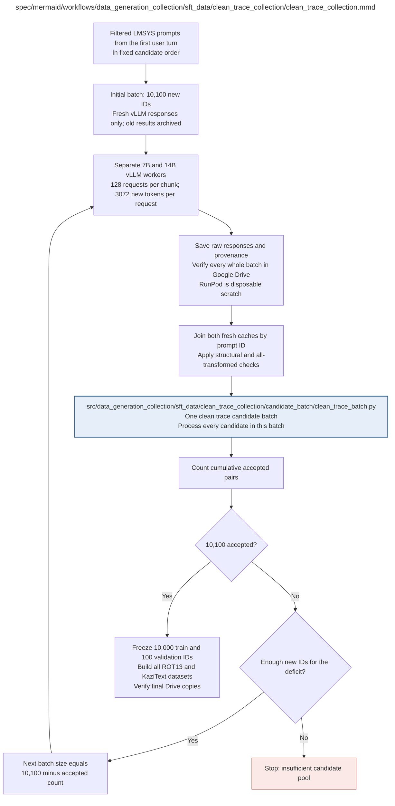

# clean_trace_collection.md

**Owner:** `data_preparation`. **Implementation status:** Implemented and tested with a full-count paired collector fixture; scientific collection remains externally gated.

| Artifact | Exact repository path |
|---|---|
| Implementation | `src/data_generation_collection/sft_data/clean_trace_collection/clean_trace_collection.py` |
| Workflow/support diagram | [`spec/mermaid/workflows/data_generation_collection/sft_data/clean_trace_collection/clean_trace_collection.mmd`](../../../../../spec/mermaid/workflows/data_generation_collection/sft_data/clean_trace_collection/clean_trace_collection.mmd) |
| This specification | `docs/modules/data_generation_collection/sft_data/clean_trace_collection/clean_trace_collection.md` |
| Unit test slot | `tests/unit/data_generation_collection/sft_data/clean_trace_collection/test_clean_trace_collection.py` |

**Scientific sources:** 3.1; B.1; E.2.2–E.2.4; H.2.3,H.3. [p. 3](../../../../../spec/experiment.pdf#page=3) · [p. 18](../../../../../spec/experiment.pdf#page=18) · [p. 54](../../../../../spec/experiment.pdf#page=54) · [p. 55](../../../../../spec/experiment.pdf#page=55) · [p. 70](../../../../../spec/experiment.pdf#page=70) · [p. 71](../../../../../spec/experiment.pdf#page=71).

## Responsibility and controlling details

Use the source diagram's first batch of 10,100 new candidate IDs. Process every candidate in that batch, count cumulative accepted paired IDs, and refill with exactly `10100 - accepted_count` new IDs in the fixed order. Stop when exactly 10,100 pass; if the remaining source pool cannot supply the deficit, stop rather than oversample with replacement or change quotas.

Generate each candidate once per untouched model under the fixed settings. Record ordinary failures rather than resampling a prompt until it passes. Infrastructure retries are separately bounded and identified; they are not an opportunity for favorable-output selection. Joint eligibility includes all transformation preflight checks; do not freeze a provisional clean pool that later loses examples selectively at higher levels. Final split is 10,000 train and 100 disjoint validation IDs, consistent across every SFT configuration.

## Interfaces and dependent procedures

Use the common [artifact contracts](../../../../contracts.md), [frozen prompt instructions](../../../../prompts.md), [decision ledger](../../../../decisions.md) and [validation requirements](../../../../validation.md). Typed signatures/serialization are delegated implementation details; their scientific meaning is not. The named owner defines this module with its consumers before dependent integration.

| Source node | Called procedure (exact path) | Specification |
|---|---|---|
| `PROCESS` | `src/data_generation_collection/sft_data/clean_trace_collection/candidate_batch/clean_trace_batch.py` | [clean_trace_batch](candidate_batch/clean_trace_batch.md) |

## Original procedural constraints

The following source comments retain the procedural detail of the supplied diagram. Obsolete introductory editing instructions and raw link directives are omitted from this list; all links are resolved in the path-synchronized diagram below. Appendix H controls any earlier conflicting language.
- Clean trace collection
- No oversampling: every refill is exactly the deficit, using new IDs.
- Rejected outputs are retained but are not resampled until they pass.
- Each model trace must pass structural checks, including at least three eligible original word spans.
- No semantic correctness or quality filter. Clean means untransformed baseline output.
- Filter English / prompt length, deduplicate and exclude detectable evaluation overlap before fixing candidate order.

## Implemented interface and evidence

`collect_clean_traces(candidate_manifest, generator, tokenizers, *, kazitext, output_dir, config_hash, batch_processor=process_clean_batch)` returns a verified accepted-pool mapping containing exactly 10100 paired records, common ordered `train_ids` (10000), `validation_ids` (100), rejected IDs, batch evidence and source/configuration hashes. The first request contains 10100 IDs; every refill contains exactly the remaining deficit and only new IDs. Insufficient fresh candidates is a recorded fatal shortage.

Raw cache recovery reuses the original ordinary response. All paired source identities are frozen before any intervention dataset is released. The first 10000 common accepted IDs are training; the final 100 are validation. Fixture/production simulation metadata propagates into the pool.

Optional callback or stop-file controls return `status="paused"` with `next_batch_start_cursor`, `next_candidate_position`, `next_operation`, committed IDs and source/configuration hashes. The default external file is `output_dir/STOP_REQUESTED`. A partial collector never publishes `accepted_pool.json`; the caller records pause and stops external billing. Remove the request before authorized resume; replay uses the same IDs and original durable raw responses.

Unit checks exercise actual 10100-plus-exact-deficit control flow, common paired counts, disjoint ordered splits, wrong batch ordering and source shortage. No scientific accepted pool was created without the authorized LMSYS source and both real model runtimes.

## Completion and failure boundary

Implement and test `src/data_generation_collection/sft_data/clean_trace_collection/clean_trace_collection.py` against its specified behavior in `tests/unit/data_generation_collection/sft_data/clean_trace_collection/test_clean_trace_collection.py`. Validate every emitted artifact and preserve its source/configuration identity. Do not claim completeness from a placeholder or passing import. Propagate required child failures and maintain ordinary model outcomes separately from infrastructure faults. Mandatory real preflights and permission gates remain in force. Unspecified allowed conventions must be documented/frozen before outcomes; new scientific choices are not silently authorized.

## Exact path-synchronized diagram

The following diagram is byte-for-byte the active `.mmd` content at generation time. Its procedural content is from the supplied workflow or the cited PDF support requirement; file labels and role assignment are the requested repository organization.

## Current procedure amendment

The approved vLLM corpus migration, Drive-only preservation, frozen RL selection, and remaining validation boundaries are documented in `docs/procedure_update.md` and PDF H.11.
