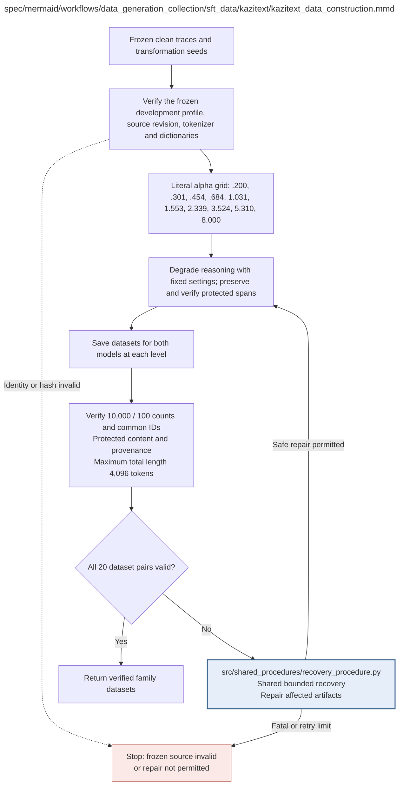

# kazitext_data_construction.md

**Owner:** `data_preparation`. **Implementation status:** blank placeholder, not implemented or tested.

| Artifact | Exact repository path |
|---|---|
| Implementation | `src/data_generation_collection/sft_data/kazitext/kazitext_data_construction.py` |
| Workflow/support diagram | [`spec/mermaid/workflows/data_generation_collection/sft_data/kazitext/kazitext_data_construction.mmd`](../../../../../spec/mermaid/workflows/data_generation_collection/sft_data/kazitext/kazitext_data_construction.mmd) |
| This specification | `docs/modules/data_generation_collection/sft_data/kazitext/kazitext_data_construction.md` |
| Unit test slot | `tests/unit/data_generation_collection/sft_data/kazitext/test_kazitext_data_construction.py` |

**Scientific sources:** C.1.4; C.2.3; E.2.4; H.2–H.3. [p. 26](../../../../../spec/experiment.pdf#page=26) · [p. 27](../../../../../spec/experiment.pdf#page=27) · [p. 30](../../../../../spec/experiment.pdf#page=30) · [p. 55](../../../../../spec/experiment.pdf#page=55) · [p. 69](../../../../../spec/experiment.pdf#page=69) · [p. 70](../../../../../spec/experiment.pdf#page=70) · [p. 71](../../../../../spec/experiment.pdf#page=71).

## Responsibility and controlling details

## Exact pinned inputs

| Field | Value |
|---|---|
| Repository | official `ufal/kazitext` |
| Revision | `435f68748fdded6d79446b8ab6bdf76fbde88818` |
| Profile | `profiles/dev/en_clean_second_learners.json` |
| SHA-256 | `8c723dd5925fc872b4ee8a5191f585dee95d1146e849fc80f5e84f3cd0f62d73` |
| Language | `en` |
| Literal alphas, levels 1–10 | `0.200, 0.301, 0.454, 0.684, 1.031, 1.553, 2.339, 3.524, 5.310, 8.000` |
| `alpha_std` / `alpha_uniformity_prob` / `beta` | `0` / `0` / `0` |
| `no_word_order` | `True` |
| `no_error_sentence_boost` | `0` |
| `spelling_detailed_ratio` | `0.3` |
| `strip_all_diacritics` | `False` |
| Other dedicated aspects | enabled |
| Seed | `42` |

Use these literal decimal alpha values, not the inconsistent overview or machine recomputation. The profile explicitly replaces the unavailable earlier pilot profile. Verify the hash against actual bytes and retain provenance. Do not import profile-CSV alpha standard deviations or sentence boosts. KaziText `beta=0` is unrelated to the RL KL coefficient 0.01.

Configure the external `english-ewt-ud-2.5-191206.udpipe` model explicitly. Its hyphens are an external identifier, not a local repository filename to rename. Verify a real loadable binary rather than an HTML page and record its checksum. Pin the binding, Python/dependencies and actual English Aspell dictionary provenance; the PDF does not supply their actual runtime checksums, so do not fabricate them.

Use the same canonical ID order at every level and freeze the stochastic ordering/seed/hash behavior across both model sizes. Candidate preflight and final construction must call the same transform with the same settings. Protect numerical literals and mathematical notation, and keep prompt/final answer unchanged; verify after every transform. Record changed-word fractions, original/transformed token counts, protection status, seed/revision and exclusions. Errors are not required to nest across levels.

Release twenty verified train/validation pairs for this family only after all 10,000/100 shared counts, identity, protection and 4096-token checks pass. A frozen-source failure is fatal, not grounds for replacing IDs. Disabling word order does not prove meaning is preserved; the pinned implementation determines what its switches actually do. Repair defects only within H.9's frozen-design boundary.

## Interfaces and dependent procedures

Use the common [artifact contracts](../../../../contracts.md), [frozen prompt instructions](../../../../prompts.md), [decision ledger](../../../../decisions.md) and [validation requirements](../../../../validation.md). Typed signatures/serialization are delegated implementation details; their scientific meaning is not. The named owner defines this module with its consumers before dependent integration.

| Source node | Called procedure (exact path) | Specification |
|---|---|---|
| `RECOVER` | `src/shared_procedures/recovery_procedure.py` | [recovery_procedure](../../../shared_procedures/recovery_procedure.md) |

## Original procedural constraints

The following source comments retain the procedural detail of the supplied diagram. Obsolete introductory editing instructions and raw link directives are omitted from this list; all links are resolved in the path-synchronized diagram below. Appendix H controls any earlier conflicting language.
- KaziText data construction
- Authoritative literal alpha grid from PDF page 27 and Appendix H. Pass these exact decimals; do not recompute.
- Alpha: 0.200, 0.301, 0.454, 0.684, 1.031, 1.553, 2.339, 3.524, 5.310, 8.000.
- Official ufal/kazitext revision: 435f68748fdded6d79446b8ab6bdf76fbde88818.
- Profile: profiles/dev/en_clean_second_learners.json.
- Profile SHA256: 8c723dd5925fc872b4ee8a5191f585dee95d1146e849fc80f5e84f3cd0f62d73.
- This development profile replaces the requirement to reproduce the unavailable earlier pilot profile.
- lang=en; alpha_std=0; alpha_uniformity_prob=0; beta=0; no_word_order=True;
- no_error_sentence_boost=0; spelling_detailed_ratio=0.3; strip_all_diacritics=False.
- All other dedicated error aspects enabled. Never import CSV reference alpha standard deviation or sentence boost.
- Global seed 42 and the same canonical processing order at every level; final and preflight transforms must agree.
- Configure english-ewt-ud-2.5-191206.udpipe explicitly and record its checksum.
- Pin the UDPipe binding and resolved English Aspell dictionary; verify the profile hash before construction.
- Protect prompts, final answers, numerical literals and mathematical notation; verify after every transform.
- Disabling the word-order aspect is not evidence of semantic preservation.
- Retry only affected model/level artifacts with the same IDs/settings/seeds.
- Transformed dataset validation
- All lengths must fit the fixed 4096-token SFT limit.
- A frozen clean source that fails its required acceptance checks is fatal; do not silently substitute another ID.
- Reopen artifacts; verify split disjointness, all hashes and settings/seeds. Max sequence length 4096.

## Completion and failure boundary

Implement and test `src/data_generation_collection/sft_data/kazitext/kazitext_data_construction.py` against its specified behavior in `tests/unit/data_generation_collection/sft_data/kazitext/test_kazitext_data_construction.py`. Validate every emitted artifact and preserve its source/configuration identity. Do not claim completeness from a placeholder or passing import. Propagate required child failures and maintain ordinary model outcomes separately from infrastructure faults. Mandatory real preflights and permission gates remain in force. Unspecified allowed conventions must be documented/frozen before outcomes; new scientific choices are not silently authorized.

## Exact path-synchronized diagram

The following diagram is byte-for-byte the active `.mmd` content at generation time. Its procedural content is from the supplied workflow or the cited PDF support requirement; file labels and role assignment are the requested repository organization.

