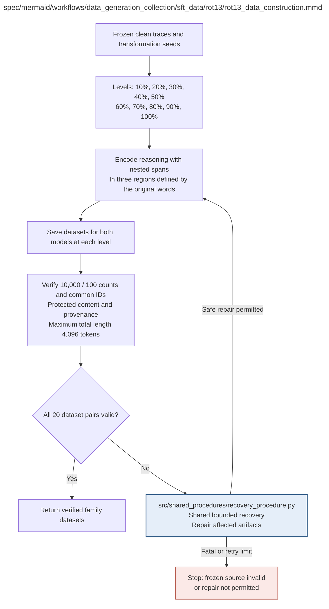

# rot13_data_construction.md

**Owner:** `data_preparation`. **Implementation status:** Implemented and tested; all ten levels and short-mask cases are exercised.

| Artifact | Exact repository path |
|---|---|
| Implementation | `src/data_generation_collection/sft_data/rot13/rot13_data_construction.py` |
| Workflow/support diagram | [`spec/mermaid/workflows/data_generation_collection/sft_data/rot13/rot13_data_construction.mmd`](../../../../../spec/mermaid/workflows/data_generation_collection/sft_data/rot13/rot13_data_construction.mmd) |
| This specification | `docs/modules/data_generation_collection/sft_data/rot13/rot13_data_construction.md` |
| Unit test slot | `tests/unit/data_generation_collection/sft_data/rot13/test_rot13_data_construction.py` |

**Scientific sources:** 3.2; C.1.1–C.1.3; C.2.3; E.2.4; H.3. [p. 3](../../../../../spec/experiment.pdf#page=3) · [p. 24](../../../../../spec/experiment.pdf#page=24) · [p. 25](../../../../../spec/experiment.pdf#page=25) · [p. 26](../../../../../spec/experiment.pdf#page=26) · [p. 30](../../../../../spec/experiment.pdf#page=30) · [p. 55](../../../../../spec/experiment.pdf#page=55) · [p. 71](../../../../../spec/experiment.pdf#page=71).

## Responsibility and controlling details

## Exact transformation

Segment the original reasoning once using a version-pinned deterministic word boundary. Eligible words contain at least one ASCII Latin letter; numbers, whitespace and punctuation-only spans do not enter the target denominator. The transformation substitutes conventional ROT13 only for ASCII alphabetic characters inside selected original word spans. Preserve other characters, the prompt and the complete final-answer field.

Let `N` be the eligible-word count. Partition its original ordered positions into three consecutive regions whose sizes differ by at most one. Each region is nonempty because accepted traces have at least three eligible words. Derive a stable region seed from global seed 42, immutable example ID and region index using a pinned cryptographic hash, not process-randomized built-in hashing. Sample one anchor. Fix a reproducible adjacent expansion order from that anchor so every prefix forms one contiguous span. Freeze the remainder assignment and left/right tie-breaking before outcome inspection.

At level `k` from 1 through 10, `p=k/10` and region `j` contributes

```text
q_j(k) = floor(p * n_j + 1/2)
```

Select exactly that prefix of the region's fixed expansion ordering. Masks must be nested across increasing levels; the last covers all eligible words. The source's absolute count discrepancy bound is `|encoded_count - p*N| <= 3/2`. Ordinary programming-language round-to-even is not the specified half-up rule. Adjacent levels may give identical masks on short traces; this is permitted and logged, not repaired by new sampling.

Construct twenty train/validation pairs for this family (two sizes × ten levels), preserving the common IDs and correct model-specific source traces. Verify 10,000/100 counts, disjoint splits, hashes/seed/settings, prompt/answer integrity and total length at most 4096. Reopen written artifacts. A frozen-source failure stops construction; safe artifact repairs retain the exact sources and settings within bounded recovery.

The encoded fraction is a manipulation measurement, not an illegibility score, and fixed words/symbols can still reveal a solution. This construction does not establish uniform positional inclusion, monotonic output opacity or causally used encoded reasoning.

## Interfaces and dependent procedures

Use the common [artifact contracts](../../../../contracts.md), [frozen prompt instructions](../../../../prompts.md), [decision ledger](../../../../decisions.md) and [validation requirements](../../../../validation.md). Typed signatures/serialization are delegated implementation details; their scientific meaning is not. The named owner defines this module with its consumers before dependent integration.

| Source node | Called procedure (exact path) | Specification |
|---|---|---|
| `RECOVER` | `src/shared_procedures/recovery_procedure.py` | [recovery_procedure](../../../shared_procedures/recovery_procedure.md) |

## Original procedural constraints

The following source comments retain the procedural detail of the supplied diagram. Obsolete introductory editing instructions and raw link directives are omitted from this list; all links are resolved in the path-synchronized diagram below. Appendix H controls any earlier conflicting language.
- ROT13 data construction
- Protect prompts and final answers; numeric literals remain protected by declared eligibility rules.
- Retry only affected model/level artifacts with the same IDs/settings/seeds.
- Frozen clean sources have at least three eligible original word spans, leaving all three regions nonempty.
- Log original reasoning length, eligible word count, actual encoded fraction and repeated masks.
- Do not reject short valid traces or regenerate to force ten distinct masks.
- Transformed dataset validation
- All lengths must fit the fixed 4096-token SFT limit.
- A frozen clean source that fails its required acceptance checks is fatal; do not silently substitute another ID.
- Reopen artifacts; verify split disjointness, all hashes and settings/seeds. Max sequence length 4096.

## Implemented interface and evidence

`rot13_masks(reasoning, example_id, seed=42)` freezes ten nested masks; `transform_rot13(reasoning, example_id, level, *, seed=42)` returns exact text plus seeds, source/content hashes and mask evidence. `construct_rot13_data` uses the shared SFT dataset writer for both model sizes and all ten levels.

Eligible original Unicode word spans contain at least one ASCII Latin letter. Regions use early remainder allocation across three contiguous spans. Each anchor is the SHA-derived region seed modulo region size; expansion orders words by distance then original index, so equal-distance ties expand left first. Half-up rounding determines the exact total requested fraction; valid short traces may repeat masks. ASCII Latin letters rotate by 13 while numbers, non-ASCII text and punctuation retain their bytes. No model tokenizer truncation is permitted.

Unit checks cover exact rotation, Unicode/numeric protection, stable ID seeds, nested contiguous region masks, dose error at most 1.5 eligible words and repeated short masks. The full-count SFT fixture exercises this actual transform for all twenty ROT13 datasets.

## Completion and failure boundary

Implement and test `src/data_generation_collection/sft_data/rot13/rot13_data_construction.py` against its specified behavior in `tests/unit/data_generation_collection/sft_data/rot13/test_rot13_data_construction.py`. Validate every emitted artifact and preserve its source/configuration identity. Do not claim completeness from a placeholder or passing import. Propagate required child failures and maintain ordinary model outcomes separately from infrastructure faults. Mandatory real preflights and permission gates remain in force. Unspecified allowed conventions must be documented/frozen before outcomes; new scientific choices are not silently authorized.

## Exact path-synchronized diagram

The following diagram is byte-for-byte the active `.mmd` content at generation time. Its procedural content is from the supplied workflow or the cited PDF support requirement; file labels and role assignment are the requested repository organization.


