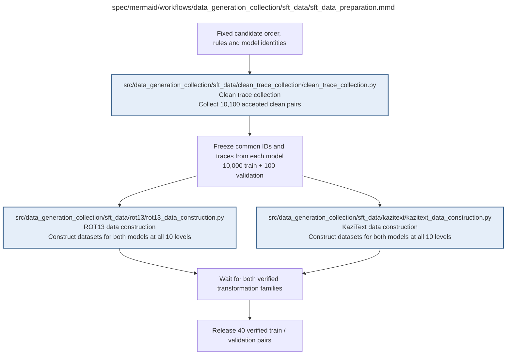

# sft_data_preparation.md

**Owner:** `data_preparation`. **Implementation status:** Implemented and tested with production-count explicit fixtures; scientific datasets await real paired sources.

| Artifact | Exact repository path |
|---|---|
| Implementation | `src/data_generation_collection/sft_data/sft_data_preparation.py` |
| Workflow/support diagram | [`spec/mermaid/workflows/data_generation_collection/sft_data/sft_data_preparation.mmd`](../../../../spec/mermaid/workflows/data_generation_collection/sft_data/sft_data_preparation.mmd) |
| This specification | `docs/modules/data_generation_collection/sft_data/sft_data_preparation.md` |
| Unit test slot | `tests/unit/data_generation_collection/sft_data/test_sft_data_preparation.py` |

**Scientific sources:** 3.1; B.1; C.1–C.2.3; E.2.2–E.2.4; H.2–H.3. [p. 3](../../../../spec/experiment.pdf#page=3) · [p. 18](../../../../spec/experiment.pdf#page=18) · [p. 25](../../../../spec/experiment.pdf#page=25) · [p. 27](../../../../spec/experiment.pdf#page=27) · [p. 30](../../../../spec/experiment.pdf#page=30) · [p. 54](../../../../spec/experiment.pdf#page=54) · [p. 55](../../../../spec/experiment.pdf#page=55) · [p. 69](../../../../spec/experiment.pdf#page=69) · [p. 70](../../../../spec/experiment.pdf#page=70) · [p. 71](../../../../spec/experiment.pdf#page=71).

## Responsibility and controlling details

Freeze the final accepted pool only after both models and every required transformed variant pass. The same 10,000 train IDs and disjoint 100 validation IDs are used across both SFT families and both model sizes, but the two sizes retain different self-generated clean traces. Each of the forty final datasets must refer back to the correct model-specific clean-trace hash. Clean means structurally valid untransformed output, not semantic correctness. Do not generate independent clean targets per family, per level or following unfavorable loss results. Both complete transformation families must verify before the parent releases the dataset handoff.

## Interfaces and dependent procedures

Use the common [artifact contracts](../../../contracts.md), [frozen prompt instructions](../../../prompts.md), [decision ledger](../../../decisions.md) and [validation requirements](../../../validation.md). Typed signatures/serialization are delegated implementation details; their scientific meaning is not. The named owner defines this module with its consumers before dependent integration.

| Source node | Called procedure (exact path) | Specification |
|---|---|---|
| `COLLECT` | `src/data_generation_collection/sft_data/clean_trace_collection/clean_trace_collection.py` | [clean_trace_collection](clean_trace_collection/clean_trace_collection.md) |
| `ROT` | `src/data_generation_collection/sft_data/rot13/rot13_data_construction.py` | [rot13_data_construction](rot13/rot13_data_construction.md) |
| `KAZ` | `src/data_generation_collection/sft_data/kazitext/kazitext_data_construction.py` | [kazitext_data_construction](kazitext/kazitext_data_construction.md) |

## Original procedural constraints

The following source comments retain the procedural detail of the supplied diagram. Obsolete introductory editing instructions and raw link directives are omitted from this list; all links are resolved in the path-synchronized diagram below. Appendix H controls any earlier conflicting language.
- SFT data preparation
- Execution contract: known faults use bounded recovery; unclassified/persistent faults stop the worker.
- Frozen invalid inputs are fatal. Unrecoverable child failures propagate; never release incomplete results.
- SFT data preparation
- Both models use the same IDs; each model contributes its own traces.
- Candidate order / rules are fixed first; accepted IDs are frozen only after collection.
- Every child must return a verified completion; stop propagates to this parent.
- Transformed-data construction
- All levels share the same 10,000 train IDs and separate 100 validation IDs.
- Accepted clean traces are untransformed, structurally valid baseline outputs, not verified correct reasoning.
- Each trace has at least three eligible words; short traces and repeated masks remain eligible.

## Implemented interface and evidence

`prepare_sft_data` joins paired collection and both intervention families. `validate_accepted_pool` requires the exact common 10100 ordered IDs and source/model/tokenizer hashes. `build_sft_record` is the canonical single-record producer, and `build_sft_datasets(pool, tokenizers, output_dir, *, config_hash, kazitext=None, families=(...))` writes and reopens all forty train/validation dataset pairs. `validate_sft_bundle(bundle, pool, *, tokenizers=None, kazitext=None, recompute=False)` traverses actual files, exact counts/IDs, hashes, protected content and optionally recomputes every frozen transform/native rendered token count.

Boundary records are JSON mappings with `example_id`, original `prompt`, transformed `reasoning`, exact `final_answer`, complete native `completion`, `split`, `model`, `model_id`, `method`, `family`, `level`, token counts, immutable source/trace/model/tokenizer/configuration hashes, transformation evidence, `identity` and `simulation`. Dataset descriptors contain `train_path`, `validation_path`, their content hashes and common source identity. Level paths are `family/model/level_XX/{train,validation}.jsonl`.

The intact native-training renderer counts all assistant reasoning plus final bytes at the fixed 4096 total limit. Existing differing frozen files are fatal rather than silently overwritten. Every durable JSONL write/reuse invokes the shared artifact hook. Fixture datasets are explicitly simulation-marked; live readiness requires real traces and exact recomputation.

`prepare_sft_data` propagates optional callback/stop-file controls and returns a truthful paused collection with `datasets=None`, without building partial scientific datasets.

Unit and integration checks use the actual source-record producer, parser, ROT13 algorithm, serializer/readback, shared schemas and SFT consumer. The disk fixture writes/reopens the full forty conditions (404000 records with common 10000/100 splits and distinct model-specific sources); the handoff fixture constructs the complete SFT worklist and rejects altered source finals. External model/noise outputs in these tests are labeled fixtures.

## Completion and failure boundary

Implement and test `src/data_generation_collection/sft_data/sft_data_preparation.py` against its specified behavior in `tests/unit/data_generation_collection/sft_data/test_sft_data_preparation.py`. Validate every emitted artifact and preserve its source/configuration identity. Do not claim completeness from a placeholder or passing import. Propagate required child failures and maintain ordinary model outcomes separately from infrastructure faults. Mandatory real preflights and permission gates remain in force. Unspecified allowed conventions must be documented/frozen before outcomes; new scientific choices are not silently authorized.

## Exact path-synchronized diagram

The following diagram is byte-for-byte the active `.mmd` content at generation time. Its procedural content is from the supplied workflow or the cited PDF support requirement; file labels and role assignment are the requested repository organization.

