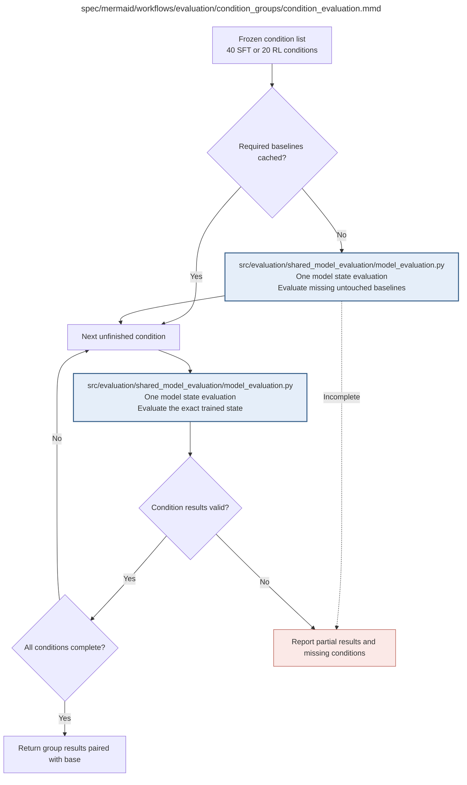

# condition_evaluation.md

**Owner:** `evaluation`. **Implementation status:** blank placeholder, not implemented or tested.

| Artifact | Exact repository path |
|---|---|
| Implementation | `src/evaluation/condition_groups/condition_evaluation.py` |
| Workflow/support diagram | [`spec/mermaid/workflows/evaluation/condition_groups/condition_evaluation.mmd`](../../../../spec/mermaid/workflows/evaluation/condition_groups/condition_evaluation.mmd) |
| This specification | `docs/modules/evaluation/condition_groups/condition_evaluation.md` |
| Unit test slot | `tests/unit/evaluation/condition_groups/test_condition_evaluation.py` |

**Scientific sources:** C.3.6; D.1–D.2; G; H.5–H.6. [p. 35](../../../../spec/experiment.pdf#page=35) · [p. 36](../../../../spec/experiment.pdf#page=36) · [p. 38](../../../../spec/experiment.pdf#page=38) · [p. 41](../../../../spec/experiment.pdf#page=41) · [p. 43](../../../../spec/experiment.pdf#page=43) · [p. 65](../../../../spec/experiment.pdf#page=65) · [p. 67](../../../../spec/experiment.pdf#page=67) · [p. 73](../../../../spec/experiment.pdf#page=73) · [p. 75](../../../../spec/experiment.pdf#page=75) · [p. 76](../../../../spec/experiment.pdf#page=76).

## Responsibility and controlling details

The SFT group contains forty conditions; the RL group contains twenty snapshots. Both require the same two untouched baseline packages with exact matching generation, scoring and all three evaluation-request identities. Coordinate cache ownership so concurrent groups do not regenerate or overwrite bases. Complete missing baseline packages before trained comparisons, but do not claim baseline-only results complete the group.

Evaluate each exact remaining state through the shared model runner. Preserve model/family/level for SFT and model/original checkpoint step for RL. Keep conditions separate rather than accidentally pooling trajectories or model sizes. Failure produces a partial report and explicit missing condition list; never substitute a different snapshot, compare against a mismatched baseline or select only favorable completed states.

## Interfaces and dependent procedures

Use the common [artifact contracts](../../../contracts.md), [frozen prompt instructions](../../../prompts.md), [decision ledger](../../../decisions.md) and [validation requirements](../../../validation.md). Typed signatures/serialization are delegated implementation details; their scientific meaning is not. The named owner defines this module with its consumers before dependent integration.

| Source node | Called procedure (exact path) | Specification |
|---|---|---|
| `MAKEBASE` | `src/evaluation/shared_model_evaluation/model_evaluation.py` | [model_evaluation](../shared_model_evaluation/model_evaluation.md) |
| `MODEL` | `src/evaluation/shared_model_evaluation/model_evaluation.py` | [model_evaluation](../shared_model_evaluation/model_evaluation.md) |

## Original procedural constraints

The following source comments retain the procedural detail of the supplied diagram. Obsolete introductory editing instructions and raw link directives are omitted from this list; all links are resolved in the path-synchronized diagram below. Appendix H controls any earlier conflicting language.
- Condition group evaluation
- Execution contract: known faults use bounded recovery; unclassified/persistent faults stop the worker.
- Frozen invalid inputs are fatal. Unrecoverable child failures propagate; never release incomplete results.
- SFT evaluation
- Generate absent baselines before trained comparisons; reuse only exact valid matching packages.
- SFT and RL share the same two base results and the same procedure; coordinate concurrent requests to avoid duplicate baseline generation.
- Cross-domain transfer is assessed within domain-specific capability and legibility results.
- RL evaluation
- Both groups require the same two verified base packages. MAKEBASE invokes the shared procedure for each missing base.
- A missing or invalid baseline package is completed before trained comparisons; baseline-only results never complete a condition.
- Preserve grouping fields: SFT model/family/level; RL model/checkpoint step. Reports never pool them by accident.
- Required baseline packages include the same two illegibility scores and separate GPT4o audit as trained packages.
- Missing or uncertain required baseline evidence cannot be interpreted as zero qualifying opacity.

## Completion and failure boundary

Implement and test `src/evaluation/condition_groups/condition_evaluation.py` against its specified behavior in `tests/unit/evaluation/condition_groups/test_condition_evaluation.py`. Validate every emitted artifact and preserve its source/configuration identity. Do not claim completeness from a placeholder or passing import. Propagate required child failures and maintain ordinary model outcomes separately from infrastructure faults. Mandatory real preflights and permission gates remain in force. Unspecified allowed conventions must be documented/frozen before outcomes; new scientific choices are not silently authorized.

## Exact path-synchronized diagram

The following diagram is byte-for-byte the active `.mmd` content at generation time. Its procedural content is from the supplied workflow or the cited PDF support requirement; file labels and role assignment are the requested repository organization.

