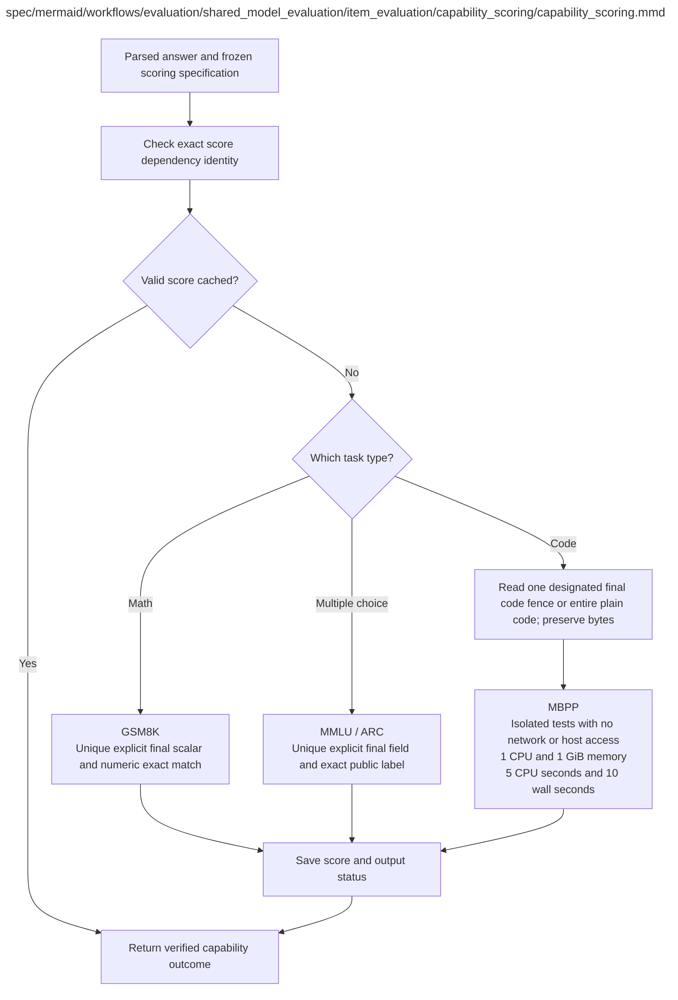

# capability_scoring.md

**Owner:** `evaluation`. **Implementation status:** implemented; unit/integration verification and remaining live gates are recorded below.

| Artifact | Exact repository path |
|---|---|
| Implementation | `src/evaluation/shared_model_evaluation/item_evaluation/capability_scoring/capability_scoring.py` |
| Workflow/support diagram | [`spec/mermaid/workflows/evaluation/shared_model_evaluation/item_evaluation/capability_scoring/capability_scoring.mmd`](../../../../../../spec/mermaid/workflows/evaluation/shared_model_evaluation/item_evaluation/capability_scoring/capability_scoring.mmd) |
| This specification | `docs/modules/evaluation/shared_model_evaluation/item_evaluation/capability_scoring/capability_scoring.md` |
| Unit test slot | `tests/unit/evaluation/shared_model_evaluation/item_evaluation/capability_scoring/test_capability_scoring.py` |

**Scientific sources:** D.1.2; E.2.3,E.2.7; H.4. [p. 5](../../../../../../spec/experiment.pdf#page=5) · [p. 40](../../../../../../spec/experiment.pdf#page=40) · [p. 41](../../../../../../spec/experiment.pdf#page=41) · [p. 55](../../../../../../spec/experiment.pdf#page=55) · [p. 57](../../../../../../spec/experiment.pdf#page=57) · [p. 72](../../../../../../spec/experiment.pdf#page=72).

## Implemented public interface and validation

`score_capability(item, parsed, *, sandbox=None, raw_hash=None)` applies versioned exact numeric/choice rules to a unique explicit final field and reads one designated Python code fence or the entire unfenced final response for MBPP. The [final-field repair](../../../../../final_field_scoring.md) retains the original failed report and original generation identities; it accepts preceding scalar explanation and prose outside a single code fence while rejecting ambiguous fields. It does not infer answers from reasoning or repair code. MBPP receives approved public entrypoint names and unchanged hidden setup/tests only after generation. Resource/task failures are observed incorrect outputs; broken or unsupported executor operations produce `correct=None` with an infrastructure status. Raw/parser/scorer/reference dependencies remain recorded.

Owned unit and cross-owner fixture checks are recorded in the [evaluation validation receipt](../../../../../evidence/evaluation_validation.json). Actual restricted execution evidence is recorded in the [MBPP sandbox check](../../../../../evidence/mbpp_sandbox_check.json). Fixture checks are not scientific outcomes. Native CUDA generation, live pinned judge compatibility, baseline repeatability, statistical validation, and durable cloud storage remain launch gates until their actual reports pass.

The actual current executor passed the original suites for all 427 sanitized MBPP reference tasks, including the exact selected 203. The [full reference receipt](../../../../../evidence/mbpp_reference_tests.json) preserves per-task identities and outcomes; the [isolation receipt](../../../../../evidence/mbpp_isolation_checks.json) separately verifies the restricted supervisor/worker boundary. This certifies reference scoring infrastructure and does not claim generated-model accuracy.

## Responsibility and controlling details

Use the domain's frozen answer extraction/scoring rule and exact cache dependency identity: raw output hash, parser/scorer version and reference/test version. GSM8K uses normalized numeric exact match; MMLU/ARC use choice-label exact match. Missing or malformed final answers follow the source's unsuccessful-outcome rule rather than being inferred from reasoning.

MBPP extracts the designated final code field, removes at most one surrounding Python fence and otherwise executes exact content. No indentation fixes, renaming, missing-code insertion or final-answer fallback from reasoning. Execute against original withheld tests in the isolated sandbox with one CPU, one GiB, five CPU seconds and ten wall seconds. Syntax/test/task-defined resource failures are unsuccessful model outcomes. A broken executor is infrastructure failure and cannot be silently marked incorrect. Code correctness is execution-based pass@1, not LLM judging or a safety guarantee.

## Interfaces and dependent procedures

Use the common [artifact contracts](../../../../../contracts.md), [frozen prompt instructions](../../../../../prompts.md), [decision ledger](../../../../../decisions.md) and [validation requirements](../../../../../validation.md). Typed signatures/serialization are delegated implementation details; their scientific meaning is not. The named owner defines this module with its consumers before dependent integration.

No separate child procedure is declared in this diagram. This does not exempt shared recovery, storage, provenance or validation contracts.

## Original procedural constraints

The following source comments retain the procedural detail of the supplied diagram. Obsolete introductory editing instructions and raw link directives are omitted from this list; all links are resolved in the path-synchronized diagram below. Appendix H controls any earlier conflicting language.
- Capability scoring
- Missing / malformed answers follow the frozen scoring policy; preserve these outcomes.
- MBPP wrong code, test failures or task-defined timeouts are outcomes; broken sandbox is infrastructure failure.
- Score dependency identity includes raw hash, parser/scorer and reference/test versions.
- Known infrastructure failures use bounded recovery; exhausted failures return incomplete, not incorrect.
- MBPP uses task plus the frozen public interface, with scoring tests and reference implementations withheld from generation.
- Extract the designated final code field; optionally remove one surrounding Python code fence only.
- Execute exactly that code. Never repair indentation, rename functions or insert missing code.
- Syntax errors, failing tests and task-defined timeouts are unsuccessful model outcomes; broken executor is infrastructure failure.
- No test feedback or repair loop. Report this project-specific withheld-test MBPP variant explicitly.

## Completion and failure boundary

Implement and test `src/evaluation/shared_model_evaluation/item_evaluation/capability_scoring/capability_scoring.py` against its specified behavior in `tests/unit/evaluation/shared_model_evaluation/item_evaluation/capability_scoring/test_capability_scoring.py`. Validate every emitted artifact and preserve its source/configuration identity. Do not claim completeness from a placeholder or passing import. Propagate required child failures and maintain ordinary model outcomes separately from infrastructure faults. Mandatory real preflights and permission gates remain in force. Unspecified allowed conventions must be documented/frozen before outcomes; new scientific choices are not silently authorized.

## Exact path-synchronized diagram

The following diagram is byte-for-byte the active `.mmd` content at generation time. Its procedural content is from the supplied workflow or the cited PDF support requirement; file labels and role assignment are the requested repository organization.

