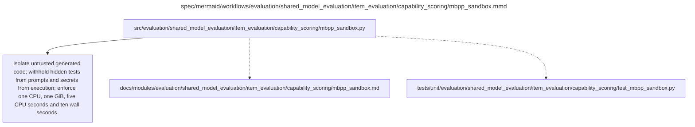

# mbpp_sandbox.md

**Owner:** `evaluation`. **Implementation status:** blank placeholder, not implemented or tested.

| Artifact | Exact repository path |
|---|---|
| Implementation | `src/evaluation/shared_model_evaluation/item_evaluation/capability_scoring/mbpp_sandbox.py` |
| Workflow/support diagram | [`spec/mermaid/workflows/evaluation/shared_model_evaluation/item_evaluation/capability_scoring/mbpp_sandbox.mmd`](../../../../../../spec/mermaid/workflows/evaluation/shared_model_evaluation/item_evaluation/capability_scoring/mbpp_sandbox.mmd) |
| This specification | `docs/modules/evaluation/shared_model_evaluation/item_evaluation/capability_scoring/mbpp_sandbox.md` |
| Unit test slot | `tests/unit/evaluation/shared_model_evaluation/item_evaluation/capability_scoring/test_mbpp_sandbox.py` |

**Scientific sources:** D.1.2; E.2.7; H.4. [p. 41](../../../../../../spec/experiment.pdf#page=41) · [p. 57](../../../../../../spec/experiment.pdf#page=57) · [p. 72](../../../../../../spec/experiment.pdf#page=72).

## Responsibility and controlling details

Implement the source-required separate disposable executor, not code execution in the trainer, judge service or privileged host. Enforce no outbound network, least privilege, read-only allowed inputs and no access to host secrets/training artifacts. Limits are one CPU, one GiB memory, five CPU seconds and ten wall seconds. Use only the original hidden scoring tests for functional correctness; do not expose tests or their outputs to the generating model for repairs.

Verify reference tests and interface extraction before evaluation. Do not modify generated solutions, inject missing algorithms or fix interfaces after generation. Differentiate syntax/failing assertions/task-defined timeouts from failure of the executor itself. Record resource and infrastructure statuses with test/scorer/raw-output identity. A normal subprocess timeout on a privileged trainer host is explicitly insufficient isolation. Sandbox correctness must be tested in the real deployment, not inferred from a blank file's existence.

## Interfaces and dependent procedures

Use the common [artifact contracts](../../../../../contracts.md), [frozen prompt instructions](../../../../../prompts.md), [decision ledger](../../../../../decisions.md) and [validation requirements](../../../../../validation.md). Typed signatures/serialization are delegated implementation details; their scientific meaning is not. The named owner defines this module with its consumers before dependent integration.

No separate child procedure is declared in this diagram. This does not exempt shared recovery, storage, provenance or validation contracts.

## Completion and failure boundary

Implement and test `src/evaluation/shared_model_evaluation/item_evaluation/capability_scoring/mbpp_sandbox.py` against its specified behavior in `tests/unit/evaluation/shared_model_evaluation/item_evaluation/capability_scoring/test_mbpp_sandbox.py`. Validate every emitted artifact and preserve its source/configuration identity. Do not claim completeness from a placeholder or passing import. Propagate required child failures and maintain ordinary model outcomes separately from infrastructure faults. Mandatory real preflights and permission gates remain in force. Unspecified allowed conventions must be documented/frozen before outcomes; new scientific choices are not silently authorized.

## Exact path-synchronized diagram

The following diagram is byte-for-byte the active `.mmd` content at generation time. Its procedural content is from the supplied workflow or the cited PDF support requirement; file labels and role assignment are the requested repository organization.

