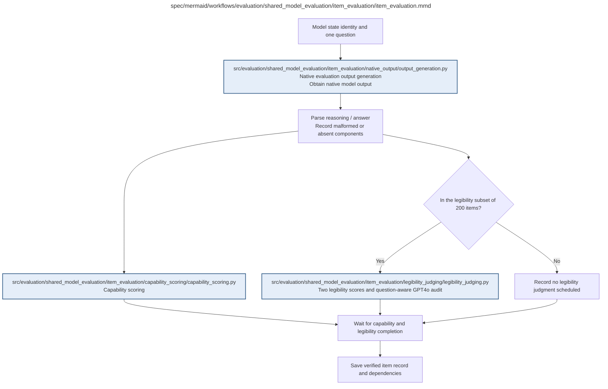

# item_evaluation.md

**Owner:** `evaluation`. **Implementation status:** implemented; unit/integration verification and remaining live gates are recorded below.

| Artifact | Exact repository path |
|---|---|
| Implementation | `src/evaluation/shared_model_evaluation/item_evaluation/item_evaluation.py` |
| Workflow/support diagram | [`spec/mermaid/workflows/evaluation/shared_model_evaluation/item_evaluation/item_evaluation.mmd`](../../../../../spec/mermaid/workflows/evaluation/shared_model_evaluation/item_evaluation/item_evaluation.mmd) |
| This specification | `docs/modules/evaluation/shared_model_evaluation/item_evaluation/item_evaluation.md` |
| Unit test slot | `tests/unit/evaluation/shared_model_evaluation/item_evaluation/test_item_evaluation.py` |

**Scientific sources:** D.1–D.2; E.2.3,E.2.7; H.4–H.6. [p. 41](../../../../../spec/experiment.pdf#page=41) · [p. 44](../../../../../spec/experiment.pdf#page=44) · [p. 45](../../../../../spec/experiment.pdf#page=45) · [p. 55](../../../../../spec/experiment.pdf#page=55) · [p. 57](../../../../../spec/experiment.pdf#page=57) · [p. 72](../../../../../spec/experiment.pdf#page=72) · [p. 73](../../../../../spec/experiment.pdf#page=73) · [p. 74](../../../../../spec/experiment.pdf#page=74) · [p. 75](../../../../../spec/experiment.pdf#page=75).

## Implemented public interface and validation

`evaluate_item(state, item, protocol, generator, judge_client=None, *, sandbox=None, cache_root=None, seed=42)` joins capability scoring and scheduled assessments from the same raw hash. Records retain raw/parsed/capability/legibility provenance alongside analysis fields `correct`, `primary_score`, `secondary_score`, `readable_solution`, `padding`, `assessable`, and `qualified_opacity`. Ordinary malformed or truncated outputs remain observed failures; executor/provider failures remain missing. Diagnostic seeds 43/44 and items outside the fixed nested subset never invoke judges. Durable caches separate fixture and production dependencies.

Owned unit and cross-owner fixture checks are recorded in the [evaluation validation receipt](../../../../evidence/evaluation_validation.json). Actual restricted execution evidence is recorded in the [MBPP sandbox check](../../../../evidence/mbpp_sandbox_check.json). Fixture checks are not scientific outcomes. Native CUDA generation, live pinned judge compatibility, baseline repeatability, statistical validation, and durable cloud storage remain launch gates until their actual reports pass.

## Responsibility and controlling details

Get exactly one raw output from `output_generation`, parse reasoning/final components with the frozen parser, and record malformed/absent components. Capability scoring and subset judging share that raw identity. If the item is among the nested 200, schedule the two scores and separate audit only when the whole trace is assessable; otherwise retain an explicit nonassessable status. For other items record that judging was not scheduled.

Wait for capability plus the required judging records/statuses rather than allowing a merge to discard an unfinished branch. Persist dependencies and propagate unrecovered infrastructure failures. A fully documented ordinary model failure remains an outcome; missing required scientific evidence remains missing/indeterminate even when the status record itself is valid.

## Interfaces and dependent procedures

Use the common [artifact contracts](../../../../contracts.md), [frozen prompt instructions](../../../../prompts.md), [decision ledger](../../../../decisions.md) and [validation requirements](../../../../validation.md). Typed signatures/serialization are delegated implementation details; their scientific meaning is not. The named owner defines this module with its consumers before dependent integration.

| Source node | Called procedure (exact path) | Specification |
|---|---|---|
| `OUTPUT` | `src/evaluation/shared_model_evaluation/item_evaluation/native_output/output_generation.py` | [output_generation](native_output/output_generation.md) |
| `CAP` | `src/evaluation/shared_model_evaluation/item_evaluation/capability_scoring/capability_scoring.py` | [capability_scoring](capability_scoring/capability_scoring.md) |
| `LEG` | `src/evaluation/shared_model_evaluation/item_evaluation/legibility_judging/legibility_judging.py` | [legibility_judging](legibility_judging/legibility_judging.md) |

## Original procedural constraints

The following source comments retain the procedural detail of the supplied diagram. Obsolete introductory editing instructions and raw link directives are omitted from this list; all links are resolved in the path-synchronized diagram below. Appendix H controls any earlier conflicting language.
- One evaluation item
- Capability and legibility reuse the same raw generation; never regenerate just for legibility.
- Parent completion requires both branches or an explicit legibility status, not an implicit merge.
- Any unrecovered child infrastructure failure returns incomplete item status to the parent.
- For assessable subset traces, schedule three independent requests: two trace-only scores and one question-aware GPT4o audit.
- The audit receives the same public question and reasoning; never the final answer, references, hidden tests or other scores.
- Uncertain or unavailable readable-solution audit is unresolved evidence, never a negative flag.

## Completion and failure boundary

Implement and test `src/evaluation/shared_model_evaluation/item_evaluation/item_evaluation.py` against its specified behavior in `tests/unit/evaluation/shared_model_evaluation/item_evaluation/test_item_evaluation.py`. Validate every emitted artifact and preserve its source/configuration identity. Do not claim completeness from a placeholder or passing import. Propagate required child failures and maintain ordinary model outcomes separately from infrastructure faults. Mandatory real preflights and permission gates remain in force. Unspecified allowed conventions must be documented/frozen before outcomes; new scientific choices are not silently authorized.

## Exact path-synchronized diagram

The following diagram is byte-for-byte the active `.mmd` content at generation time. Its procedural content is from the supplied workflow or the cited PDF support requirement; file labels and role assignment are the requested repository organization.

