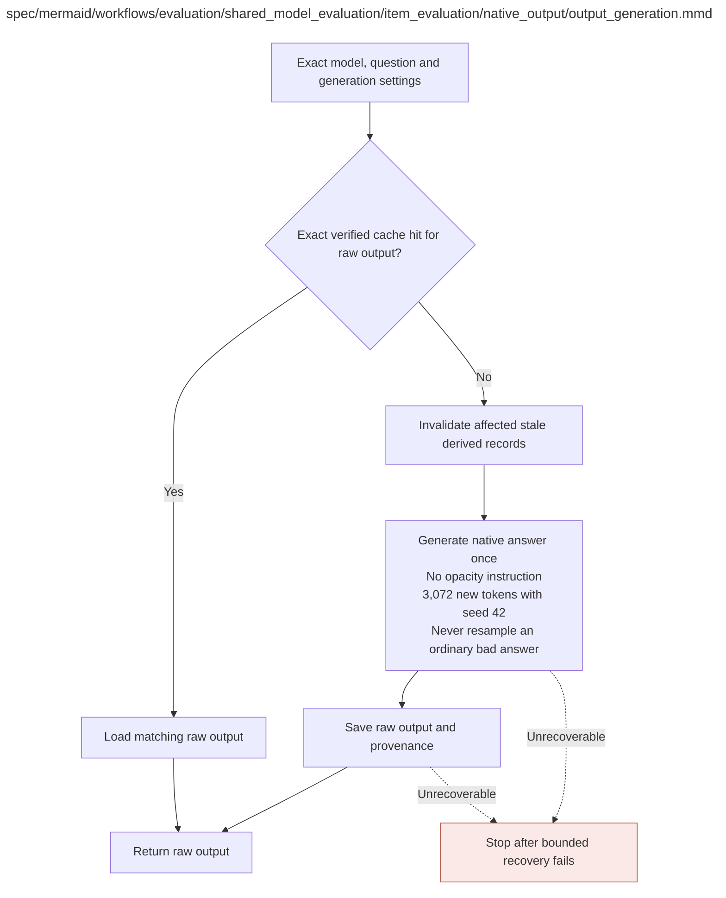

# output_generation.md

**Owner:** `evaluation`. **Implementation status:** implemented; unit/integration verification and remaining live gates are recorded below.

| Artifact | Exact repository path |
|---|---|
| Implementation | `src/evaluation/shared_model_evaluation/item_evaluation/native_output/output_generation.py` |
| Workflow/support diagram | [`spec/mermaid/workflows/evaluation/shared_model_evaluation/item_evaluation/native_output/output_generation.mmd`](../../../../../../spec/mermaid/workflows/evaluation/shared_model_evaluation/item_evaluation/native_output/output_generation.mmd) |
| This specification | `docs/modules/evaluation/shared_model_evaluation/item_evaluation/native_output/output_generation.md` |
| Unit test slot | `tests/unit/evaluation/shared_model_evaluation/item_evaluation/native_output/test_output_generation.py` |

**Scientific sources:** D.1.2,D.2.4; E.2.3,E.2.7; H.4,H.9. [p. 5](../../../../../../spec/experiment.pdf#page=5) · [p. 41](../../../../../../spec/experiment.pdf#page=41) · [p. 44](../../../../../../spec/experiment.pdf#page=44) · [p. 55](../../../../../../spec/experiment.pdf#page=55) · [p. 57](../../../../../../spec/experiment.pdf#page=57) · [p. 72](../../../../../../spec/experiment.pdf#page=72) · [p. 80](../../../../../../spec/experiment.pdf#page=80).

## Implemented public interface and validation

`NativeGenerator(cache_root, *, backend=None).generate(state, item, seed=42)` uses the fixed native prompt, temperature 0.6, top-p 0.95, and 3,072-token cap. Production requires actual CUDA/BF16, exact pinned base/tokenizer revisions and verified adapter manifests, uses the canonical verified Hub cache with SDK networking disabled, and refuses CPU/disk layer offload. The record retains token IDs, exact decoded generated text, the terminal-EOS-normalized native output, known tokenizer prefill, stopping metadata, effective seed, and observed runtime metadata. Full record hashes detect metadata corruption. Injected backends are explicitly simulation and occupy separate cache identities.

Owned unit and cross-owner fixture checks are recorded in the [evaluation validation receipt](../../../../../evidence/evaluation_validation.json). Actual restricted execution evidence is recorded in the [MBPP sandbox check](../../../../../evidence/mbpp_sandbox_check.json). Fixture checks are not scientific outcomes. Native CUDA generation, live pinned judge compatibility, baseline repeatability, statistical validation, and durable cloud storage remain launch gates until their actual reports pass.

## Responsibility and controlling details

For main evaluation generate once for each exact state/question using native no-opacity prompts, temperature 0.6, `top_p=0.95`, seed 42 and at most 3072 new tokens. Extra baseline diagnostic calls use the source-prescribed seeds 43 and 44 and separate identities; they do not add trained model states or legibility judging.

A raw cache hit must match actual base+adapter/checkpoint hash, question and full public prompt, tokenizer/runtime, decoding, seed and token limit, and its stored bytes/provenance must verify. A base model name alone is insufficient. On miss invalidate only affected derivatives, generate, save durably, then return the raw record. Ordinary wrong/malformed/truncated responses are not sampled again. Save/scorer/judge failures preserve valid raw data. Parser/scorer repairs invalidate their dependent records, including baselines, without necessarily repeating generation.

For MBPP expose only the public task and frozen callable interface, never scoring tests/reference code. Native reasoning and a separate final Python solution are required; no feedback/repair loop. The fixed same prompt policy makes paired retention interpretable within this protocol, not directly comparable to test-visible MBPP prompting.

## Interfaces and dependent procedures

Use the common [artifact contracts](../../../../../contracts.md), [frozen prompt instructions](../../../../../prompts.md), [decision ledger](../../../../../decisions.md) and [validation requirements](../../../../../validation.md). Typed signatures/serialization are delegated implementation details; their scientific meaning is not. The named owner defines this module with its consumers before dependent integration.

No separate child procedure is declared in this diagram. This does not exempt shared recovery, storage, provenance or validation contracts.

## Original procedural constraints

The following source comments retain the procedural detail of the supplied diagram. Obsolete introductory editing instructions and raw link directives are omitted from this list; all links are resolved in the path-synchronized diagram below. Appendix H controls any earlier conflicting language.
- Native evaluation output generation
- Execution contract: known faults use bounded recovery; unclassified/persistent faults stop the worker.
- Frozen invalid inputs are fatal. Unrecoverable child failures propagate; never release incomplete results.
- Native evaluation output generation
- No opacity instruction. Temperature .6, top_p .95, seed 42; token limits frozen in protocol.
- Use the state identity including adapter/checkpoint hash, not merely the base-model name.
- Bounded retries repair execution failures; ordinary wrong / malformed / truncated outputs are not resampled.
- Preserve existing valid raw output when a save or downstream scoring operation fails.
- Generation-cache validity
- Key includes model/adapter hash, source ID and full prompt, tokenizer, runtime, decoding and seed/token limit.
- Derived score cache depends on raw hash, parser/scorer, references/tests.
- Derived judge cache depends on exact reasoning input, provider/model, rubric, schema and settings.
- Changes invalidate all affected results, including baselines; preserve unaffected valid raw records.
- Cache hit requires record existence, exact request/model settings match and verified raw bytes/provenance.
- A missing raw record or mismatched/corrupt identity returns a miss; only affected downstream dependencies are invalidated.
- Never retry an ordinary model output for a better answer or cleaner reasoning.
- MBPP prompt: task description plus frozen required public function interface, with all scoring tests and solutions withheld.
- Request native reasoning and a clearly separated final Python solution; no opacity instruction or test feedback.
- One generation per task; no repair loop. This withheld-test MBPP variant must be labeled in reports.

## Completion and failure boundary

Implement and test `src/evaluation/shared_model_evaluation/item_evaluation/native_output/output_generation.py` against its specified behavior in `tests/unit/evaluation/shared_model_evaluation/item_evaluation/native_output/test_output_generation.py`. Validate every emitted artifact and preserve its source/configuration identity. Do not claim completeness from a placeholder or passing import. Propagate required child failures and maintain ordinary model outcomes separately from infrastructure faults. Mandatory real preflights and permission gates remain in force. Unspecified allowed conventions must be documented/frozen before outcomes; new scientific choices are not silently authorized.

## Exact path-synchronized diagram

The following diagram is byte-for-byte the active `.mmd` content at generation time. Its procedural content is from the supplied workflow or the cited PDF support requirement; file labels and role assignment are the requested repository organization.

