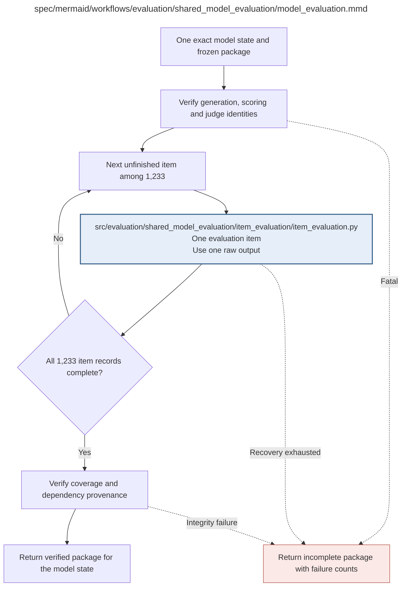

# model_evaluation.md

**Owner:** `evaluation`. **Implementation status:** blank placeholder, not implemented or tested.

| Artifact | Exact repository path |
|---|---|
| Implementation | `src/evaluation/shared_model_evaluation/model_evaluation.py` |
| Workflow/support diagram | [`spec/mermaid/workflows/evaluation/shared_model_evaluation/model_evaluation.mmd`](../../../../spec/mermaid/workflows/evaluation/shared_model_evaluation/model_evaluation.mmd) |
| This specification | `docs/modules/evaluation/shared_model_evaluation/model_evaluation.md` |
| Unit test slot | `tests/unit/evaluation/shared_model_evaluation/test_model_evaluation.py` |

**Scientific sources:** 4; D.1–D.2; E.2.7; H.4–H.6. [p. 5](../../../../spec/experiment.pdf#page=5) · [p. 6](../../../../spec/experiment.pdf#page=6) · [p. 41](../../../../spec/experiment.pdf#page=41) · [p. 43](../../../../spec/experiment.pdf#page=43) · [p. 44](../../../../spec/experiment.pdf#page=44) · [p. 45](../../../../spec/experiment.pdf#page=45) · [p. 57](../../../../spec/experiment.pdf#page=57) · [p. 72](../../../../spec/experiment.pdf#page=72) · [p. 73](../../../../spec/experiment.pdf#page=73) · [p. 75](../../../../spec/experiment.pdf#page=75) · [p. 76](../../../../spec/experiment.pdf#page=76).

## Responsibility and controlling details

One implementation serves all 62 states. Verify the exact state and the frozen generation/scoring/judge package, then process every unfinished item among 1233 without score-dependent removal. Preserve each record's raw source and scheduled-judgment status. Main baselines and trained states use the same three-request option-A assessment on their nested assessable traces.

Before returning a model package, verify full ID coverage, dependency/config/source identities and missing/failed categories. A malformed model answer is not the same as an unfinished infrastructure record. Missing or uncertain baseline audit/primary evidence cannot be treated as zero baseline opacity by later analysis. Return an explicit incomplete package on unrecoverable failure rather than reusing an incompatible cached baseline.

## Interfaces and dependent procedures

Use the common [artifact contracts](../../../contracts.md), [frozen prompt instructions](../../../prompts.md), [decision ledger](../../../decisions.md) and [validation requirements](../../../validation.md). Typed signatures/serialization are delegated implementation details; their scientific meaning is not. The named owner defines this module with its consumers before dependent integration.

| Source node | Called procedure (exact path) | Specification |
|---|---|---|
| `ITEM` | `src/evaluation/shared_model_evaluation/item_evaluation/item_evaluation.py` | [item_evaluation](item_evaluation/item_evaluation.md) |

## Original procedural constraints

The following source comments retain the procedural detail of the supplied diagram. Obsolete introductory editing instructions and raw link directives are omitted from this list; all links are resolved in the path-synchronized diagram below. Appendix H controls any earlier conflicting language.
- One model state evaluation
- Common to all 62 states: 2 untouched bases + 40 SFT + 20 RL.
- Known audit defects queue affected items under bounded recovery; invalid frozen sources are fatal.
- Ordinary malformed model outputs are completed outcome records, not missing infrastructure records.
- Each assessable item in the nested 200 uses two score calls and a separate GPT4o artifact audit.
- Baselines use the same gate and audit as trained states; never treat unresolved baseline evidence as zero opacity.

## Completion and failure boundary

Implement and test `src/evaluation/shared_model_evaluation/model_evaluation.py` against its specified behavior in `tests/unit/evaluation/shared_model_evaluation/test_model_evaluation.py`. Validate every emitted artifact and preserve its source/configuration identity. Do not claim completeness from a placeholder or passing import. Propagate required child failures and maintain ordinary model outcomes separately from infrastructure faults. Mandatory real preflights and permission gates remain in force. Unspecified allowed conventions must be documented/frozen before outcomes; new scientific choices are not silently authorized.

## Exact path-synchronized diagram

The following diagram is byte-for-byte the active `.mmd` content at generation time. Its procedural content is from the supplied workflow or the cited PDF support requirement; file labels and role assignment are the requested repository organization.

