# experiment_overview.md

**Owner:** `coordinator`. **Implementation status:** blank placeholder, not implemented or tested.

| Artifact | Exact repository path |
|---|---|
| Implementation | `src/experiment_overview/experiment_overview.py` |
| Workflow/support diagram | [`spec/mermaid/workflows/experiment_overview/experiment_overview.mmd`](../../../spec/mermaid/workflows/experiment_overview/experiment_overview.mmd) |
| This specification | `docs/modules/experiment_overview/experiment_overview.md` |
| Unit test slot | `tests/unit/experiment_overview/test_experiment_overview.py` |

**Scientific sources:** Sections 1–5; E.1–E.2; G.1; H.1,H.9. [p. 2](../../../spec/experiment.pdf#page=2) · [p. 3](../../../spec/experiment.pdf#page=3) · [p. 49](../../../spec/experiment.pdf#page=49) · [p. 54](../../../spec/experiment.pdf#page=54) · [p. 65](../../../spec/experiment.pdf#page=65) · [p. 68](../../../spec/experiment.pdf#page=68) · [p. 80](../../../spec/experiment.pdf#page=80).

## Responsibility and controlling details

The first-stage program includes data construction, SFT, RL, native evaluation, criteria analysis, durable storage, scheduling, cost accounting and recovery. It must export checkpoints and records for later activation-monitoring work; downstream probes and their integration are not part of this scope. Enforce PDF H.1 precedence and H.9 authority.

The phase overview does not override mandatory pre-training measurement and engineering preflights. Coordinate freezing manifests, real baseline-repeatability checks, exact loss/mask/gradient checks, provider/sandbox/storage integration and prospective statistical validation before affected launches. Do not postpone those gates merely because the overview arrow puts the main evaluation phase after training.

Enumerate exactly forty independent SFT fits and two independent RL trajectories, yielding forty final SFT adapters, twenty scheduled RL snapshots and two base identities. Maintain one shared evaluation implementation and matching base caches. Three concurrent GPU queues are runtime organization, not the required number of coding subagents. Release each GPU after its own work ends; record partial failure without fabricating remaining artifacts.

## Interfaces and dependent procedures

Use the common [artifact contracts](../../contracts.md), [frozen prompt instructions](../../prompts.md), [decision ledger](../../decisions.md) and [validation requirements](../../validation.md). Typed signatures/serialization are delegated implementation details; their scientific meaning is not. The named owner defines this module with its consumers before dependent integration.

| Source node | Called procedure (exact path) | Specification |
|---|---|---|
| `DATA` | `src/data_generation_collection/data_generation.py` | [data_generation](../data_generation_collection/data_generation.md) |
| `TRAIN` | `src/training/training.py` | [training](../training/training.md) |
| `EVAL` | `src/evaluation/evaluation.py` | [evaluation](../evaluation/evaluation.md) |

## Original procedural constraints

The following source comments retain the procedural detail of the supplied diagram. Obsolete introductory editing instructions and raw link directives are omitted from this list; all links are resolved in the path-synchronized diagram below. Appendix H controls any earlier conflicting language.
- Experiment overview
- The accompanying revised PDF Appendix H resolves earlier conflicts and freezes the supplied decisions.
- Technical conventions may be selected, documented, tested and frozen before trained outcomes.
- The fixed scientific design may not change; failed mandatory preflight blocks the affected launch.

## Completion and failure boundary

Implement and test `src/experiment_overview/experiment_overview.py` against its specified behavior in `tests/unit/experiment_overview/test_experiment_overview.py`. Validate every emitted artifact and preserve its source/configuration identity. Do not claim completeness from a placeholder or passing import. Propagate required child failures and maintain ordinary model outcomes separately from infrastructure faults. Mandatory real preflights and permission gates remain in force. Unspecified allowed conventions must be documented/frozen before outcomes; new scientific choices are not silently authorized.

## Exact path-synchronized diagram

The following diagram is byte-for-byte the active `.mmd` content at generation time. Its procedural content is from the supplied workflow or the cited PDF support requirement; file labels and role assignment are the requested repository organization.

```mermaid
---
title: "spec/mermaid/workflows/experiment_overview/experiment_overview.mmd"
---
flowchart LR
%% Experiment overview
%% Edit quoted node labels directly; this is native Mermaid source.
%% Entry point for the complete diagram hierarchy. See ../../readme.md for module division guidance.
%% The accompanying revised PDF Appendix H resolves earlier conflicts and freezes the supplied decisions.
%% Technical conventions may be selected, documented, tested and frozen before trained outcomes.
%% The fixed scientific design may not change; failed mandatory preflight blocks the affected launch.
%% Contract: ../shared_procedures/recovery_procedure.mmd applies to execution failures.
%% Child: DATA => ../data_generation_collection/data_generation.mmd
%% Child: TRAIN => ../training/training.mmd
%% Child: EVAL => ../evaluation/evaluation.mmd
    DATA["src/data_generation_collection/data_generation.py<br/>Data generation/collection"]
    TRAIN["src/training/training.py<br/>Training"]
    EVAL["src/evaluation/evaluation.py<br/>Evaluation"]
    DATA --> TRAIN --> EVAL
    classDef detail fill:#e5eef9,stroke:#365f8a,stroke-width:2px
    class DATA,TRAIN,EVAL detail

%% Repository module: src/experiment_overview/experiment_overview.py
%% Module documentation: docs/modules/experiment_overview/experiment_overview.md
%% Unit test: tests/unit/experiment_overview/test_experiment_overview.py
%% Owner: coordinator
%% Source sections: Sections 1–5; E.1–E.2; G.1; H.1,H.9
```

