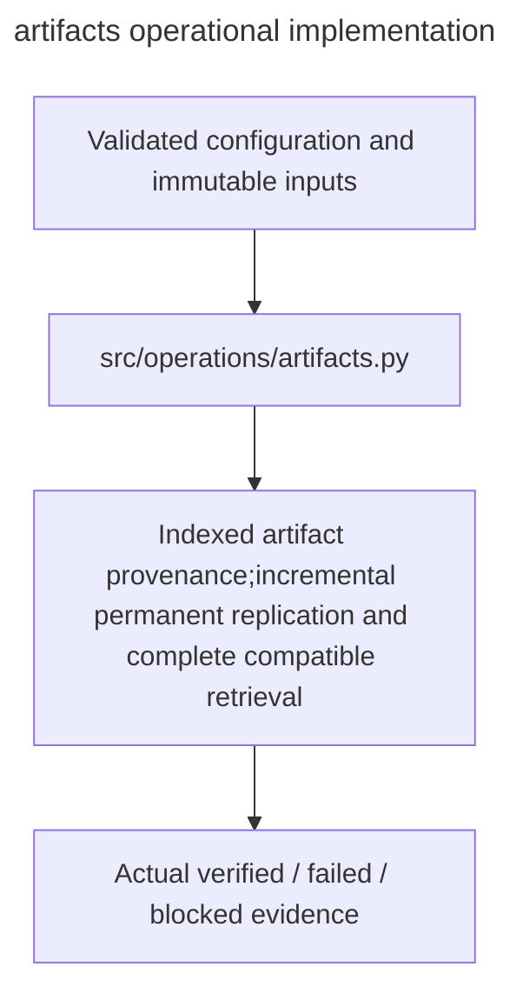

# artifacts

Owner:coordinator. Source:the user implementation assignment and PDF E/H operational requirements.

Indexed artifact provenance,incremental permanent replication and complete compatible retrieval.

Public interfaces:`ArtifactService.register/list_artifacts/sync_artifacts/retrieve_checkpoint`.

Implementation:[artifacts.py](../../../src/operations/artifacts.py). Verification:[operations tests](../../../tests/unit/operations/test_operations.py). Deployment:[runbook](../../runbook.md). Local fixtures verify failure and integrity behavior; actual OAuth,provider,GPU,cloud lifetime and full experiment checks remain separately gated.

