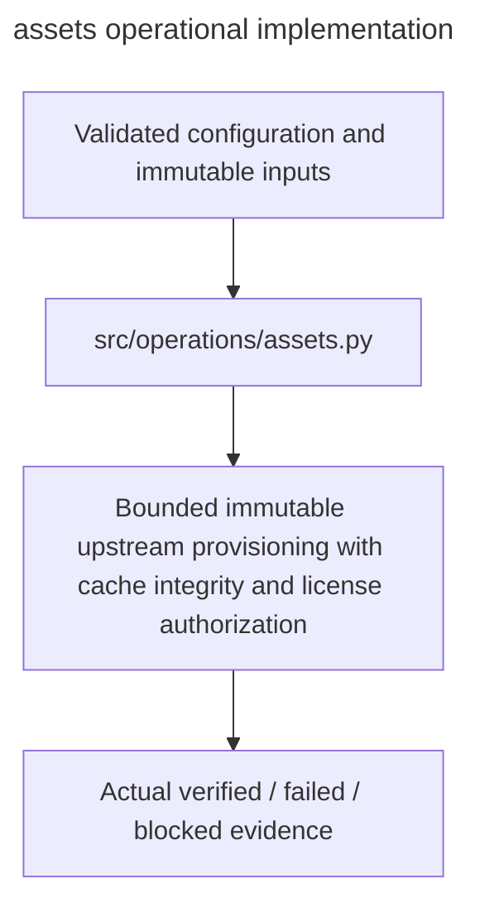

# assets

Owner:coordinator; bounded cache implementation delegated to `sft`. Source:the user implementation assignment and PDF E/H operational requirements.

Bounded immutable upstream provisioning with cache integrity and license authorization.

Public interfaces: `assets_from_configuration(config)`, `resolve_revision(asset, api=None, *, cache_root=None)`, `provision_asset(asset, cache_root, *, authorization=None, offline=False, tokenizer_only=False)`, `validate_asset(path)`, and `model_load_kwargs(model_id, revision, cache_root=None, *, tokenizer_only=False, offline=False)`.

Implementation:[assets.py](../../../src/operations/assets.py). Verification:[operations tests](../../../tests/unit/operations/test_operations.py) and [cache/retry tests](../../../tests/unit/operations/test_assets.py). Deployment:[runbook](../../runbook.md). Local fixtures verify failure and integrity behavior; actual OAuth,provider,GPU,cloud lifetime and full experiment checks remain separately gated.

The runtime provisioner makes explicit HTTPS requests without the Hub SDK download/retry layer. Immutable repository metadata binds each Git blob SHA-1 or LFS SHA-256 and exact size. Transfers stream to a private partial blob, resume a verified range after known interruption, and publish only after whole-file upstream digest validation. Known transient failures consume the common worker ledger: three retries per operation and 100 per worker, persistent across process restart. Unclassified, immutable-input, license and integrity failures stop. Cross-origin redirects remove the bearer token and require TLS.

`<cache_root>/hub/models--<namespace>--<repo>/blobs` stores each object once. Standard Hub snapshots link to these blobs; completed variant inventories and public destination paths use hardlinks. Tokenizer and full-model variants reuse blobs, and separately pinned tokenizer revisions receive their own immutable snapshot. Version-2 manifest hashes bind the complete inventory and identity. Reuse verifies payloads and native snapshot files, without overwriting corruption. Offline provisioning requires cached immutable metadata and every required verified blob; a full snapshot can supply an offline tokenizer variant.

All native model/tokenizer loaders call `model_load_kwargs` before `from_pretrained`. It provisions or verifies the requested runtime payload and returns `cache_dir=<cache_root>/hub, local_files_only=True`, so Transformers cannot download duplicate weights or perform hidden network retries. The default parent cache is `MODEL_CACHE_ROOT`, then `HF_HOME`, then `/workspace/model_cache`; experiment startup sets the canonical Hub environment before heavy imports.

Actual selected 7B and 14B official tokenizer acquisition and local-only loading succeeded on CPU; it does not establish GPU weight loading or training readiness. Cache tests verify real Git/LFS digests, shared physical inodes, native Hub offline lookup, distinct tokenizer revisions, interrupted range resume, persistent retry exhaustion, corruption refusal, authorization/path constraints and token-safe redirects. Evidence is in `artifacts/preflight/sft_implementation_report.json`.

