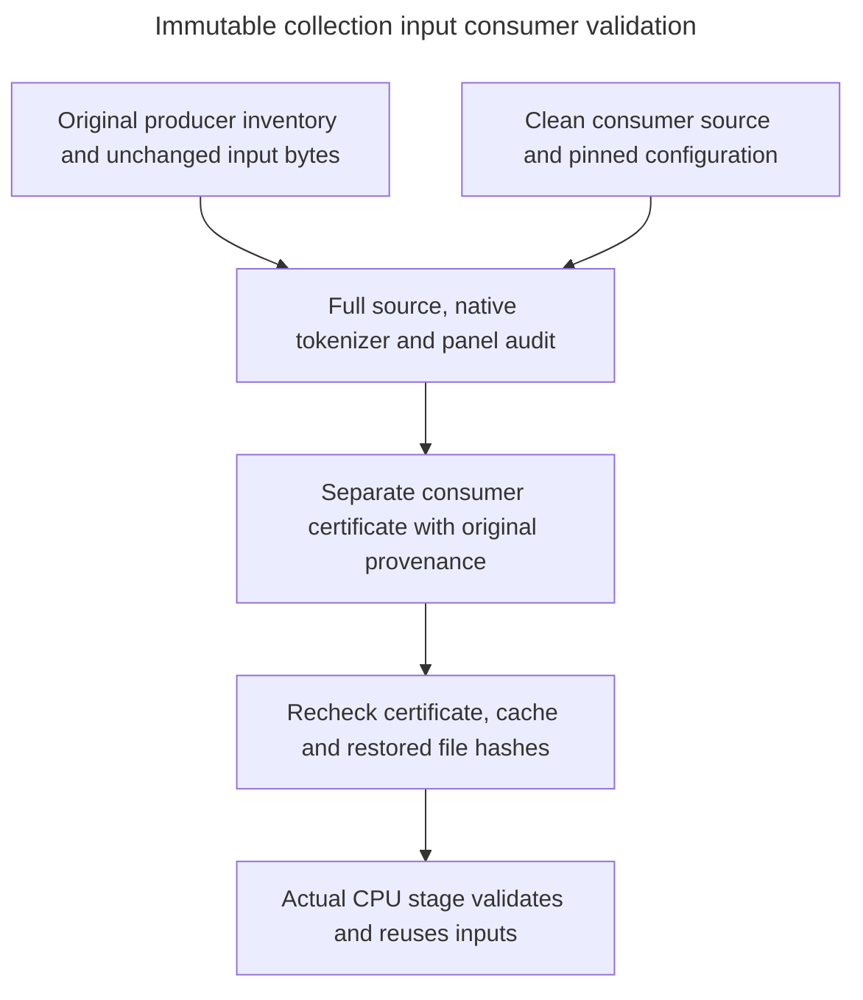

# collection_inputs

Owner: coordinator. Source: the user's requirement to preserve reusable collection inputs in Google Drive, under E.1.4, E.2.3–E.2.5 and H.9 operational conventions.

Revalidate originally produced CPU collection inputs under a new consumer source freeze while retaining their original bytes and producer provenance. This module creates evidence for operational reuse; collection, model inference, training and broader experiment readiness remain separately gated.

Public interfaces: `revalidate_collection_inputs`, `validate_consumer_certificate` and the [portable CLI](../../../scripts/revalidate_collection_inputs.py). The full audit verifies source shards, all one million source decisions and both native tokenizer counts, prospective ordering, official panels and the configured original MBPP certification. The local certificate verifier checks the same frozen source/configuration identity, cached tokenizer integrity and exact restored payload bytes before a CPU stage can reuse them.

Implementation: [collection_inputs.py](../../../src/operations/collection_inputs.py). Verification: [negative integrity tests](../../../tests/unit/operations/test_collection_input_revalidation.py). Procedure and certificate contract: [collection input reuse](../../operations/collection_inputs.md).

