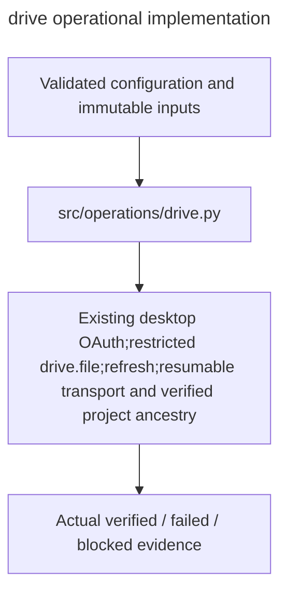

# drive

Owner:coordinator. Source:the user implementation assignment and PDF E/H operational requirements.

Existing desktop OAuth,restricted drive.file,refresh,resumable transport and verified project ancestry.

Public interfaces:`authorize; drive_service; DriveStore.create_project_folder/upload_artifact/download_artifact`.

Implementation:[drive.py](../../../src/operations/drive.py). Verification:[operations tests](../../../tests/unit/operations/test_operations.py). Deployment:[runbook](../../runbook.md). Local fixtures verify failure and integrity behavior; actual OAuth,provider,GPU,cloud lifetime and full experiment checks remain separately gated.

