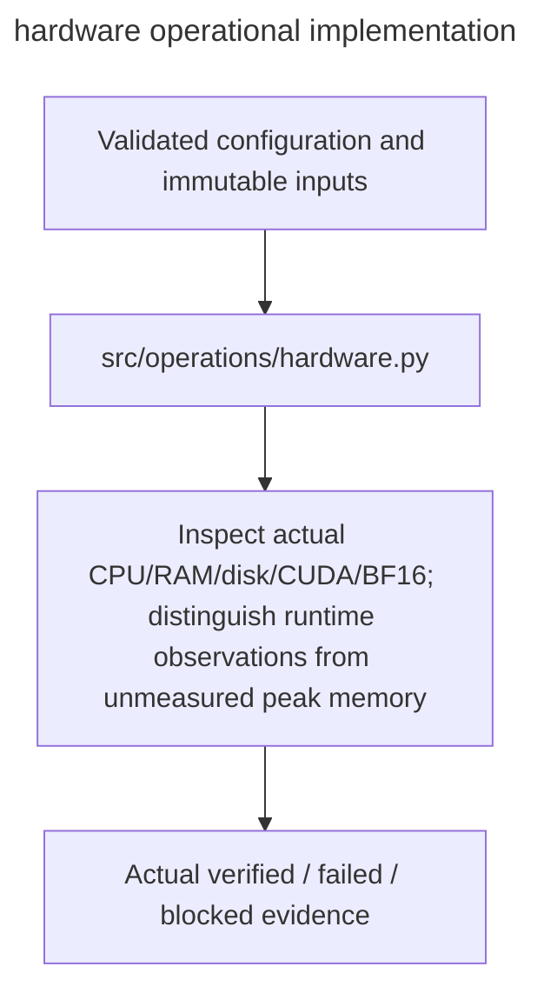

# hardware

Owner:coordinator. Source:the user implementation assignment and PDF E/H operational requirements.

Inspect actual CPU/RAM/disk/CUDA/BF16; distinguish runtime observations from unmeasured peak memory.

Public interfaces:`inspect_hardware(storage_root); validate_hardware(report,gpu=False,required_disk_bytes=0)`.

Implementation:[hardware.py](../../../src/operations/hardware.py). Verification:[operations tests](../../../tests/unit/operations/test_operations.py). Deployment:[runbook](../../runbook.md). Local fixtures verify failure and integrity behavior; actual OAuth,provider,GPU,cloud lifetime and full experiment checks remain separately gated.

