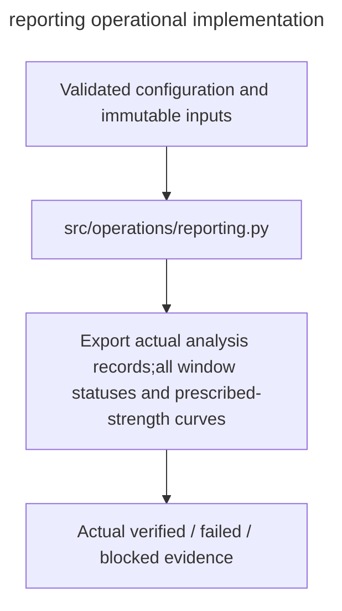

# reporting

Owner:coordinator. Source:the user implementation assignment and PDF E/H operational requirements.

Export actual analysis records,all window statuses and prescribed-strength curves.

Public interfaces:`generate_report(analysis,destination)`.

Implementation:[reporting.py](../../../src/operations/reporting.py). Verification:[operations tests](../../../tests/unit/operations/test_operations.py). Deployment:[runbook](../../runbook.md). Local fixtures verify failure and integrity behavior; actual OAuth,provider,GPU,cloud lifetime and full experiment checks remain separately gated.

