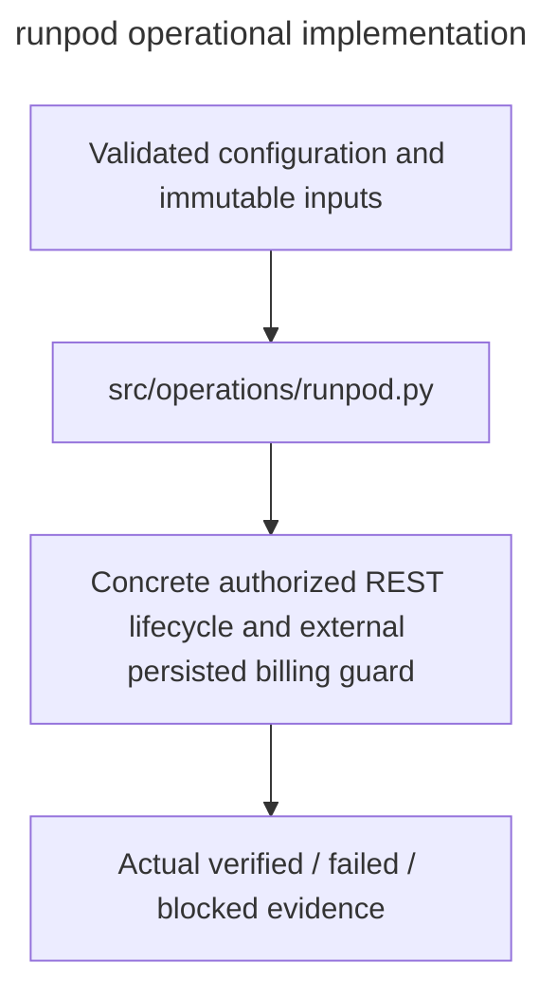

# runpod

Owner:coordinator. Source:the user implementation assignment and PDF E/H operational requirements.

Concrete authorized REST lifecycle and external persisted billing guard.

Public interfaces:`RunPodClient.create_pod/inspect_pod/stop_pod/resume_pod/guarded_lifecycle`.

Implementation:[runpod.py](../../../src/operations/runpod.py). Verification:[operations tests](../../../tests/unit/operations/test_operations.py). Deployment:[runbook](../../runbook.md). Local fixtures verify failure and integrity behavior; actual OAuth,provider,GPU,cloud lifetime and full experiment checks remain separately gated.

