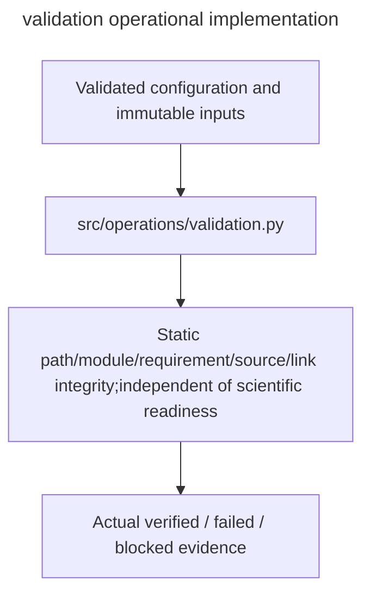

# validation

Owner:coordinator. Source:the user implementation assignment and PDF E/H operational requirements.

Static path/module/requirement/source/link integrity,independent of scientific readiness.

Public interfaces:`validate_repository(root)`.

Implementation:[validation.py](../../../src/operations/validation.py). Verification:[operations tests](../../../tests/unit/operations/test_operations.py). Deployment:[runbook](../../runbook.md). Local fixtures verify failure and integrity behavior; actual OAuth,provider,GPU,cloud lifetime and full experiment checks remain separately gated.

