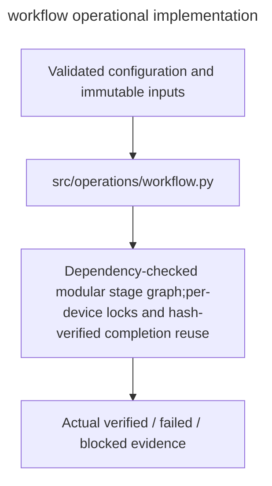

# workflow

Owner:coordinator. Source:the user implementation assignment and PDF E/H operational requirements.

Dependency-checked modular stage graph,per-device locks and hash-verified completion reuse.

Public interfaces:`Stage; experiment_graph; StageRunner.run/status/inspect`.

Implementation:[workflow.py](../../../src/operations/workflow.py). Verification:[operations tests](../../../tests/unit/operations/test_operations.py). Deployment:[runbook](../../runbook.md). Local fixtures verify failure and integrity behavior; actual OAuth,provider,GPU,cloud lifetime and full experiment checks remain separately gated.

