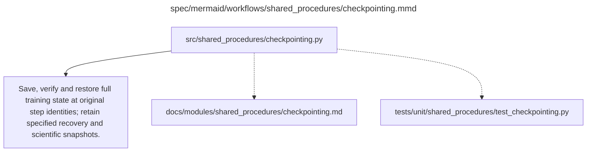

# checkpointing.md

**Owner:** `shared_infrastructure`. **Implementation status:** blank placeholder, not implemented or tested.

| Artifact | Exact repository path |
|---|---|
| Implementation | `src/shared_procedures/checkpointing.py` |
| Workflow/support diagram | [`spec/mermaid/workflows/shared_procedures/checkpointing.mmd`](../../../spec/mermaid/workflows/shared_procedures/checkpointing.mmd) |
| This specification | `docs/modules/shared_procedures/checkpointing.md` |
| Unit test slot | `tests/unit/shared_procedures/test_checkpointing.py` |

**Scientific sources:** E.1.3; E.2.3,E.2.6. [p. 50](../../../spec/experiment.pdf#page=50) · [p. 51](../../../spec/experiment.pdf#page=51) · [p. 55](../../../spec/experiment.pdf#page=55) · [p. 56](../../../spec/experiment.pdf#page=56) · [p. 57](../../../spec/experiment.pdf#page=57).

## Responsibility and controlling details

A resumable state includes trainable weights, optimizer/scheduler, completed step, available RNG/sampler/data position, exact model/tokenizer/code/dependency/configuration and data identities. `save_only_model` must not omit necessary full state. Verify publication before considering a checkpoint complete, retain an earlier valid copy and choose the latest **verified matching** state rather than the highest directory number.

SFT cadence: every 100 optimizer steps and completion, retaining latest two valid full states plus final named adapter for every fit. RL: scientific snapshots every ten steps to 100 for each model, retain all ten adapters and at least latest two complete full states. Capacity permitting all full RL states may remain. Intentional pauses finish an update and save/flush/verify before stopping; unexpected loss or OOM may only allow recovery from the previous completed state. Never promise a fresh checkpoint after an OOM. Recorded hardware swaps need not replay bit-for-bit.

Recovery backups must retain original step identity. Never use a later policy for a lost earlier evaluation snapshot, or use cached rewards as if optimizer microstate were restored. Persistent retry counters and replay logs survive restoration.

## Interfaces and dependent procedures

Use the common [artifact contracts](../../contracts.md), [frozen prompt instructions](../../prompts.md), [decision ledger](../../decisions.md) and [validation requirements](../../validation.md). Typed signatures/serialization are delegated implementation details; their scientific meaning is not. The named owner defines this module with its consumers before dependent integration.

No separate child procedure is declared in this diagram. This does not exempt shared recovery, storage, provenance or validation contracts.

## Completion and failure boundary

Implement and test `src/shared_procedures/checkpointing.py` against its specified behavior in `tests/unit/shared_procedures/test_checkpointing.py`. Validate every emitted artifact and preserve its source/configuration identity. Do not claim completeness from a placeholder or passing import. Propagate required child failures and maintain ordinary model outcomes separately from infrastructure faults. Mandatory real preflights and permission gates remain in force. Unspecified allowed conventions must be documented/frozen before outcomes; new scientific choices are not silently authorized.

## Exact path-synchronized diagram

The following diagram is byte-for-byte the active `.mmd` content at generation time. Its procedural content is from the supplied workflow or the cited PDF support requirement; file labels and role assignment are the requested repository organization.

