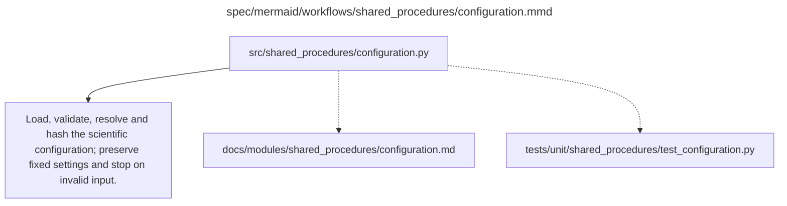

# configuration.md

**Owner:** `shared_infrastructure`. **Implementation status:** blank placeholder, not implemented or tested.

| Artifact | Exact repository path |
|---|---|
| Implementation | `src/shared_procedures/configuration.py` |
| Workflow/support diagram | [`spec/mermaid/workflows/shared_procedures/configuration.mmd`](../../../spec/mermaid/workflows/shared_procedures/configuration.mmd) |
| This specification | `docs/modules/shared_procedures/configuration.md` |
| Unit test slot | `tests/unit/shared_procedures/test_configuration.py` |

**Scientific sources:** E.2.3; H.1,H.9. [p. 54](../../../spec/experiment.pdf#page=54) · [p. 55](../../../spec/experiment.pdf#page=55) · [p. 68](../../../spec/experiment.pdf#page=68) · [p. 80](../../../spec/experiment.pdf#page=80).

## Responsibility and controlling details

The source specifies a single machine-readable configuration with model/dataset/tokenizer revisions, generation settings, exact SFT/GRPO recipes, interventions, panel counts, storage and spending controls. Validate all fixed values and the forty-fit/two-trajectory matrix, and reject contradictory/missing required scientific fields. Resolve allowed technical defaults prospectively, record every default affecting data/output/loss/reward/measurement and hash a canonical representation with source/dependency revisions before training.

Do not populate missing real model/dataset/tokenizer or binary hashes with placeholders that pass validation. Account credentials never belong in YAML/checkpoints/Git. The legacy spending-warning conflict is explicitly logged in `docs/decisions.md`; no unlimited authorization is implied by the initial $300 planning envelope. The blank `config.yaml` is intentionally invalid until the future implementer completes it and the required preflights.

## Interfaces and dependent procedures

Use the common [artifact contracts](../../contracts.md), [frozen prompt instructions](../../prompts.md), [decision ledger](../../decisions.md) and [validation requirements](../../validation.md). Typed signatures/serialization are delegated implementation details; their scientific meaning is not. The named owner defines this module with its consumers before dependent integration.

No separate child procedure is declared in this diagram. This does not exempt shared recovery, storage, provenance or validation contracts.

## Completion and failure boundary

Implement and test `src/shared_procedures/configuration.py` against its specified behavior in `tests/unit/shared_procedures/test_configuration.py`. Validate every emitted artifact and preserve its source/configuration identity. Do not claim completeness from a placeholder or passing import. Propagate required child failures and maintain ordinary model outcomes separately from infrastructure faults. Mandatory real preflights and permission gates remain in force. Unspecified allowed conventions must be documented/frozen before outcomes; new scientific choices are not silently authorized.

## Exact path-synchronized diagram

The following diagram is byte-for-byte the active `.mmd` content at generation time. Its procedural content is from the supplied workflow or the cited PDF support requirement; file labels and role assignment are the requested repository organization.

