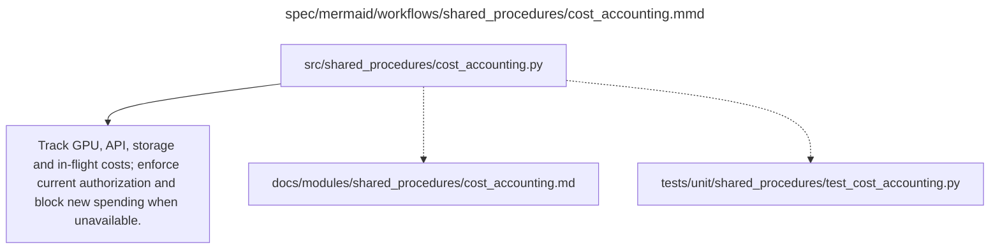

# cost_accounting.md

**Owner:** `shared_infrastructure`. **Implementation status:** implemented with actual local CPU tests; mandatory live integrations remain separately gated.

| Artifact | Exact repository path |
|---|---|
| Implementation | `src/shared_procedures/cost_accounting.py` |
| Workflow/support diagram | [`spec/mermaid/workflows/shared_procedures/cost_accounting.mmd`](../../../spec/mermaid/workflows/shared_procedures/cost_accounting.mmd) |
| This specification | `docs/modules/shared_procedures/cost_accounting.md` |
| Unit test slot | `tests/unit/shared_procedures/test_cost_accounting.py` |

**Scientific sources:** 5; B.1.4; C.2.4; E.1.4–E.1.5,E.2.5; H.6.4. [p. 6](../../../spec/experiment.pdf#page=6) · [p. 19](../../../spec/experiment.pdf#page=19) · [p. 30](../../../spec/experiment.pdf#page=30) · [p. 51](../../../spec/experiment.pdf#page=51) · [p. 52](../../../spec/experiment.pdf#page=52) · [p. 56](../../../spec/experiment.pdf#page=56) · [p. 76](../../../spec/experiment.pdf#page=76).

## Responsibility and controlling details

Record booked GPU type/rate, start/stop timestamps, paid hours, idle reward-wait time, storage, request-specific tokens and charges, and other actual costs. Track ROT13/KaziText/RL and evaluation separately, plus both provider services. Update forecasts for up to 37200 evaluation and 12800 training-reward requests before retries; clean generation and baseline diagnostics also cost resources.

The PDF's initial $300 planning envelope is not a demonstrated total or unlimited authorization; team/account rules still apply. Preserve the unresolved warning-schedule conflict noted in `docs/decisions.md` and freeze a conservative explicitly authorized operational policy before paid scheduling. Never silently increase the ceiling. In-flight charges and service latency mean application-side limits do not guarantee a hard provider cap or exactly-once billing. Block new jobs when funds/permission are unavailable; safe planned pauses checkpoint/flush/verify before releasing idle GPUs. Ordinary funding exhaustion is infrastructure, not evidence an intervention scientifically failed.

## Interfaces and dependent procedures

Use the common [artifact contracts](../../contracts.md), [frozen prompt instructions](../../prompts.md), [decision ledger](../../decisions.md) and [validation requirements](../../validation.md). Typed signatures/serialization are delegated implementation details; their scientific meaning is not. The named owner defines this module with its consumers before dependent integration.

No separate child procedure is declared in this diagram. This does not exempt shared recovery, storage, provenance or validation contracts.

## Completion and failure boundary

Implement and test `src/shared_procedures/cost_accounting.py` against its specified behavior in `tests/unit/shared_procedures/test_cost_accounting.py`. Validate every emitted artifact and preserve its source/configuration identity. Do not claim completeness from a placeholder or passing import. Propagate required child failures and maintain ordinary model outcomes separately from infrastructure faults. Mandatory real preflights and permission gates remain in force. Unspecified allowed conventions must be documented/frozen before outcomes; new scientific choices are not silently authorized.

## Exact path-synchronized diagram

The following diagram is byte-for-byte the active `.mmd` content at generation time. Its procedural content is from the supplied workflow or the cited PDF support requirement; file labels and role assignment are the requested repository organization.

## Implemented public interfaces and evidence

`CostLedger(path, authorization=...).reserve`, `commit`, `release`, `totals` and `record_resource` persist actual charges and in-flight reservations. Missing authorization/evidence, overrun and ambiguous-billing release are refused. Source warning thresholds and the local reward-service allowance are recorded without increasing the approved ceiling. `estimate_judge_cost` requires actual usage and provided rates; `request_forecast` reports the source workload, not observed spending.

Local verification uses `PYTHONPATH=src python -m pytest tests/unit/shared_procedures tests/integration/test_recovery_handoff.py --import-mode=importlib`. Tests exercise positive behavior and actual negative cases, including schema/model/hash failures, no-auth spending blocks, persistent retry exhaustion, fixture-cache exclusion and real CPU optimizer restoration. CUDA/API/lifecycle evidence is reported separately; passing local tests does not authorize or certify scientific launch.

Indexed SQLite transactions store operation reservations/charges and append audit events. Grand and reward-category totals update in constant-size transactions; reserve, commit, release and totals never scan or rewrite full history. `<path>.sqlite3` uses WAL and FULL synchronous transactions; legacy JSON is imported once and retained. `read()` exports the full audit only when requested. `snapshot_database(destination)` creates a coherent atomic backup for durable replication, including committed WAL state.
