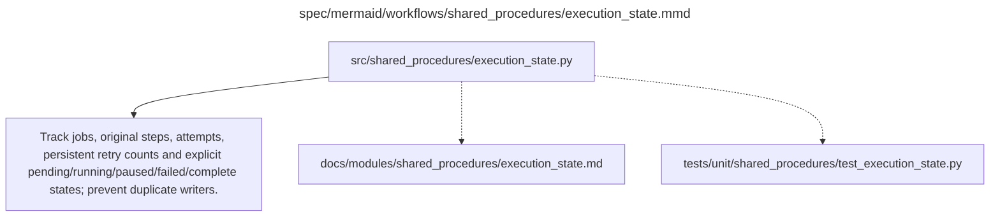

# execution_state.md

**Owner:** `shared_infrastructure`. **Implementation status:** implemented with actual local CPU tests; mandatory live integrations remain separately gated.

| Artifact | Exact repository path |
|---|---|
| Implementation | `src/shared_procedures/execution_state.py` |
| Workflow/support diagram | [`spec/mermaid/workflows/shared_procedures/execution_state.mmd`](../../../spec/mermaid/workflows/shared_procedures/execution_state.mmd) |
| This specification | `docs/modules/shared_procedures/execution_state.md` |
| Unit test slot | `tests/unit/shared_procedures/test_execution_state.py` |

**Scientific sources:** E.1–E.2; H.9. [p. 49](../../../spec/experiment.pdf#page=49) · [p. 50](../../../spec/experiment.pdf#page=50) · [p. 52](../../../spec/experiment.pdf#page=52) · [p. 53](../../../spec/experiment.pdf#page=53) · [p. 55](../../../spec/experiment.pdf#page=55) · [p. 56](../../../spec/experiment.pdf#page=56) · [p. 57](../../../spec/experiment.pdf#page=57) · [p. 80](../../../spec/experiment.pdf#page=80).

## Responsibility and controlling details

Maintain lock-protected job/status records with distinct pending, running, paused, failed and complete states as in the source scaffold contracts. Exact job identity includes scientific condition and config/data hashes; don't run two writers against the same output. Preserve attempts, original steps, completed-operation progress and partial-group information. Completed conditions cannot silently reopen under another configuration.

Retry counts are persistent per operation and worker; restore/re-entry/restart must not reset them. A rollback does not advance completed updates. Distinguish a verified negative model outcome from an unfinished infrastructure operation and a fully recorded unavailable observation from complete confirmatory evidence. Save partial reports and preserve valid work when a worker stops.

## Interfaces and dependent procedures

Use the common [artifact contracts](../../contracts.md), [frozen prompt instructions](../../prompts.md), [decision ledger](../../decisions.md) and [validation requirements](../../validation.md). Typed signatures/serialization are delegated implementation details; their scientific meaning is not. The named owner defines this module with its consumers before dependent integration.

No separate child procedure is declared in this diagram. This does not exempt shared recovery, storage, provenance or validation contracts.

## Completion and failure boundary

Implement and test `src/shared_procedures/execution_state.py` against its specified behavior in `tests/unit/shared_procedures/test_execution_state.py`. Validate every emitted artifact and preserve its source/configuration identity. Do not claim completeness from a placeholder or passing import. Propagate required child failures and maintain ordinary model outcomes separately from infrastructure faults. Mandatory real preflights and permission gates remain in force. Unspecified allowed conventions must be documented/frozen before outcomes; new scientific choices are not silently authorized.

## Exact path-synchronized diagram

The following diagram is byte-for-byte the active `.mmd` content at generation time. Its procedural content is from the supplied workflow or the cited PDF support requirement; file labels and role assignment are the requested repository organization.

## Implemented public interfaces and evidence

`ExecutionState(path, identity)` supplies immutable job identity, persistent status/history/attempt/progress, legal `transition`, `update_progress` and exclusive `claim`. Pending/running/paused/failed/complete remain distinct. Terminal completion cannot reopen under new configuration and completed progress cannot move backwards or complete a partial group.

Local verification uses `PYTHONPATH=src python -m pytest tests/unit/shared_procedures tests/integration/test_recovery_handoff.py --import-mode=importlib`. Tests exercise positive behavior and actual negative cases, including schema/model/hash failures, no-auth spending blocks, persistent retry exhaustion, fixture-cache exclusion and real CPU optimizer restoration. CUDA/API/lifecycle evidence is reported separately; passing local tests does not authorize or certify scientific launch.
