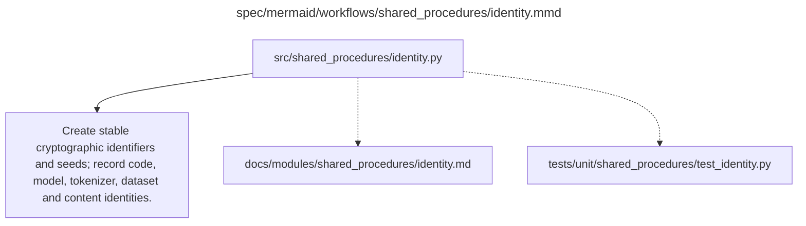

# identity.md

**Owner:** `shared_infrastructure`. **Implementation status:** implemented with actual local CPU tests; mandatory live integrations remain separately gated.

| Artifact | Exact repository path |
|---|---|
| Implementation | `src/shared_procedures/identity.py` |
| Workflow/support diagram | [`spec/mermaid/workflows/shared_procedures/identity.mmd`](../../../spec/mermaid/workflows/shared_procedures/identity.mmd) |
| This specification | `docs/modules/shared_procedures/identity.md` |
| Unit test slot | `tests/unit/shared_procedures/test_identity.py` |

**Scientific sources:** C.1.3; E.1.4; E.2.3. [p. 25](../../../spec/experiment.pdf#page=25) · [p. 52](../../../spec/experiment.pdf#page=52) · [p. 54](../../../spec/experiment.pdf#page=54) · [p. 55](../../../spec/experiment.pdf#page=55).

## Responsibility and controlling details

Use stable cryptographic content/configuration identities, with source-described SHA-256 hashing for canonical artifacts/configuration. Seed derivations must be pinned and independent of Python's session-dependent built-in hash. Region seed inputs are global seed 42, immutable example ID and region index; phase namespaces and tie-breaking mechanics are frozen implementation conventions, not newly selected scientific levels.

Include exact models/tokenizers/revisions, adapters/original checkpoint steps, datasets/IDs, code/runtime, prompt/parser/scorer/rubric/schema/settings and actual bytes where applicable. Do not treat model name, filepath, request timeout or checkpoint directory number as sufficient identity. Record requested and returned judge versions with a prospective cache-index scheme; future response fields cannot literally be known before the first request.

## Interfaces and dependent procedures

Use the common [artifact contracts](../../contracts.md), [frozen prompt instructions](../../prompts.md), [decision ledger](../../decisions.md) and [validation requirements](../../validation.md). Typed signatures/serialization are delegated implementation details; their scientific meaning is not. The named owner defines this module with its consumers before dependent integration.

No separate child procedure is declared in this diagram. This does not exempt shared recovery, storage, provenance or validation contracts.

## Completion and failure boundary

Implement and test `src/shared_procedures/identity.py` against its specified behavior in `tests/unit/shared_procedures/test_identity.py`. Validate every emitted artifact and preserve its source/configuration identity. Do not claim completeness from a placeholder or passing import. Propagate required child failures and maintain ordinary model outcomes separately from infrastructure faults. Mandatory real preflights and permission gates remain in force. Unspecified allowed conventions must be documented/frozen before outcomes; new scientific choices are not silently authorized.

## Exact path-synchronized diagram

The following diagram is byte-for-byte the active `.mmd` content at generation time. Its procedural content is from the supplied workflow or the cited PDF support requirement; file labels and role assignment are the requested repository organization.

## Implemented public interfaces and evidence

`content_hash(value)`, `file_hash(path)`, `derive_seed(*parts)` and `artifact_identity(kind, **dependencies)` use SHA-256. Text hashes exact UTF-8 bytes; mappings use sorted compact UTF-8 JSON without nonfinite numbers. `derive_seed` uses the first 32 bits of the versioned structured hash, independent of process hash randomization.

Local verification uses `PYTHONPATH=src python -m pytest tests/unit/shared_procedures tests/integration/test_recovery_handoff.py --import-mode=importlib`. Tests exercise positive behavior and actual negative cases, including schema/model/hash failures, no-auth spending blocks, persistent retry exhaustion, fixture-cache exclusion and real CPU optimizer restoration. CUDA/API/lifecycle evidence is reported separately; passing local tests does not authorize or certify scientific launch.
