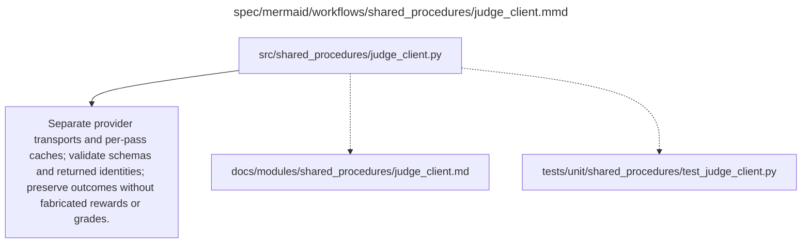

# judge_client.md

**Owner:** `shared_infrastructure`. **Implementation status:** blank placeholder, not implemented or tested.

| Artifact | Exact repository path |
|---|---|
| Implementation | `src/shared_procedures/judge_client.py` |
| Workflow/support diagram | [`spec/mermaid/workflows/shared_procedures/judge_client.mmd`](../../../spec/mermaid/workflows/shared_procedures/judge_client.mmd) |
| This specification | `docs/modules/shared_procedures/judge_client.md` |
| Unit test slot | `tests/unit/shared_procedures/test_judge_client.py` |

**Scientific sources:** C.3.3–C.3.4; D.2.4–D.2.6; E.1.4; H.5. [p. 33](../../../spec/experiment.pdf#page=33) · [p. 34](../../../spec/experiment.pdf#page=34) · [p. 45](../../../spec/experiment.pdf#page=45) · [p. 46](../../../spec/experiment.pdf#page=46) · [p. 51](../../../spec/experiment.pdf#page=51) · [p. 52](../../../spec/experiment.pdf#page=52) · [p. 73](../../../spec/experiment.pdf#page=73) · [p. 74](../../../spec/experiment.pdf#page=74).

## Responsibility and controlling details

Provide shared transport, bounded concurrency, request validation, persistent independent caches, costs and failure statuses. Keep scientific semantics in request-specific consumers: two boolean/score Sonnet training requests versus GPT primary/Sonnet secondary score and separate tri-state GPT evaluation audit. Use exact frozen prompts/settings from `docs/prompts.md`; the client does not add new retry-based sampling, default grades or substituted models.

RL reward concurrency is at most eight in-flight requests, and actual account quotas take priority. Respect Retry-After, otherwise exponential backoff with jitter. Maximum three retries per operation includes SDK retries, with the shared 100-worker retry cap and persistent counters. Quota/billing/unclassified failures do not retry indefinitely. Persist successful passes before the corresponding update and preserve them if another call fails. Record sent/completed-committed/failed states; timeouts cannot guarantee exactly-once billing. Evaluation records unavailable results honestly; RL cannot update using missing rewards.

A requested/returned model mismatch or provider version discontinuity is recorded and handled under the source stop/report constraints, not silently pooled. Schema validity does not prove substantive judge accuracy. Integration checks on actual providers remain unperformed in the scaffold.

## Interfaces and dependent procedures

Use the common [artifact contracts](../../contracts.md), [frozen prompt instructions](../../prompts.md), [decision ledger](../../decisions.md) and [validation requirements](../../validation.md). Typed signatures/serialization are delegated implementation details; their scientific meaning is not. The named owner defines this module with its consumers before dependent integration.

No separate child procedure is declared in this diagram. This does not exempt shared recovery, storage, provenance or validation contracts.

## Completion and failure boundary

Implement and test `src/shared_procedures/judge_client.py` against its specified behavior in `tests/unit/shared_procedures/test_judge_client.py`. Validate every emitted artifact and preserve its source/configuration identity. Do not claim completeness from a placeholder or passing import. Propagate required child failures and maintain ordinary model outcomes separately from infrastructure faults. Mandatory real preflights and permission gates remain in force. Unspecified allowed conventions must be documented/frozen before outcomes; new scientific choices are not silently authorized.

## Exact path-synchronized diagram

The following diagram is byte-for-byte the active `.mmd` content at generation time. Its procedural content is from the supplied workflow or the cited PDF support requirement; file labels and role assignment are the requested repository organization.

