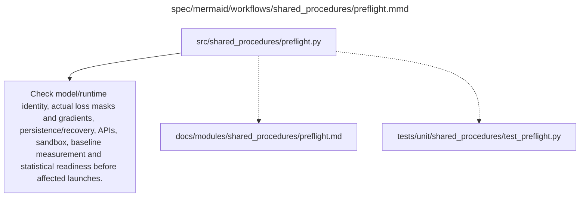

# preflight.md

**Owner:** `shared_infrastructure`. **Implementation status:** implemented with actual local CPU tests; mandatory live integrations remain separately gated.

| Artifact | Exact repository path |
|---|---|
| Implementation | `src/shared_procedures/preflight.py` |
| Workflow/support diagram | [`spec/mermaid/workflows/shared_procedures/preflight.mmd`](../../../spec/mermaid/workflows/shared_procedures/preflight.mmd) |
| This specification | `docs/modules/shared_procedures/preflight.md` |
| Unit test slot | `tests/unit/shared_procedures/test_preflight.py` |

**Scientific sources:** 5; E.1–E.2.8; G.9–G.10; H.4,H.7–H.9. [p. 6](../../../spec/experiment.pdf#page=6) · [p. 49](../../../spec/experiment.pdf#page=49) · [p. 50](../../../spec/experiment.pdf#page=50) · [p. 51](../../../spec/experiment.pdf#page=51) · [p. 57](../../../spec/experiment.pdf#page=57) · [p. 58](../../../spec/experiment.pdf#page=58) · [p. 67](../../../spec/experiment.pdf#page=67) · [p. 72](../../../spec/experiment.pdf#page=72) · [p. 77](../../../spec/experiment.pdf#page=77) · [p. 79](../../../spec/experiment.pdf#page=79) · [p. 80](../../../spec/experiment.pdf#page=80).

## Responsibility and controlling details

Coordinate the required real checks: construction model/tokenizer/runtime identity; authorized/pinned source data and all transformed lengths/protected spans; actual completion-only masks and nonzero LoRA gradients; full checkpoint save/resume; genuine durable storage and intended stop/terminate survival; real judge schemas/version/quota/cache/retry/cost behavior; isolated MBPP execution and reference tests; exact eight-by-four GRPO update; baseline repeatability; prospectively validated simultaneous inference; and actual spending authorization.

Keep unit/mocked checks separate from GPU/API/provider evidence. The old CPU-test count in the PDF is historical and does not describe the current implementation. Failed mandatory checks block affected launches; fix defects only within the frozen design and log revisions. Source-required scientific protocol revision, new credentials or more budget cannot be manufactured by routine implementation autonomy. H.9 still permits constructing the whole program, including its honest stop paths, without inventing those external facts.

## Interfaces and dependent procedures

Use the common [artifact contracts](../../contracts.md), [frozen prompt instructions](../../prompts.md), [decision ledger](../../decisions.md) and [validation requirements](../../validation.md). Typed signatures/serialization are delegated implementation details; their scientific meaning is not. The named owner defines this module with its consumers before dependent integration.

No separate child procedure is declared in this diagram. This does not exempt shared recovery, storage, provenance or validation contracts.

## Completion and failure boundary

Implement and test `src/shared_procedures/preflight.py` against its specified behavior in `tests/unit/shared_procedures/test_preflight.py`. Validate every emitted artifact and preserve its source/configuration identity. Do not claim completeness from a placeholder or passing import. Propagate required child failures and maintain ordinary model outcomes separately from infrastructure faults. Mandatory real preflights and permission gates remain in force. Unspecified allowed conventions must be documented/frozen before outcomes; new scientific choices are not silently authorized.

## Exact path-synchronized diagram

The following diagram is byte-for-byte the active `.mmd` content at generation time. Its procedural content is from the supplied workflow or the cited PDF support requirement; file labels and role assignment are the requested repository organization.

## Implemented public interfaces and evidence

`run_preflights(config, checks=None, output_dir=None, execute_live=False)`, `CheckResult`, `require_preflights` and `load_preflight_evidence` enforce named launch gates and report integrity/configuration identity. `--execute-live` executes available actual selected-model native/mask/LoRA/checkpoint controls, all five authorized provider request kinds, whole-corpus transform validation, the actual GRPO callback, MBPP reference/isolation callback and durable flush. Missing resources block affected checks; mocked checks cannot satisfy a live gate. Local persistence never supplies stop/delete lifetime evidence. The actual prospectively frozen statistical simulation report is imported with code/hash verification and currently records a failed mandatory coverage gate.

Local verification uses `PYTHONPATH=src python -m pytest tests/unit/shared_procedures tests/integration/test_recovery_handoff.py --import-mode=importlib`. Tests exercise positive behavior and actual negative cases, including schema/model/hash failures, no-auth spending blocks, persistent retry exhaustion, fixture-cache exclusion and real CPU optimizer restoration. CUDA/API/lifecycle evidence is reported separately; passing local tests does not authorize or certify scientific launch.

`preflight_requirements(scope)` defines launch scopes; `run_preflights(..., scope="generation"|"training")` defaults to training. Generation requires configuration, actual selected-model native runtime, actual official transformation runtime, durable storage and current spending authorization. Full-corpus, mask/checkpoint, judges/MBPP/GRPO, baseline and statistical gates remain training requirements. Non-scoped gates are skipped without execution. Reports contain scope, required_names, scoped ready, training_ready and study_ready; a generation pass never claims training or full-study readiness. Use a separate `artifacts/preflight/generation/report.json` and call `require_preflights` with the matching scope/configuration hash.
