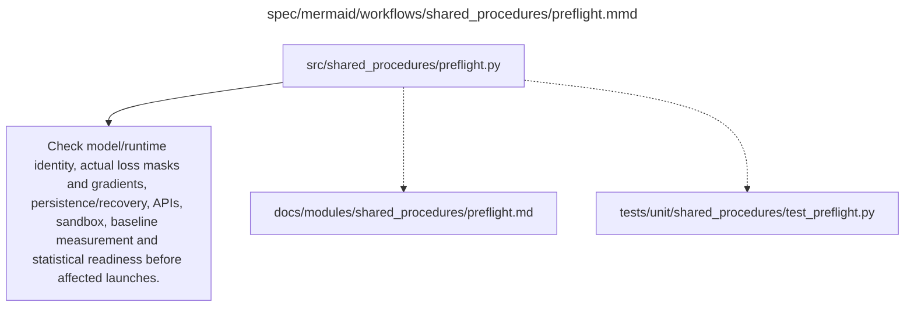

# preflight.md

**Owner:** `shared_infrastructure`. **Implementation status:** blank placeholder, not implemented or tested.

| Artifact | Exact repository path |
|---|---|
| Implementation | `src/shared_procedures/preflight.py` |
| Workflow/support diagram | [`spec/mermaid/workflows/shared_procedures/preflight.mmd`](../../../spec/mermaid/workflows/shared_procedures/preflight.mmd) |
| This specification | `docs/modules/shared_procedures/preflight.md` |
| Unit test slot | `tests/unit/shared_procedures/test_preflight.py` |

**Scientific sources:** 5; E.1–E.2.8; G.9–G.10; H.4,H.7–H.9. [p. 6](../../../spec/experiment.pdf#page=6) · [p. 49](../../../spec/experiment.pdf#page=49) · [p. 50](../../../spec/experiment.pdf#page=50) · [p. 51](../../../spec/experiment.pdf#page=51) · [p. 57](../../../spec/experiment.pdf#page=57) · [p. 58](../../../spec/experiment.pdf#page=58) · [p. 67](../../../spec/experiment.pdf#page=67) · [p. 72](../../../spec/experiment.pdf#page=72) · [p. 77](../../../spec/experiment.pdf#page=77) · [p. 79](../../../spec/experiment.pdf#page=79) · [p. 80](../../../spec/experiment.pdf#page=80).

## Responsibility and controlling details

Coordinate the required real checks: construction model/tokenizer/runtime identity; authorized/pinned source data and all transformed lengths/protected spans; actual completion-only masks and nonzero LoRA gradients; full checkpoint save/resume; genuine durable storage and intended stop/terminate survival; real judge schemas/version/quota/cache/retry/cost behavior; isolated MBPP execution and reference tests; exact eight-by-four GRPO update; baseline repeatability; prospectively validated simultaneous inference; and actual spending authorization.

Keep unit/mocked checks separate from GPU/API/provider evidence. The old CPU-test count in the PDF is historical and does not describe this blank repository. Failed mandatory checks block affected launches; fix defects only within the frozen design and log revisions. Source-required scientific protocol revision, new credentials or more budget cannot be manufactured by routine implementation autonomy. H.9 still permits constructing the whole program, including its honest stop paths, without inventing those external facts.

## Interfaces and dependent procedures

Use the common [artifact contracts](../../contracts.md), [frozen prompt instructions](../../prompts.md), [decision ledger](../../decisions.md) and [validation requirements](../../validation.md). Typed signatures/serialization are delegated implementation details; their scientific meaning is not. The named owner defines this module with its consumers before dependent integration.

No separate child procedure is declared in this diagram. This does not exempt shared recovery, storage, provenance or validation contracts.

## Completion and failure boundary

Implement and test `src/shared_procedures/preflight.py` against its specified behavior in `tests/unit/shared_procedures/test_preflight.py`. Validate every emitted artifact and preserve its source/configuration identity. Do not claim completeness from a placeholder or passing import. Propagate required child failures and maintain ordinary model outcomes separately from infrastructure faults. Mandatory real preflights and permission gates remain in force. Unspecified allowed conventions must be documented/frozen before outcomes; new scientific choices are not silently authorized.

## Exact path-synchronized diagram

The following diagram is byte-for-byte the active `.mmd` content at generation time. Its procedural content is from the supplied workflow or the cited PDF support requirement; file labels and role assignment are the requested repository organization.

