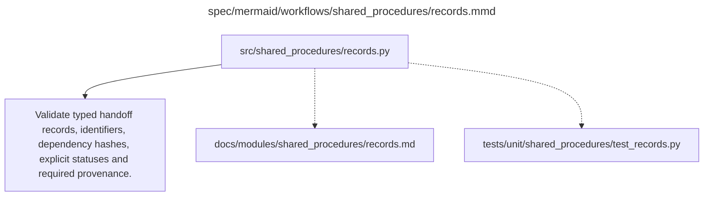

# records.md

**Owner:** `shared_infrastructure`. **Implementation status:** blank placeholder, not implemented or tested.

| Artifact | Exact repository path |
|---|---|
| Implementation | `src/shared_procedures/records.py` |
| Workflow/support diagram | [`spec/mermaid/workflows/shared_procedures/records.mmd`](../../../spec/mermaid/workflows/shared_procedures/records.mmd) |
| This specification | `docs/modules/shared_procedures/records.md` |
| Unit test slot | `tests/unit/shared_procedures/test_records.py` |

**Scientific sources:** E.2.3; H.5–H.6,H.9. [p. 55](../../../spec/experiment.pdf#page=55) · [p. 73](../../../spec/experiment.pdf#page=73) · [p. 74](../../../spec/experiment.pdf#page=74) · [p. 75](../../../spec/experiment.pdf#page=75) · [p. 80](../../../spec/experiment.pdf#page=80).

## Responsibility and controlling details

Implement the artifact contracts in `docs/contracts.md`: stable source prompts; raw and parsed clean responses; transformed SFT records; full optimizer checkpoints; per-state/item evaluation records; independent judge records; qualification estimates/bounds/statuses. The source prescribes semantic fields, exact request-field names and required provenance, but leaves most serialization and Python signatures to H.9. Agree on those typed interfaces with consumers before parallel integration.

Separate ordinary model outcomes, infrastructure failures, trace assessability, missing/uncertain evidence and confirmatory indeterminacy. `not_detected` is a resolved evaluation audit value, not a catch-all for absent fields. A complete negative outcome row is not an incomplete job; a complete failure-status row does not make missing scientific evidence available. Publish completion only after schema, count and dependency checks.

## Interfaces and dependent procedures

Use the common [artifact contracts](../../contracts.md), [frozen prompt instructions](../../prompts.md), [decision ledger](../../decisions.md) and [validation requirements](../../validation.md). Typed signatures/serialization are delegated implementation details; their scientific meaning is not. The named owner defines this module with its consumers before dependent integration.

No separate child procedure is declared in this diagram. This does not exempt shared recovery, storage, provenance or validation contracts.

## Completion and failure boundary

Implement and test `src/shared_procedures/records.py` against its specified behavior in `tests/unit/shared_procedures/test_records.py`. Validate every emitted artifact and preserve its source/configuration identity. Do not claim completeness from a placeholder or passing import. Propagate required child failures and maintain ordinary model outcomes separately from infrastructure faults. Mandatory real preflights and permission gates remain in force. Unspecified allowed conventions must be documented/frozen before outcomes; new scientific choices are not silently authorized.

## Exact path-synchronized diagram

The following diagram is byte-for-byte the active `.mmd` content at generation time. Its procedural content is from the supplied workflow or the cited PDF support requirement; file labels and role assignment are the requested repository organization.

