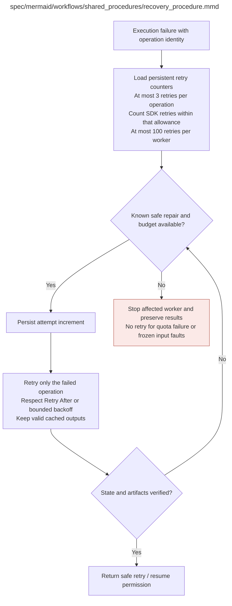

# recovery_procedure.md

**Owner:** `shared_infrastructure`. **Implementation status:** implemented with actual local CPU tests; mandatory live integrations remain separately gated.

| Artifact | Exact repository path |
|---|---|
| Implementation | `src/shared_procedures/recovery_procedure.py` |
| Workflow/support diagram | [`spec/mermaid/workflows/shared_procedures/recovery_procedure.mmd`](../../../spec/mermaid/workflows/shared_procedures/recovery_procedure.mmd) |
| This specification | `docs/modules/shared_procedures/recovery_procedure.md` |
| Unit test slot | `tests/unit/shared_procedures/test_recovery_procedure.py` |

**Scientific sources:** E.1–E.2; H.9. [p. 49](../../../spec/experiment.pdf#page=49) · [p. 50](../../../spec/experiment.pdf#page=50) · [p. 51](../../../spec/experiment.pdf#page=51) · [p. 52](../../../spec/experiment.pdf#page=52) · [p. 53](../../../spec/experiment.pdf#page=53) · [p. 55](../../../spec/experiment.pdf#page=55) · [p. 56](../../../spec/experiment.pdf#page=56) · [p. 57](../../../spec/experiment.pdf#page=57) · [p. 80](../../../spec/experiment.pdf#page=80).

## Responsibility and controlling details

Use at most three retries per operation and at most 100 per worker, counting automatic SDK retries and preserving counters across re-entry/restart/rollback. Missing finite retry configuration is fatal. Increment/persist before attempting a known safe repair; respect Retry-After or bounded exponential backoff with jitter and actual account constraints. Unclassified faults, impossible quotas, invalid frozen sources or changes to scientific semantics stop the affected worker.

Ordinary bad model answers, rejected candidates and zero reward variance are outcomes, not execution retries. Preserve valid cached artifacts and retry only failed operations. An identified repair invalidates all affected derivatives, including baseline records, without discarding unrelated valid sources. Partial optimizer updates require a verified exact full-checkpoint rollback; reward cache alone is insufficient. Replays keep original condition/step provenance and persistent attempts; no later model substitutes for a missing old snapshot.

Quota/billing failures require authorization rather than unlimited retry. After OOM preserve/log the last already-complete checkpoint when possible, stop the unsafe process and resume only with source-permitted memory-safe execution changes. Do not silently shorten sequences, reduce scientific batch/group counts or replace models. Failed recovery returns explicit failure/partial progress to parents and releases unnecessary paid resources without inventing scores or results.

## Interfaces and dependent procedures

Use the common [artifact contracts](../../contracts.md), [frozen prompt instructions](../../prompts.md), [decision ledger](../../decisions.md) and [validation requirements](../../validation.md). Typed signatures/serialization are delegated implementation details; their scientific meaning is not. The named owner defines this module with its consumers before dependent integration.

No separate child procedure is declared in this diagram. This does not exempt shared recovery, storage, provenance or validation contracts.

## Original procedural constraints

The following source comments retain the procedural detail of the supplied diagram. Obsolete introductory editing instructions and raw link directives are omitted from this list; all links are resolved in the path-synchronized diagram below. Appendix H controls any earlier conflicting language.
- Shared bounded recovery
- Missing finite retry configuration is fatal; counters persist across re-entry, restart and rollback.
- Ordinary bad model answers / rejected candidates / zero variance are outcomes, not execution failures.
- Invalid frozen sources, impossible quotas, unclassified faults or changed scientific semantics stop the worker.
- Repairs invalidate all affected derived results, including baselines; retain unaffected valid upstream results.
- Partially updated training state requires full-checkpoint rollback; reward cache is insufficient.
- Both per-operation and global retry limits apply; verified checkpoint backups retain original step identity.
- Three retries per judge request are inherited from the design. Extending this limit to known artifact repairs
- and setting a 100-retry worker cap are new engineering defaults. Counters survive restarts and rollback.
- Waits use Retry-After when provided, otherwise exponential backoff with jitter. Never retry a model outcome.

## Completion and failure boundary

Implement and test `src/shared_procedures/recovery_procedure.py` against its specified behavior in `tests/unit/shared_procedures/test_recovery_procedure.py`. Validate every emitted artifact and preserve its source/configuration identity. Do not claim completeness from a placeholder or passing import. Propagate required child failures and maintain ordinary model outcomes separately from infrastructure faults. Mandatory real preflights and permission gates remain in force. Unspecified allowed conventions must be documented/frozen before outcomes; new scientific choices are not silently authorized.

## Exact path-synchronized diagram

The following diagram is byte-for-byte the active `.mmd` content at generation time. Its procedural content is from the supplied workflow or the cited PDF support requirement; file labels and role assignment are the requested repository organization.

## Implemented public interfaces and evidence

`RecoveryManager(path, max_operation_retries=3, max_worker_retries=100).run`, `reserve_retry` and `counters` preserve counters across restart and rollback. Indexed SQLite transactions store each operation and the worker total; hot paths never export or rewrite the whole ledger. The durable database is `<path>.sqlite3`, uses WAL with FULL synchronous transactions, and imports existing JSON once without replacing it. `counters()` explicitly exports an audit. `snapshot_database(destination)` creates a coherent atomic SQLite backup including committed WAL state. Only `RetryableFailure` enters bounded recovery; unknown/frozen/quota failures and ordinary model outcomes propagate. Optional short `before_attempt` guards run before recording an attempt or charging a retry. SDK transport has no hidden retries.

`RecoveryManager.for_worker(artifact_root=None, worker_id=None)` binds production judge, upload, asset and trainer operations to one worker budget. `worker_recovery_path` resolves ILLEGIBILITY_WORKER_RECOVERY_PATH, otherwise ARTIFACT_ROOT or the supplied artifact root, then `state/workers/<ILLEGIBILITY_WORKER_ID>/retries.json`; the default validated worker ID is coordinator. `configure_worker_recovery` binds startup, while explicitly supplied fixture paths stay isolated. `migrate_worker_recovery` imports only nondecreasing counter deltas from older production ledgers, preserving original files and budget exhaustion. Distinct stable worker IDs identify independent queues; operation keys include stage/run/item identity.

Local verification uses `PYTHONPATH=src python -m pytest tests/unit/shared_procedures tests/integration/test_recovery_handoff.py --import-mode=importlib`. Tests exercise positive behavior and actual negative cases, including schema/model/hash failures, no-auth spending blocks, persistent retry exhaustion, fixture-cache exclusion and real CPU optimizer restoration. CUDA/API/lifecycle evidence is reported separately; passing local tests does not authorize or certify scientific launch.
