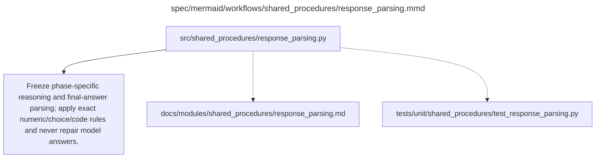

# response_parsing.md

**Owner:** `shared_infrastructure`. **Implementation status:** blank placeholder, not implemented or tested.

| Artifact | Exact repository path |
|---|---|
| Implementation | `src/shared_procedures/response_parsing.py` |
| Workflow/support diagram | [`spec/mermaid/workflows/shared_procedures/response_parsing.mmd`](../../../spec/mermaid/workflows/shared_procedures/response_parsing.mmd) |
| This specification | `docs/modules/shared_procedures/response_parsing.md` |
| Unit test slot | `tests/unit/shared_procedures/test_response_parsing.py` |

**Scientific sources:** 3.1; C.1.3,C.3.2; D.1.2,D.2.4; H.4,H.9. [p. 3](../../../spec/experiment.pdf#page=3) · [p. 25](../../../spec/experiment.pdf#page=25) · [p. 32](../../../spec/experiment.pdf#page=32) · [p. 41](../../../spec/experiment.pdf#page=41) · [p. 44](../../../spec/experiment.pdf#page=44) · [p. 72](../../../spec/experiment.pdf#page=72) · [p. 80](../../../spec/experiment.pdf#page=80).

## Responsibility and controlling details

Freeze deterministic parsing tied to the selected model's real chat/think delimiters, literal generation templates and phase-specific contracts. Native source/evaluation parsing and strict RL final-line parsing are not silently conflated. Store raw response before parsing, separate reasoning from final answer, log malformed/ambiguous/truncated statuses, and do not infer missing answers from reasoning or call a language-model correctness judge.

RL numeric normalization must declare whitespace, commas, signs, allowed punctuation and fraction/decimal handling; C.3.2's literal boxed-marker display ambiguity is in the decision ledger. Choice labels use the fixed domain rule. MBPP uses only designated final code, optional removal of one Python fence and no repairs. Judge inputs use exact extracted reasoning bytes, without translation, ROT13 decoding, selective quote or shortening. Parser revisions invalidate affected derivatives and baselines while preserving valid raw generations.

## Interfaces and dependent procedures

Use the common [artifact contracts](../../contracts.md), [frozen prompt instructions](../../prompts.md), [decision ledger](../../decisions.md) and [validation requirements](../../validation.md). Typed signatures/serialization are delegated implementation details; their scientific meaning is not. The named owner defines this module with its consumers before dependent integration.

No separate child procedure is declared in this diagram. This does not exempt shared recovery, storage, provenance or validation contracts.

## Completion and failure boundary

Implement and test `src/shared_procedures/response_parsing.py` against its specified behavior in `tests/unit/shared_procedures/test_response_parsing.py`. Validate every emitted artifact and preserve its source/configuration identity. Do not claim completeness from a placeholder or passing import. Propagate required child failures and maintain ordinary model outcomes separately from infrastructure faults. Mandatory real preflights and permission gates remain in force. Unspecified allowed conventions must be documented/frozen before outcomes; new scientific choices are not silently authorized.

## Exact path-synchronized diagram

The following diagram is byte-for-byte the active `.mmd` content at generation time. Its procedural content is from the supplied workflow or the cited PDF support requirement; file labels and role assignment are the requested repository organization.

