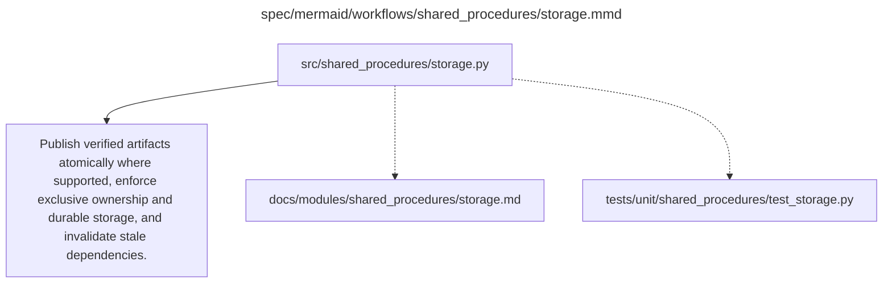

# storage.md

**Owner:** `shared_infrastructure`. **Implementation status:** blank placeholder, not implemented or tested.

| Artifact | Exact repository path |
|---|---|
| Implementation | `src/shared_procedures/storage.py` |
| Workflow/support diagram | [`spec/mermaid/workflows/shared_procedures/storage.mmd`](../../../spec/mermaid/workflows/shared_procedures/storage.mmd) |
| This specification | `docs/modules/shared_procedures/storage.md` |
| Unit test slot | `tests/unit/shared_procedures/test_storage.py` |

**Scientific sources:** E.1.1,E.1.3; E.2.3,E.2.5. [p. 49](../../../spec/experiment.pdf#page=49) · [p. 50](../../../spec/experiment.pdf#page=50) · [p. 51](../../../spec/experiment.pdf#page=51) · [p. 55](../../../spec/experiment.pdf#page=55) · [p. 56](../../../spec/experiment.pdf#page=56).

## Responsibility and controlling details

Persist immutable sources and raw outputs before downstream consumption. Use append-safe/locked writes and atomic final publication when supported; reopen/verify written artifacts before marking complete. Enforce separate writer namespaces across jobs/queues and prevent accidental reopening of a completed job under a changed configuration. Cache invalidation follows dependency identities and must include affected baseline derivatives while preserving valid raw records.

Use verified durable provider storage or equivalent external storage, not an assumed durable path name. The PDF distinguishes container, Pod-volume and independent network-volume lifetimes and requires testing actual survival/access in the intended deployment. Do not assume one volume can be simultaneously attached to every worker. Copy irreplaceable manifests/checkpoints to a separate durable location; record capacity, retention, access and storage charges. Credentials stay out of artifacts/Git.

## Interfaces and dependent procedures

Use the common [artifact contracts](../../contracts.md), [frozen prompt instructions](../../prompts.md), [decision ledger](../../decisions.md) and [validation requirements](../../validation.md). Typed signatures/serialization are delegated implementation details; their scientific meaning is not. The named owner defines this module with its consumers before dependent integration.

No separate child procedure is declared in this diagram. This does not exempt shared recovery, storage, provenance or validation contracts.

## Completion and failure boundary

Implement and test `src/shared_procedures/storage.py` against its specified behavior in `tests/unit/shared_procedures/test_storage.py`. Validate every emitted artifact and preserve its source/configuration identity. Do not claim completeness from a placeholder or passing import. Propagate required child failures and maintain ordinary model outcomes separately from infrastructure faults. Mandatory real preflights and permission gates remain in force. Unspecified allowed conventions must be documented/frozen before outcomes; new scientific choices are not silently authorized.

## Exact path-synchronized diagram

The following diagram is byte-for-byte the active `.mmd` content at generation time. Its procedural content is from the supplied workflow or the cited PDF support requirement; file labels and role assignment are the requested repository organization.

