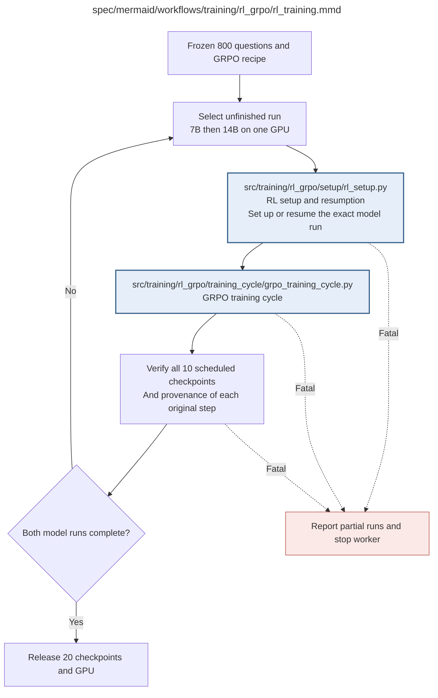

# rl_training.md

**Owner:** `rl`. **Implementation status:** blank placeholder, not implemented or tested.

| Artifact | Exact repository path |
|---|---|
| Implementation | `src/training/rl_grpo/rl_training.py` |
| Workflow/support diagram | [`spec/mermaid/workflows/training/rl_grpo/rl_training.mmd`](../../../../spec/mermaid/workflows/training/rl_grpo/rl_training.mmd) |
| This specification | `docs/modules/training/rl_grpo/rl_training.md` |
| Unit test slot | `tests/unit/training/rl_grpo/test_rl_training.py` |

**Scientific sources:** C.3; E.1.1–E.1.4; E.2.6; H.7. [p. 32](../../../../spec/experiment.pdf#page=32) · [p. 33](../../../../spec/experiment.pdf#page=33) · [p. 34](../../../../spec/experiment.pdf#page=34) · [p. 35](../../../../spec/experiment.pdf#page=35) · [p. 49](../../../../spec/experiment.pdf#page=49) · [p. 50](../../../../spec/experiment.pdf#page=50) · [p. 51](../../../../spec/experiment.pdf#page=51) · [p. 52](../../../../spec/experiment.pdf#page=52) · [p. 56](../../../../spec/experiment.pdf#page=56) · [p. 57](../../../../spec/experiment.pdf#page=57) · [p. 77](../../../../spec/experiment.pdf#page=77).

## Responsibility and controlling details

Run 7B and then 14B sequentially on the RL GPU. Both begin at their own untouched bases with separate optimizer, adapter, RNG, rollout, request and checkpoint namespaces. Each consumes the same 800 frozen questions and prescribed ordering, four rollouts each, over exactly 100 logical steps. Use the shared setup/training-cycle implementation and fixed reward/Dr. GRPO conventions, not duplicated model-specific algorithms.

Verify every required scientific checkpoint at steps 10,20,…,100 for each run, preserving the original step identity. Matching verified backups may be restored under bounded recovery; a later policy cannot substitute for a missing earlier snapshot. Unrecoverable setup, update or final verification failure produces a partial report and stops the worker. No added trajectory, training ablation or reward retuning is authorized. All twenty snapshots are dependent within their two trajectories, not twenty independent opacity interventions.

## Interfaces and dependent procedures

Use the common [artifact contracts](../../../contracts.md), [frozen prompt instructions](../../../prompts.md), [decision ledger](../../../decisions.md) and [validation requirements](../../../validation.md). Typed signatures/serialization are delegated implementation details; their scientific meaning is not. The named owner defines this module with its consumers before dependent integration.

| Source node | Called procedure (exact path) | Specification |
|---|---|---|
| `SETUP` | `src/training/rl_grpo/setup/rl_setup.py` | [rl_setup](setup/rl_setup.md) |
| `CYCLE` | `src/training/rl_grpo/training_cycle/grpo_training_cycle.py` | [grpo_training_cycle](training_cycle/grpo_training_cycle.md) |

## Original procedural constraints

The following source comments retain the procedural detail of the supplied diagram. Obsolete introductory editing instructions and raw link directives are omitted from this list; all links are resolved in the path-synchronized diagram below. Appendix H controls any earlier conflicting language.
- RL training runs
- Separate trajectories; no training-time reasoning ablations.
- Both sizes use the same 800 question IDs and order.
- GRPO with Dr. GRPO loss normalization; no adaptive runs or extra updates.
- Each logical step uses eight distinct questions and four completions per question before one optimizer update.
- Controlled fixtures must verify actual logged question IDs and update boundaries, not only divisibility.
- RL checkpoint completion
- Backups must match original step identities; a later policy cannot stand in for an earlier checkpoint.
- Bound restoration attempts through shared recovery; persistent restoration errors stop the worker.
- Completion may restore matching verified original-step backups under bounded recovery; otherwise stop and report missing states.

## Completion and failure boundary

Implement and test `src/training/rl_grpo/rl_training.py` against its specified behavior in `tests/unit/training/rl_grpo/test_rl_training.py`. Validate every emitted artifact and preserve its source/configuration identity. Do not claim completeness from a placeholder or passing import. Propagate required child failures and maintain ordinary model outcomes separately from infrastructure faults. Mandatory real preflights and permission gates remain in force. Unspecified allowed conventions must be documented/frozen before outcomes; new scientific choices are not silently authorized.

## Exact path-synchronized diagram

The following diagram is byte-for-byte the active `.mmd` content at generation time. Its procedural content is from the supplied workflow or the cited PDF support requirement; file labels and role assignment are the requested repository organization.

