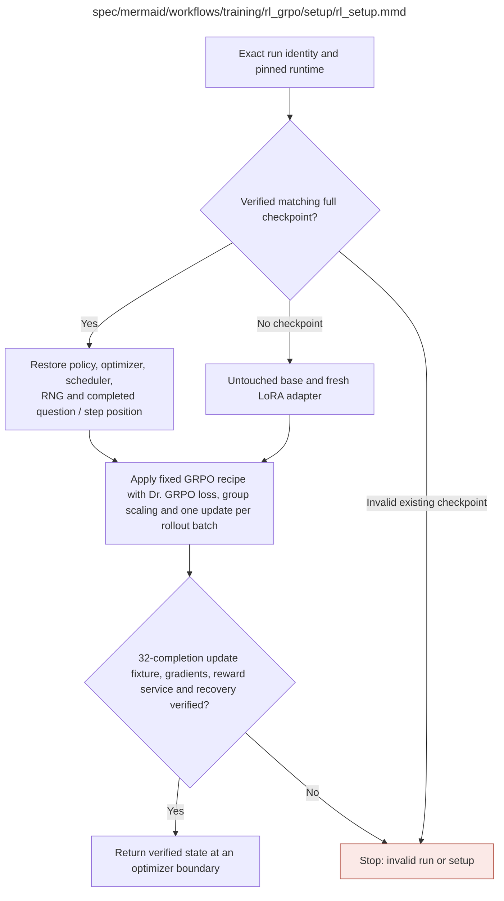

# rl_setup.md

**Owner:** `rl`. **Implementation status:** blank placeholder, not implemented or tested.

| Artifact | Exact repository path |
|---|---|
| Implementation | `src/training/rl_grpo/setup/rl_setup.py` |
| Workflow/support diagram | [`spec/mermaid/workflows/training/rl_grpo/setup/rl_setup.mmd`](../../../../../spec/mermaid/workflows/training/rl_grpo/setup/rl_setup.mmd) |
| This specification | `docs/modules/training/rl_grpo/setup/rl_setup.md` |
| Unit test slot | `tests/unit/training/rl_grpo/setup/test_rl_setup.py` |

**Scientific sources:** C.3.5; E.1.2–E.1.3; E.2.6; H.7. [p. 35](../../../../../spec/experiment.pdf#page=35) · [p. 49](../../../../../spec/experiment.pdf#page=49) · [p. 50](../../../../../spec/experiment.pdf#page=50) · [p. 56](../../../../../spec/experiment.pdf#page=56) · [p. 57](../../../../../spec/experiment.pdf#page=57) · [p. 77](../../../../../spec/experiment.pdf#page=77).

## Responsibility and controlling details

Use the exact specified base for the selected independent run, or restore a verified matching full checkpoint with policy/optimizer/scheduler/RNG and question/step position. A mismatched or corrupt existing recovery state is not a fresh-start cache miss.

H.7 fixes GRPO with **Dr. GRPO loss normalization**: `loss_type="dr_grpo"`, `scale_rewards="group"`, `num_iterations=1`, token-level importance sampling, symmetric `epsilon=0.2`/`epsilon_high=0.2`, original frozen reference policy without synchronization, `mask_truncated_completions=False`, `top_p=1.0`, no top-k restriction, repetition penalty 1.0, no entropy bonus or adaptive reward changes. Retain LoRA rank/scaling 32/32, learning rate `5e-6`, KL coefficient 0.01, temperature 1.0, cap 2048, `use_vllm=False`, 100 updates and the same 800-question order for both models.

The Dr. GRPO denominator uses the fixed maximum completion length, not each response's realized length. The inspected TRL v0.26.2 is a compatibility reference, not proof the actual deployment is pinned or correct. Freeze remaining optimizer/scheduler/precision/adapter/numerical/batching details consistently and verify with controlled fixtures. Each logical update must really have eight distinct questions × four completions, not just a divisible batch-size setting. Setup verifies gradients, reward service and exact-boundary recovery before returning usable state.

## Interfaces and dependent procedures

Use the common [artifact contracts](../../../../contracts.md), [frozen prompt instructions](../../../../prompts.md), [decision ledger](../../../../decisions.md) and [validation requirements](../../../../validation.md). Typed signatures/serialization are delegated implementation details; their scientific meaning is not. The named owner defines this module with its consumers before dependent integration.

No separate child procedure is declared in this diagram. This does not exempt shared recovery, storage, provenance or validation contracts.

## Original procedural constraints

The following source comments retain the procedural detail of the supplied diagram. Obsolete introductory editing instructions and raw link directives are omitted from this list; all links are resolved in the path-synchronized diagram below. Appendix H controls any earlier conflicting language.
- RL setup and resumption
- LoRA rank/alpha 32/32; LR 5e-6; KL coefficient .01.
- Rollout temperature 1.0; maximum new tokens 2048.
- Pin logical-step, gradient accumulation and group semantics; check against the 8-question / 4-rollout contract.
- Known setup failures use shared bounded recovery before returning STOP.
- Checkpoint presence is not enough: exact run identity and state integrity must match.
- Explicit GRPO with Dr. GRPO loss normalization, never an unspecified installed-trainer default.
- loss_type=dr_grpo; scale_rewards=group; num_iterations=1; token-level importance sampling.
- epsilon=0.2; epsilon_high=0.2; frozen original reference policy; no reference synchronization.
- mask_truncated_completions=False, so invalid truncated responses retain their stipulated negative reward in loss.
- top_p=1.0; no top-k restriction; repetition_penalty=1.0; no added entropy bonus or adaptive reward.
- Preserve LoRA rank/alpha 32/32, LR 5e-6, KL .01, temperature 1.0 and completion cap 2048.
- Exactly 8 distinct questions x 4 responses = 32 completions precede one logical optimizer update.
- Freeze a compatible pinned runtime and microbatch arrangement; verify with logged IDs and a controlled fixture.
- Dependency versions and remaining implementation conventions are delegated; scientific settings are fixed.
- A permitted restart before the first full checkpoint uses the fixed recipe and recorded seed/RNG; mark replay attempts.

## Completion and failure boundary

Implement and test `src/training/rl_grpo/setup/rl_setup.py` against its specified behavior in `tests/unit/training/rl_grpo/setup/test_rl_setup.py`. Validate every emitted artifact and preserve its source/configuration identity. Do not claim completeness from a placeholder or passing import. Propagate required child failures and maintain ordinary model outcomes separately from infrastructure faults. Mandatory real preflights and permission gates remain in force. Unspecified allowed conventions must be documented/frozen before outcomes; new scientific choices are not silently authorized.

## Exact path-synchronized diagram

The following diagram is byte-for-byte the active `.mmd` content at generation time. Its procedural content is from the supplied workflow or the cited PDF support requirement; file labels and role assignment are the requested repository organization.

