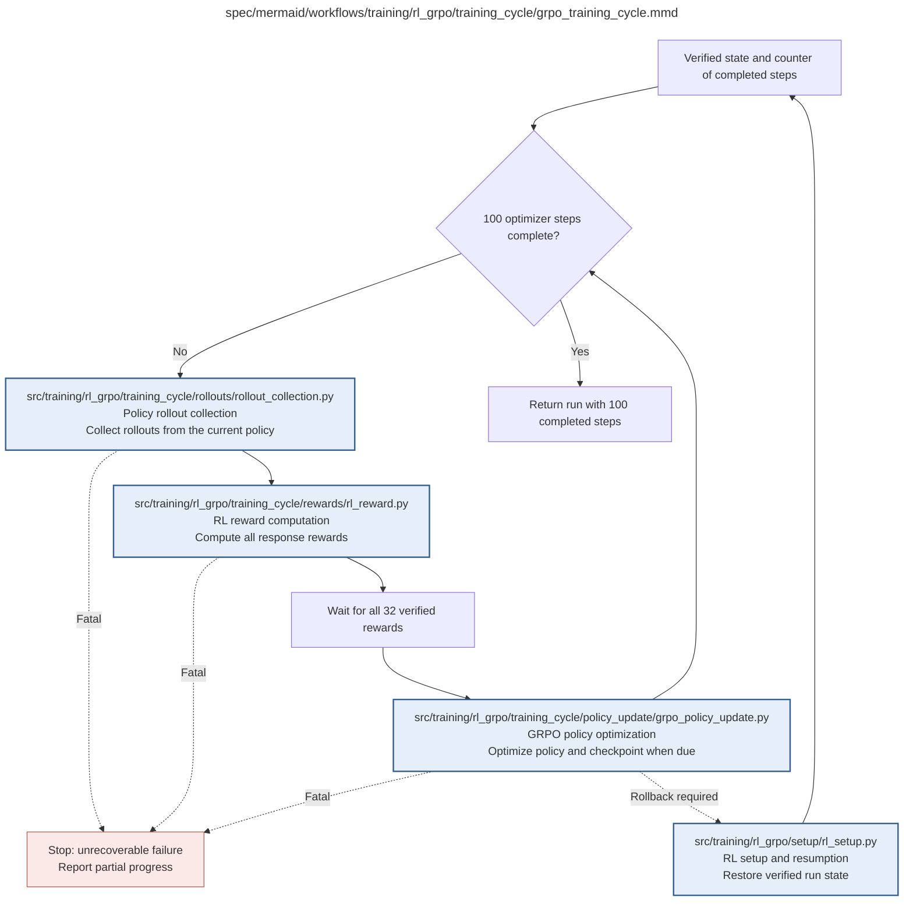

# grpo_training_cycle.md

**Owner:** `rl`. **Implementation status:** blank placeholder, not implemented or tested.

| Artifact | Exact repository path |
|---|---|
| Implementation | `src/training/rl_grpo/training_cycle/grpo_training_cycle.py` |
| Workflow/support diagram | [`spec/mermaid/workflows/training/rl_grpo/training_cycle/grpo_training_cycle.mmd`](../../../../../spec/mermaid/workflows/training/rl_grpo/training_cycle/grpo_training_cycle.mmd) |
| This specification | `docs/modules/training/rl_grpo/training_cycle/grpo_training_cycle.md` |
| Unit test slot | `tests/unit/training/rl_grpo/training_cycle/test_grpo_training_cycle.py` |

**Scientific sources:** C.3.4–C.3.5; E.1.3–E.1.4; E.2.6; H.7. [p. 34](../../../../../spec/experiment.pdf#page=34) · [p. 35](../../../../../spec/experiment.pdf#page=35) · [p. 50](../../../../../spec/experiment.pdf#page=50) · [p. 52](../../../../../spec/experiment.pdf#page=52) · [p. 56](../../../../../spec/experiment.pdf#page=56) · [p. 57](../../../../../spec/experiment.pdf#page=57) · [p. 77](../../../../../spec/experiment.pdf#page=77).

## Responsibility and controlling details

At a verified optimizer boundary, stop normally if 100 logical steps are complete. Otherwise take the next eight questions, collect four responses each, persist raw rollout/provenance, obtain all 32 deterministic/reward-judge results and only then update once. A necessary unavailable judge result pauses before the update; an incomplete group must not be used. Persist successful request records for recovery.

Rollout or reward cache contents alone are not optimizer recovery. Following partial-update faults, return through exact-run setup at the last verified checkpoint and document replay attempts; do not increment the completed counter until the update genuinely completes. Invalid/wrong/truncated ordinary responses still take their stipulated reward/loss path. Zero group reward variation is logged, not repaired by resampling or bonus changes. Each completed trajectory accounts for 3200 planned rollouts; recovery attempts are separately identified.

## Interfaces and dependent procedures

Use the common [artifact contracts](../../../../contracts.md), [frozen prompt instructions](../../../../prompts.md), [decision ledger](../../../../decisions.md) and [validation requirements](../../../../validation.md). Typed signatures/serialization are delegated implementation details; their scientific meaning is not. The named owner defines this module with its consumers before dependent integration.

| Source node | Called procedure (exact path) | Specification |
|---|---|---|
| `ROLLOUT` | `src/training/rl_grpo/training_cycle/rollouts/rollout_collection.py` | [rollout_collection](rollouts/rollout_collection.md) |
| `REWARD` | `src/training/rl_grpo/training_cycle/rewards/rl_reward.py` | [rl_reward](rewards/rl_reward.md) |
| `UPDATE` | `src/training/rl_grpo/training_cycle/policy_update/grpo_policy_update.py` | [grpo_policy_update](policy_update/grpo_policy_update.md) |
| `RESTORE` | `src/training/rl_grpo/setup/rl_setup.py` | [rl_setup](../setup/rl_setup.md) |

## Original procedural constraints

The following source comments retain the procedural detail of the supplied diagram. Obsolete introductory editing instructions and raw link directives are omitted from this list; all links are resolved in the path-synchronized diagram below. Appendix H controls any earlier conflicting language.
- GRPO training cycle
- One completed cycle consumes 8 questions × 4 responses = 32 completions.
- 100 steps imply 3,200 completions per model, excluding explicitly labeled recovery attempts.
- Rollbacks return through exact-run setup; cached rollouts are not a restored optimizer state.
- Use GRPO with Dr. GRPO loss normalization and group reward scaling; one optimizer update per rollout batch.
- Each cycle retains all 32 planned completions, including invalid truncated outcomes under the frozen reward.

## Completion and failure boundary

Implement and test `src/training/rl_grpo/training_cycle/grpo_training_cycle.py` against its specified behavior in `tests/unit/training/rl_grpo/training_cycle/test_grpo_training_cycle.py`. Validate every emitted artifact and preserve its source/configuration identity. Do not claim completeness from a placeholder or passing import. Propagate required child failures and maintain ordinary model outcomes separately from infrastructure faults. Mandatory real preflights and permission gates remain in force. Unspecified allowed conventions must be documented/frozen before outcomes; new scientific choices are not silently authorized.

## Exact path-synchronized diagram

The following diagram is byte-for-byte the active `.mmd` content at generation time. Its procedural content is from the supplied workflow or the cited PDF support requirement; file labels and role assignment are the requested repository organization.

