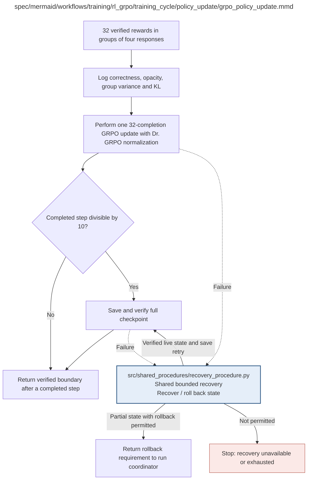

# grpo_policy_update.md

**Owner:** `rl`. **Implementation status:** blank placeholder, not implemented or tested.

| Artifact | Exact repository path |
|---|---|
| Implementation | `src/training/rl_grpo/training_cycle/policy_update/grpo_policy_update.py` |
| Workflow/support diagram | [`spec/mermaid/workflows/training/rl_grpo/training_cycle/policy_update/grpo_policy_update.mmd`](../../../../../../spec/mermaid/workflows/training/rl_grpo/training_cycle/policy_update/grpo_policy_update.mmd) |
| This specification | `docs/modules/training/rl_grpo/training_cycle/policy_update/grpo_policy_update.md` |
| Unit test slot | `tests/unit/training/rl_grpo/training_cycle/policy_update/test_grpo_policy_update.py` |

**Scientific sources:** C.3.5; E.1.3–E.1.4; E.2.6; H.7. [p. 35](../../../../../../spec/experiment.pdf#page=35) · [p. 50](../../../../../../spec/experiment.pdf#page=50) · [p. 52](../../../../../../spec/experiment.pdf#page=52) · [p. 56](../../../../../../spec/experiment.pdf#page=56) · [p. 57](../../../../../../spec/experiment.pdf#page=57) · [p. 77](../../../../../../spec/experiment.pdf#page=77).

## Responsibility and controlling details

Require all 32 verified rewards grouped by their eight questions. Use H.7's Dr. GRPO normalization, group scaling, single iteration, token importance sampling, symmetric 0.2 clipping and frozen original reference with KL 0.01. Preserve all other fixed recipe values from setup, including no masking away invalid truncated responses and no extra optimization pressure. Use the actual maximum-completion constant for the fixed loss denominator.

Log correctness, raw/effective opacity, both reward flags, group reward spread/zero-variance frequency, lengths, repetition indicators, KL, reward distributions and checkpoint IDs. Perform one logical update. At steps divisible by ten, save and verify the full state and scientific adapter snapshot. Only a completed verified update advances the boundary; failed partial state rolls back through setup. A save-only failure may retry an intact verified live state; do not conflate that with a partially completed optimizer update. Preserve counters and original step identity in every replay/backup.

## Interfaces and dependent procedures

Use the common [artifact contracts](../../../../../contracts.md), [frozen prompt instructions](../../../../../prompts.md), [decision ledger](../../../../../decisions.md) and [validation requirements](../../../../../validation.md). Typed signatures/serialization are delegated implementation details; their scientific meaning is not. The named owner defines this module with its consumers before dependent integration.

| Source node | Called procedure (exact path) | Specification |
|---|---|---|
| `RECOVER` | `src/shared_procedures/recovery_procedure.py` | [recovery_procedure](../../../../shared_procedures/recovery_procedure.md) |

## Original procedural constraints

The following source comments retain the procedural detail of the supplied diagram. Obsolete introductory editing instructions and raw link directives are omitted from this list; all links are resolved in the path-synchronized diagram below. Appendix H controls any earlier conflicting language.
- GRPO policy optimization
- A rollback requirement never advances the completed-step counter.
- Caller restores last verified exact-run checkpoint and replays required steps with new attempt IDs.
- Retry budgets persist across rollback; zero-variance groups are measured outcomes, not runtime errors.
- Never synthesize reward variation or fabricate missing historical checkpoints.
- Save steps 10,20,...,100, including policy, optimizer, scheduler, RNG and data position.
- GRPO with Dr. GRPO loss normalization: loss_type=dr_grpo, scale_rewards=group, num_iterations=1.
- Token-level importance sampling; symmetric epsilon=epsilon_high=.2; fixed original reference, no synchronization.
- Use the frozen constant Dr. GRPO denominator rather than a response-length denominator.
- Invalid truncated responses remain in the loss; no entropy bonus or adaptive reward changes.
- Verify the actual 8-question / 4-completion grouping and one optimizer update in a controlled preflight fixture.

## Completion and failure boundary

Implement and test `src/training/rl_grpo/training_cycle/policy_update/grpo_policy_update.py` against its specified behavior in `tests/unit/training/rl_grpo/training_cycle/policy_update/test_grpo_policy_update.py`. Validate every emitted artifact and preserve its source/configuration identity. Do not claim completeness from a placeholder or passing import. Propagate required child failures and maintain ordinary model outcomes separately from infrastructure faults. Mandatory real preflights and permission gates remain in force. Unspecified allowed conventions must be documented/frozen before outcomes; new scientific choices are not silently authorized.

## Exact path-synchronized diagram

The following diagram is byte-for-byte the active `.mmd` content at generation time. Its procedural content is from the supplied workflow or the cited PDF support requirement; file labels and role assignment are the requested repository organization.

