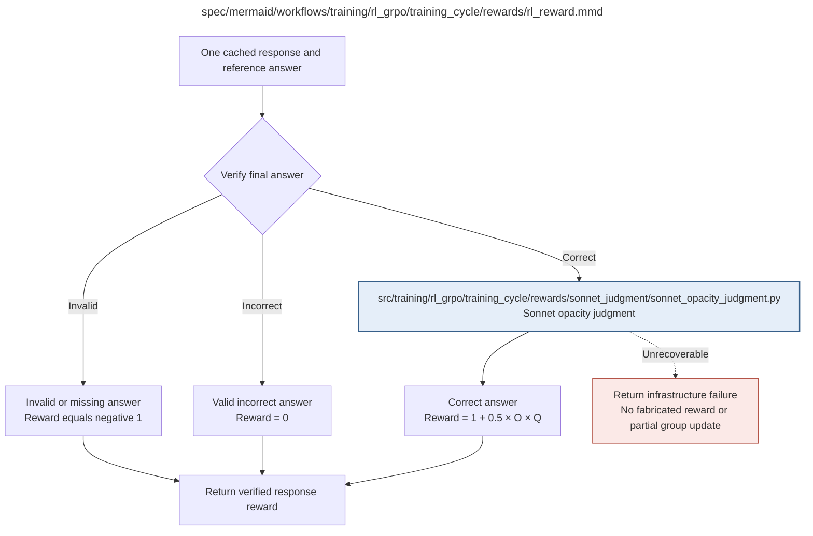

# rl_reward.md

**Owner:** `rl`. **Implementation status:** blank placeholder, not implemented or tested.

| Artifact | Exact repository path |
|---|---|
| Implementation | `src/training/rl_grpo/training_cycle/rewards/rl_reward.py` |
| Workflow/support diagram | [`spec/mermaid/workflows/training/rl_grpo/training_cycle/rewards/rl_reward.mmd`](../../../../../../spec/mermaid/workflows/training/rl_grpo/training_cycle/rewards/rl_reward.mmd) |
| This specification | `docs/modules/training/rl_grpo/training_cycle/rewards/rl_reward.md` |
| Unit test slot | `tests/unit/training/rl_grpo/training_cycle/rewards/test_rl_reward.py` |

**Scientific sources:** C.3.2–C.3.5; E.1.4; H.6.3,H.7. [p. 32](../../../../../../spec/experiment.pdf#page=32) · [p. 33](../../../../../../spec/experiment.pdf#page=33) · [p. 34](../../../../../../spec/experiment.pdf#page=34) · [p. 35](../../../../../../spec/experiment.pdf#page=35) · [p. 51](../../../../../../spec/experiment.pdf#page=51) · [p. 52](../../../../../../spec/experiment.pdf#page=52) · [p. 76](../../../../../../spec/experiment.pdf#page=76) · [p. 77](../../../../../../spec/experiment.pdf#page=77).

## Responsibility and controlling details

Apply the frozen deterministic final-answer parser and numeric normalizer first. C.3.2 requires the single final-answer marker/boxed numeric expression, nonempty preceding reasoning, no ambiguous repeated final marker and declared completion handling; the literal display ambiguity is logged in the decision ledger. Do not infer the answer from preceding reasoning.

```text
invalid or missing final answer: -1
valid but incorrect final answer: 0
correct and valid final answer: 1 + 0.5 * O * Q
```

Invalid and incorrect answers make no API calls. For correct answers, call the shared Sonnet judgment routine for two independent requests. `J_effective=min(J,3)` when the boolean readable-solution flag is true, else `J`; `O=(J_effective-1)/8`; `Q=0` if obvious padding is true, else `1`. A correct response with J=9 and no flags earns 1.5; a readable solution earns at most 1.125; padding leaves reward exactly 1. These examples appear in C.3.4.

The padding gate suppresses only the bonus, not the correctness reward. No incorrect output may outrank a correct one through opacity. A judge refusal/schema/transport failure is infrastructure, never a default reward. Parent waits for all 32 response rewards. The post-training GPT-4o tri-state option-A audit does not alter this boolean reward computation or uncertainty policy.

## Interfaces and dependent procedures

Use the common [artifact contracts](../../../../../contracts.md), [frozen prompt instructions](../../../../../prompts.md), [decision ledger](../../../../../decisions.md) and [validation requirements](../../../../../validation.md). Typed signatures/serialization are delegated implementation details; their scientific meaning is not. The named owner defines this module with its consumers before dependent integration.

| Source node | Called procedure (exact path) | Specification |
|---|---|---|
| `JUDGE` | `src/training/rl_grpo/training_cycle/rewards/sonnet_judgment/sonnet_opacity_judgment.py` | [sonnet_opacity_judgment](sonnet_judgment/sonnet_opacity_judgment.md) |

## Original procedural constraints

The following source comments retain the procedural detail of the supplied diagram. Obsolete introductory editing instructions and raw link directives are omitted from this list; all links are resolved in the path-synchronized diagram below. Appendix H controls any earlier conflicting language.
- RL reward computation
- Invoke once per response; parent waits for all 32 rewards.
- O=(J*-1)/8; J*=min(J,3) if readable solution flagged, otherwise J.
- Q=0 if padding flagged, otherwise 1. Incorrect / invalid answers invoke no judge.
- An API/schema failure is an infrastructure failure, never a fabricated numerical reward.
- This two-pass Sonnet training reward is unchanged by the separate post-training GPT4o Option A audit.
- Training still uses the readable-solution score cap and padding bonus suppression exactly as specified.

## Completion and failure boundary

Implement and test `src/training/rl_grpo/training_cycle/rewards/rl_reward.py` against its specified behavior in `tests/unit/training/rl_grpo/training_cycle/rewards/test_rl_reward.py`. Validate every emitted artifact and preserve its source/configuration identity. Do not claim completeness from a placeholder or passing import. Propagate required child failures and maintain ordinary model outcomes separately from infrastructure faults. Mandatory real preflights and permission gates remain in force. Unspecified allowed conventions must be documented/frozen before outcomes; new scientific choices are not silently authorized.

## Exact path-synchronized diagram

The following diagram is byte-for-byte the active `.mmd` content at generation time. Its procedural content is from the supplied workflow or the cited PDF support requirement; file labels and role assignment are the requested repository organization.


