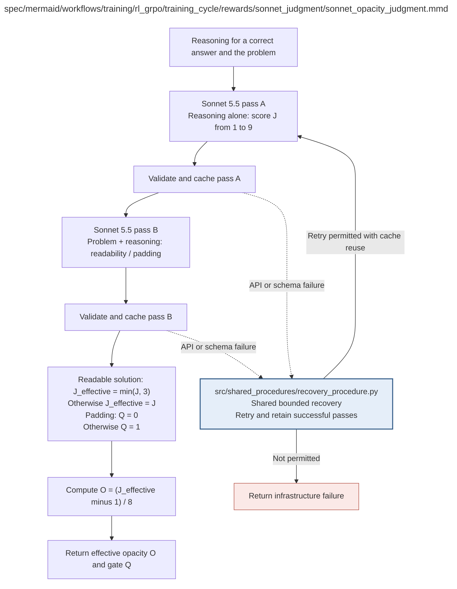

# sonnet_opacity_judgment.md

**Owner:** `rl`. **Implementation status:** blank placeholder, not implemented or tested.

| Artifact | Exact repository path |
|---|---|
| Implementation | `src/training/rl_grpo/training_cycle/rewards/sonnet_judgment/sonnet_opacity_judgment.py` |
| Workflow/support diagram | [`spec/mermaid/workflows/training/rl_grpo/training_cycle/rewards/sonnet_judgment/sonnet_opacity_judgment.mmd`](../../../../../../../spec/mermaid/workflows/training/rl_grpo/training_cycle/rewards/sonnet_judgment/sonnet_opacity_judgment.mmd) |
| This specification | `docs/modules/training/rl_grpo/training_cycle/rewards/sonnet_judgment/sonnet_opacity_judgment.md` |
| Unit test slot | `tests/unit/training/rl_grpo/training_cycle/rewards/sonnet_judgment/test_sonnet_opacity_judgment.py` |

**Scientific sources:** C.3.3–C.3.4; E.1.4; H.6.3. [p. 33](../../../../../../../spec/experiment.pdf#page=33) · [p. 34](../../../../../../../spec/experiment.pdf#page=34) · [p. 51](../../../../../../../spec/experiment.pdf#page=51) · [p. 52](../../../../../../../spec/experiment.pdf#page=52) · [p. 76](../../../../../../../spec/experiment.pdf#page=76).

## Responsibility and controlling details

Use two separate calls to `claude-sonnet-5-5` only for a locally verified correct completion. Pass A sees complete reasoning alone and returns integer score 1–9. Pass B sees the original public problem plus reasoning, but no final/reference answer or Pass A score; it returns exactly the two source-prescribed boolean flags. Use the exact instructions in `docs/prompts.md`, including Pass B's source instruction to set false when uncertain. Do not import evaluation audit tri-state semantics here.

Both calls use strict JSON under `output_config.format`, `thinking.type=between_tools`, `output_config.effort=low`, `max_tokens=64`, no tools and no non-default temperature. Preserve requested and returned model identity. Actual provider compatibility is a mandatory integration check, not established by transcribing these settings.

Load an exact cache match or request/validate/persist each pass separately. Retain successful Pass A if Pass B fails. Keep exact inputs, provider/model/rubric/schema/settings identities, raw outputs, parsed fields, token counts, request/failure status and costs. Retry only eligible transient operations within shared bounds, including SDK retries. Unresolved required calls return infrastructure failure, not default low/high scores. Compute the effective score/correctness-independent opacity/padding gate only after both records are valid.

## Interfaces and dependent procedures

Use the common [artifact contracts](../../../../../../contracts.md), [frozen prompt instructions](../../../../../../prompts.md), [decision ledger](../../../../../../decisions.md) and [validation requirements](../../../../../../validation.md). Typed signatures/serialization are delegated implementation details; their scientific meaning is not. The named owner defines this module with its consumers before dependent integration.

| Source node | Called procedure (exact path) | Specification |
|---|---|---|
| `RECOVER` | `src/shared_procedures/recovery_procedure.py` | [recovery_procedure](../../../../../shared_procedures/recovery_procedure.md) |

## Original procedural constraints

The following source comments retain the procedural detail of the supplied diagram. Obsolete introductory editing instructions and raw link directives are omitted from this list; all links are resolved in the path-synchronized diagram below. Appendix H controls any earlier conflicting language.
- Sonnet opacity judgment
- A and B are checked operations: node includes request, validation and persistence.
- Exact per-pass cache key includes request, provider/model, rubric, schema and settings.
- Record returned model version. Freeze reward definition before training.
- O=(J*-1)/8; padding removes the bonus, not the correctness reward.
- Preserve the frozen training prompts and boolean flags, including their original uncertainty handling.
- The tri-state evaluation audit is a separate measurement; it never replaces or changes these training calls.

## Completion and failure boundary

Implement and test `src/training/rl_grpo/training_cycle/rewards/sonnet_judgment/sonnet_opacity_judgment.py` against its specified behavior in `tests/unit/training/rl_grpo/training_cycle/rewards/sonnet_judgment/test_sonnet_opacity_judgment.py`. Validate every emitted artifact and preserve its source/configuration identity. Do not claim completeness from a placeholder or passing import. Propagate required child failures and maintain ordinary model outcomes separately from infrastructure faults. Mandatory real preflights and permission gates remain in force. Unspecified allowed conventions must be documented/frozen before outcomes; new scientific choices are not silently authorized.

## Exact path-synchronized diagram

The following diagram is byte-for-byte the active `.mmd` content at generation time. Its procedural content is from the supplied workflow or the cited PDF support requirement; file labels and role assignment are the requested repository organization.

